# WGS与WES：从测序数据到可信的小变异 {#sec-ch07}

::: {.hero-book .book-chapter-summary}

## 本章提要 {#chapter-summary-07 .unnumbered}

本章以 WGS/WES 的胚系小变异分析为主线，先明确任务、变异类型和所需参考资源，再组织 DNA 比对与前处理。通过基因型似然和局部单倍型重组装的讲解，理解候选变异如何获得支持；随后学习单样本调用、gVCF 与联合分型、VCF 阅读和过滤、变异注释及 IGV 复核。最终需要交付能够追溯数据、参数和质量判断的结果，并说明分析的适用范围。较长的概率推导可结合第 11 章学习。

:::

## 分析任务、变异类型与应用边界 {#sec-07-01}

明确本章要检测什么，以及哪些任务需要不同流程。

[]{#src-0070-WGS-1} []{#src-0070-WGS-3} []{#whole_genome_sequencing}

### 变异类型与本章范围 {#sec-07-01-variant-types}

开始分析之前，先要把"检测变异"这句话拆开：检测哪些变异、用来回答什么问题。不同类型的变异在数据中的形态差别很大，检测它们所需的证据和流程也不同。

按变异涉及的范围，常见的分类从小到大有：

- **单核苷酸变异（SNV）**：基因组某个位置上单个碱基与其他个体或参考基因组不同。当它在群体中达到一定频率时也称为 SNP（single nucleotide polymorphism）。SNV 是最容易检测的一类：一个位置、两种或多种碱基状态，比对结果直接可见。
- **插入缺失（indel）**：相对于参考基因组插入或缺失了少量碱基（通常几个到几十个）。indel 比 SNV 难检测，因为一条带 indel 的 read 与参考比对时需要引入缺口，比对质量下降，缺失附近还常出现比对位置的整体偏移。
- **拷贝数变异（CNV）**：大片段（通常大于 1 kb）的拷贝数增减。它的证据主要来自深度变化和读段两端间距，而不是逐碱基的差异，需要专门的检测工具。
- **结构变异（SV）**：更大范围的结构重排，如倒位、易位、大片段插入缺失。短读长数据对 SV 的检测能力有限，常需要长读长测序辅助判断断点。

另一组必须区分的概念是变异发生在哪种细胞里：

- **胚系变异（germline variant）**：存在于受精卵、随后存在于个体几乎所有细胞中的变异，一半来自父亲、一半来自母亲。检测胚系变异时，个体的每个二倍体位点都有两个等位基因可供判断。
- **体细胞变异（somatic variant）**：个体发育过程中部分细胞新获得的变异，典型场景是肿瘤组织相对于正常组织的突变。它的检测需要肿瘤—正常配对样本，从混合信号中区分真正的体细胞事件，流程与胚系明显不同。

**本章讨论的是胚系 SNV 与 indel 的检测**，这也是"小变异（small variant）"通常所指的范围。CNV 和 SV 的检测思路（深度、分裂 read、组装）本章只在边角提及；体细胞变异检测的核心（配对比较、等位基因频率过滤）也不在本章展开。给定一个任务，先判断它属于哪一类，再决定用哪套流程——这是避免"用错工具得出错误结论"的第一步。

### WGS 与 WES 的原理与取舍 {#sec-07-01-wgs-vs-wes}

[]{#src-0070-WGS-639} []{#src-0070-WGS-643} []{#topic-07-37}

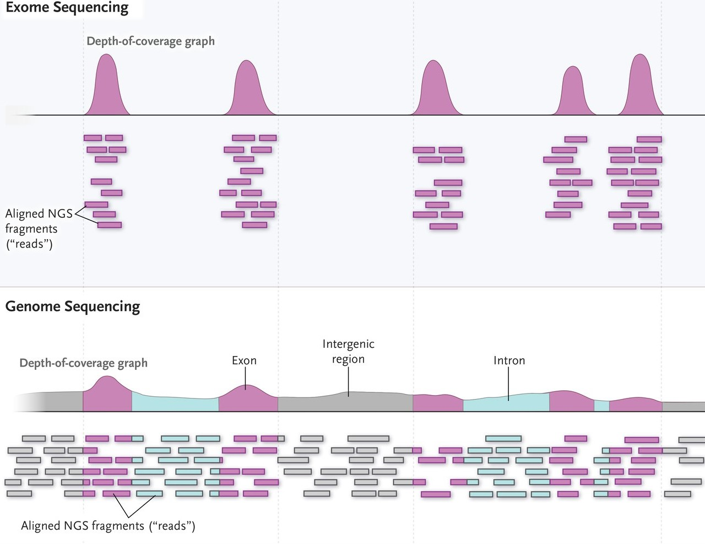{#fig-08-wgs-and-wes-004}

@fig-08-wgs-and-wes-004 直观展示了两种策略的差别：全基因组测序（Whole Genome Sequencing，**WGS**）对约 30 亿碱基对的人类基因组均匀测序；全外显子组测序（Whole Exome Sequencing，**WES**）则先用探针捕获外显子区域，只对这部分约 30–60 Mb（约占基因组 1%–2%）富集测序。

真核生物中编码蛋白质的基因由外显子（exon）和内含子（intron）组成；转录后内含子被剪接移除、外显子相连，形成成熟的 mRNA（这一过程在第 5 章转录组建库部分已经介绍）。所有外显子区域的集合称为外显子组（exome）。从检测能力看，外显子组虽小，位置却关键：蛋白质编码基因只占人类基因组约 1%，却集中了约 85% 对疾病性状有较大效应的已知突变[^choi-2009]。外显子长度普遍较短，约 80% 的人类外显子短于 200 bp，平均约 170 bp[^sakharkar-2004]。

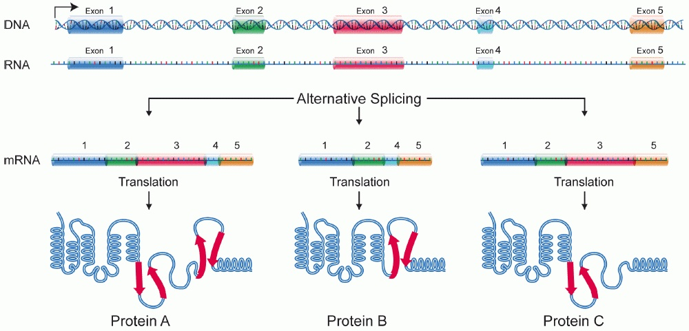{#fig-08-wgs-and-wes-003}

@fig-08-wgs-and-wes-003 回顾了外显子、内含子与剪接的关系：内含子在剪接中被移除、外显子相连形成成熟 mRNA，而且外显子的取舍可以不同（可变剪接）。这是理解"WES 测的到底是什么区域"的基础——WES 的目标外显子，正是各转录本外显子集合的并集。

WGS 与 WES 各有所长，实际中应当结合研究课题和实验设计选择最合适的测序方案[^goodwin-2016]。

**WES 的优点：**

- 深度高：外显子组的测序深度一般达到 50–100×，而 WGS 一般为 30× 左右——同样的测序量集中在了小得多的区域；
- 单样本测序成本低，数据存储和计算资源需求都相应减小；
- 编码区变异与表型的关联相对直接，结果可解释性强。

**WES 的缺点与边界：**

- 只能检测捕获区域内及其附近的变异（以 SNV 和 indel 为主），区域外的变异、CNV 和 SV 都在能力范围之外；
- 捕获和扩增步骤对不同区域的效率不一致，测序深度不均匀（7.2.3 详细讨论）；
- 实际产出的序列只有约 65%–75% 落在目标区域，其余为脱靶序列，需要靠提高整体深度弥补有效深度不足；
- 阴性结果要谨慎解读（见下一小节）。

WGS 不经过捕获，还可以构建 PCR-free 文库直接测序，因此覆盖更均匀、深度更稳定，能发现捕获设计之外的区域，SNV 检测灵敏度也不依赖捕获效率[^meynert-2014]。随着测序成本下降（见 @fig-08-wgs-and-wes-005 ），WGS 在科研项目中的比重持续上升；但在需要高深度编码区检测、样本量大或预算有限的场景中，WES 仍然是常规选择。

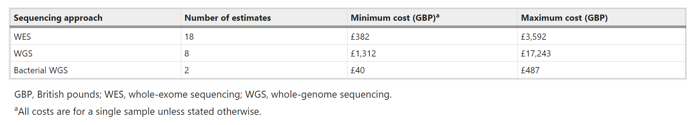{#fig-08-wgs-and-wes-005}

在 WGS 与 WES 之外还有第三种常见选择：**靶向 panel 测序（targeted panel sequencing）**，只捕获数十到数百个特定基因或已知致病位点，深度可达数百至上千倍，适合定向检测已知变异、临床快速筛查等场景。它覆盖最窄、成本最低；WES 覆盖较宽、能发现新变异；WGS 覆盖最全。三者构成覆盖范围与成本的连续谱，没有绝对的优劣。

### 应用场景与检测边界 {#sec-07-01-applications}

[]{#src-0070-WGS-5} []{#src-0070-WGS-7}

WES/WGS 检测胚系小变异的典型场景包括：

- **罕见病与孟德尔疾病的诊断**：对外显子组进行测序分析、寻找致病的罕见变异，是临床遗传病和罕见病的常规检测方法之一。对超声发现结构异常、疑似单基因病的胎儿，产前外显子组测序可以显著提高诊断率，帮助家庭在围产期做出更明确的决策[^lord-2019]。WES 首次成功定位孟德尔疾病致病基因（Miller 综合征）正是这一应用路线的里程碑[^ng-2010]。
- **肿瘤研究中的胚系分析**：肿瘤患者的遗传风险评估（如 BRCA1/2 胚系突变）使用的是胚系检测流程；肿瘤组织相对正常组织的体细胞突变检测则是另一套流程，本章不展开。
- **个人基因组与健康风险**：分析个人基因组数据，评估部分疾病的携带状态与用药参考。这类分析要特别注意区分"检测到的变异"与"能解释的变异"——绝大多数常见病风险并不能由外显子组的数据可靠预测。

在这些场景中，最容易被忽视的判断是**阴性结果的两种不同含义**。WES 的检测设计覆盖近两万个基因的外显子区域，但实际检测是否全面，很大程度取决于捕获实验是否覆盖了全部目标区域、每个区域深度是否足够。因此对 WES 的阴性结果，需要进一步区分：是这个基因（的已捕获区域）确实没有检出变异，还是这个基因的某些区域根本未被有效测序。前者受限于检测方法的分辨率，后者则意味着结论只适用于"被覆盖到的部分"。同样，突变注释数据库的覆盖度、样本质量造成的偏差，在 WGS 中也无法完全避免——区分"没测到"与"测到了但没检出"，是解读阴性结果时的基本习惯。

实验设计与样本量的考量属于立项阶段：群体关联研究需要按统计功效估算样本量；家系分析（如三口之家 trio）通过遗传共分离缩小候选变异范围，样本量小也能提供强证据；临床检测则遵循检测规范的覆盖要求。这些设计决定影响后续所有分析步骤的效力，应与测序策略一起在开始时确定。

## 示例数据、参考资源与覆盖设计 {#sec-07-02}

准备一套能支撑目标检测的匹配输入。

### 本章示例数据 {#sec-07-02-example-data}

本章实战使用公共数据集中的一份人类 WES 数据：**SRR8381428**，来自 ENA/SRA 公共项目 PRJNA511646。它是国际标准参考样本 **NA12878**（CEPH/Utah 家系女性个体，HapMap 与 GIAB 项目的核心样本）的全外显子组测序：

| 属性 | 值 |
| :--- | :--- |
| 样本 | NA12878（Homo sapiens） |
| 文库 | WXS（全外显子组），PCR 文库，双端 |
| 测序仪 | Illumina HiSeq 4000 |
| 读长 | 2 × 150 bp |
| 数据量 | 约 41.9 Gb（约 1.42 亿对 reads） |

: 本章示例数据 SRR8381428 的基本信息（据 ENA 元数据，2026-10 核查） {#tbl-07-example-data}

选择这份数据有三个原因：它是真实的研究级 WES 数据；NA12878 是世界上被测序最充分的人类样本之一，GIAB（Genome in a Bottle）项目为它提供了高置信度真值集，本章 7.8 讨论如何评价检测流程准确性时可以直接对照；数据可从 ENA 以 HTTPS 直链下载并核对官方校验值。下载方式与第 5 章相同（`prefetch`/`fasterq-dump`，或 ENA 直链 `curl`/`wget`），工具安装不再重复。

出于运行时间的考虑，本章的命令演示使用这份文件的**教学子集**（前 100 万对 reads）；你可以用相同命令处理完整数据，检查方法也一致。但要记住子集的局限：它只覆盖基因组的一部分区域，深度等指标不能外推到完整数据的水平。

### 参考基因组与变异资源 {#sec-07-02-reference-resources}

胚系变异检测需要两类配套资源，它们决定"比对到什么上"和"哪些位点已知存在变异"。

**参考基因组。** 本章沿用第 5 章使用的 Ensembl GRCh38（`Homo_sapiens.GRCh38.dna.primary_assembly.fa`）。下载后需要准备三样配套：

```{.bash .numberLines data-book-role="code"}
# 下载参考基因组（Ensembl，HTTPS 直链）
wget -c -P ref/ https://ftp.ensembl.org/pub/release-116/fasta/homo_sapiens/dna/Homo_sapiens.GRCh38.dna.primary_assembly.fa.gz
cd ref/ && gunzip Homo_sapiens.GRCh38.dna.primary_assembly.fa.gz
mv Homo_sapiens.GRCh38.dna.primary_assembly.fa GRCh38.fa

# 三样配套：BWA 索引、fasta 索引、序列字典
# bwa 索引默认以参考文件名为前缀，生成 GRCh38.fa.amb/.ann/.bwt/.pac/.sa 五个文件
bwa index GRCh38.fa
samtools faidx GRCh38.fa
gatk CreateSequenceDictionary -R GRCh38.fa -O GRCh38.dict
```

`bwa index` 供比对使用（第 4 章讲过 FM 索引的原理）；`.fai` 让工具能按名字和区间快速取序列；`.dict` 是 GATK 要求的序列字典。三者必须与参考版本一致——用一套版本的索引配另一版本的字典，是最常见的"看起来都对了但结果全错"的来源之一。

**已知变异位点（known-sites）。** BQSR 和候选过滤都需要"哪些位点在人群中已知存在变异"的清单，用来把真变异与测序错误区分开（原理见 7.3.2）。GATK 官方推荐的一组资源整合自 dbSNP、Mills indel、1000 Genomes 等人群项目；本章从 Ensembl 的 variation 数据库获取，它按染色体提供 dbSNP 整合的 VCF 及索引：

```{.bash data-book-role="code"}
# 已知变异资源：Ensembl 按染色体提供的 VCF（dbSNP 整合，release-116）
wget -c -P ref/known/ https://ftp.ensembl.org/pub/release-116/variation/vcf/homo_sapiens/homo_sapiens-chr21.vcf.gz
wget -c -P ref/known/ https://ftp.ensembl.org/pub/release-116/variation/vcf/homo_sapiens/homo_sapiens-chr21.vcf.gz.csi

# GATK 需要 .tbi 索引（Ensembl 提供的是 .csi），一条命令补上：
gatk IndexFeatureFile -I ref/known/homo_sapiens-chr21.vcf.gz
```

::: {.callout-warning .book-warning title="注意｜参考与资源的命名系统要一致"}

不同机构发布的 GRCh38 资源在染色体命名上不统一：Ensembl 用 `1`、`2`、`X`，Broad/GATK 官方包用 `chr1`、`chr2`、`chrX`。坐标本身一致，名字却不同。参考基因组、索引、known-sites VCF、注释数据库必须使用同一套命名，否则工具会报"找不到序列"，或者更隐蔽地静默丢失数据。混用不同来源的资源前，先用 `samtools faidx` 或 `bcftools view -h` 检查双方的序列名。

:::

如果你阅读的教程使用 GATK 官方资源包（`gs://broad-references/hg38-v0/` 下的 `dbsnp138.vcf`、`Mills_and_1000G_gold_standard.indels.hg38.vcf.gz` 等），注意该渠道目前需要 Google 云账号授权才能访问；本章改用公开直链的 Ensembl 资源，作用相同、版本更新。

### 覆盖度、测序深度与捕获偏差 {#sec-07-02-coverage-bias}

[]{#src-0070-WGS-679}

第 4 章已经定义了测序深度（depth，每个位置被 reads 覆盖的次数）与覆盖度（coverage，被测到的区域比例）。WES 的特殊之处在于：深度不仅要整体够，还要**在捕获区域内部足够均匀**，因为判断每个外显子里有没有变异，依赖的是那个区域自己的深度。

WES 样本在上机前要经过**捕获（capture）**和**PCR 扩增**两个步骤，不同区域的效率差别会直接转化为深度的不均匀：

- GC 含量高的区域在捕获、扩增和测序中都受影响[^gc-capture]；
- 低复杂度片段（如重复区域）和含模糊碱基的区域捕获效率偏低；
- 文库片段长度偏离扩增的最佳范围（约 70–200 bp 之外）的片段回收差；
- 假基因与真实基因高度相似，影响 reads 比对到正确位置的程度，进而影响该区域的深度计算；
- DNA 起始量低时需要更多 PCR 循环，引入大量重复，影响后续分析的可信度；
- DNA 质量差（如石蜡包埋 FFPE 样本提取的 DNA）导致某些区域片段化严重、偏差增大。


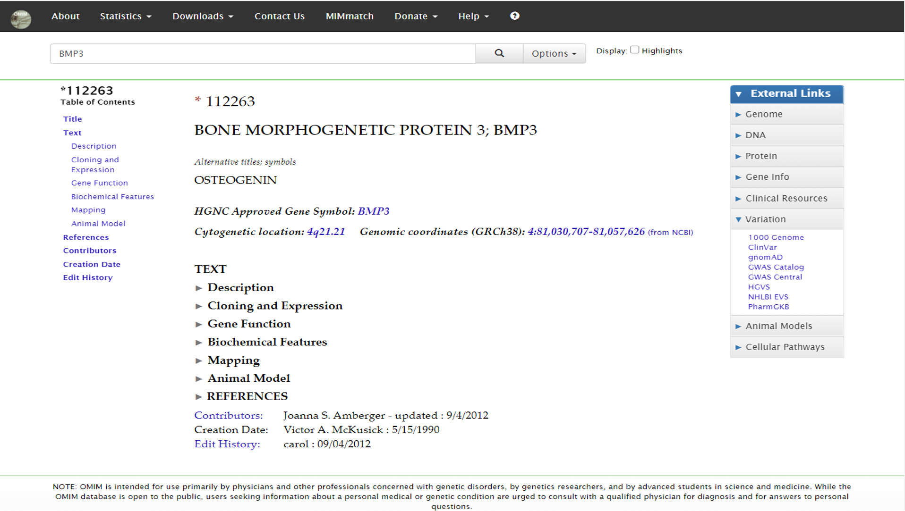{#fig-08-wgs-and-wes-006}

@fig-08-wgs-and-wes-006 用同一批样本比较了 WES、经 PCR 的 WGS 与 PCR-free WGS：面板 a 显示编码外显子的平均深度随 GC 含量明显波动，WES 的波动最剧烈；面板 b 显示 WES 的覆盖集中在捕获目标区域，而 WGS 在各类区域上覆盖更完整。这组对比也提醒我们：**PCR-free 文库能显著减弱 GC 偏差**，这是高质量 WGS 的优势之一[^meynert-2014]。

捕获探针可以购买商品化产品，也可以自行设计：在感兴趣的区域增加探针、在难捕获区域提高探针密度。评估一个捕获设计的常用指标有：

- **中靶率（on-target rate）**：落在目标区域内的序列占比；
- **覆盖度（coverage）**：目标区域被测到的比例，如"98% 的目标区域达到 20× 以上"；
- **均一性（uniformity）**：目标区域内部深度的均匀程度；
- **重复率（duplication rate）**：来自同一原始片段的重复 reads 占比，高重复率意味着文库复杂度低或测序过饱和。

这四个指标是判断"WES 数据质量好不好"的第一组证据，拿到下机数据后就应该结合 FastQC/MultiQC 报告（第 3 章）与比对后的深度统计（本章 7.3.1）一起检查。看到某个外显子深度骤降时，按上面的偏差来源逐项排查——GC、捕获效率、重复、假基因——而不是先怀疑"这里有变异"。

## DNA比对与变异检测前处理 {#sec-07-03}

理解哪些处理改善调用依据及其适用条件。

### 从 FASTQ 到分析就绪的 BAM {#sec-07-03-preprocessing-overview}

变异检测的输入不是 FASTQ，而是一个经过整理的 BAM。从下机数据到"分析就绪"，中间每一步都在为 caller 整理证据：

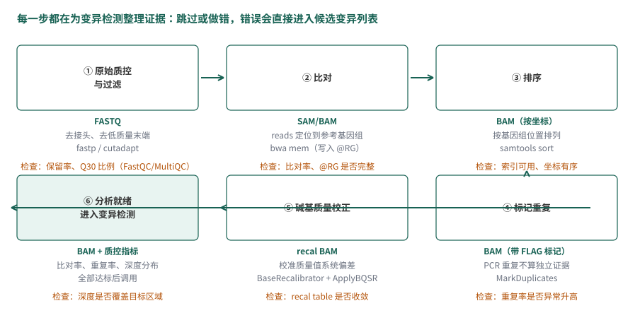{#fig-07-preprocessing-overview}

@fig-07-preprocessing-overview 概括了这条链。对照第 4 章你会发现，算法与工具都见过，本章要回答的是新问题：**这些步骤为什么是变异检测的必要条件，而不是可选的整理**。

- **原始质控与过滤**（第 3 章的 FastQC/cutadapt 或 fastp）：去除接头和低质量碱基。低质量碱基携带失真的质量值，会干扰后面每一步的统计判断。
- **比对**（`bwa mem`）：DNA 比对没有剪接位点问题，用第 4 章讲过的 BWT/FM 索引短读长比对器即可——RNA-seq 之所以需要 HISAT2/STAR 这类剪接感知比对器，是因为 reads 会横跨外显子连接。`@RG` 读组信息在这一步写入：后面 BQSR 按读组统计误差，缺了它 BQSR 无法工作。
- **排序**（`samtools sort`）：把按 FASTQ 顺序排列的比对结果整理为按基因组位置排列。变异检测逐区间读取数据，位置排序是一切"按位置聚拢证据"步骤的前提。
- **标记重复（MarkDuplicates）**：PCR 或测序过程中，同一 DNA 片段产生的多条 reads 不是独立证据。第 4 章讲过重复的识别方法（位置与方向相同）；对变异检测而言，不去重的后果是具体的：一个片段被扩增三次、恰好带一个测序错误，caller 会看到"三条一致支持错误碱基"的假证据，等位基因比例被扭曲。标记（而非删除）重复保留了信息，让后续统计把这类 reads 排除在外。
- **碱基质量校正（BQSR）**：下一小节专门讨论。

"分析就绪"没有单一判据，常见的检查包括：比对率、重复率、深度分布（平均深度、目标区域达到 20× 的比例）、`@RG` 完整性。这些指标异常时先解决数据问题，再进入变异检测——**在坏数据上跑出的变异列表，错误没有简单的下游办法弥补**。

### 碱基质量校正 BQSR {#sec-07-03-bqsr}

[]{#src-0070-WGS-287} []{#src-0070-WGS-289}

**为什么需要校正。** Phred 碱基质量值由测序仪的 base-calling 算法给出。这套算法对研究者是黑盒：它给出的质量评估带有一定程度的系统性偏差（非随机误差），实际测序质量可能被低估或高估。质量值是变异检测公式中错误率的直接输入（7.4 会看到 $\epsilon$ 如何进入似然计算），系统性的偏差会原样传递到变异的置信度上。

举一个形象化的例子：对于某一次测序（一个 run），如果无论何时测到 `AA` 这样的子序列时，紧随其后的那个碱基的测序错误率总比其实际错误率高出约 1%，那么就可以把这类碱基找出来，把它们的报告错误率整体下调来校正。

**BQSR 的思路。** BQSR（Base Quality Score Recalibration）用回归的框架重新校准质量值：把"测序仪声称的质量"与"实际观察到的错误率"对齐。它的前提假设是：影响质量评估的因素可以列举为几类**协变量（covariate）**——读组（read group）来源、碱基在 read 中所处的 cycle、该碱基上游若干碱基的序列背景（默认取上游 6 个碱基）、以及原始报告质量值本身。协变量组合相同的碱基归入同一组（bin），同一 bin 内的碱基被认为具有相同的真实错误率。

那"实际观察到的错误率"从哪里来？BQSR 把比对结果与已知变异位点对照：**先剔除 known-sites 清单上的人群变异位点**，剩下的位置上，read 与参考基因组的每个 mismatch 都被假定为测序错误而非真实变异。于是每个 bin 的经验错误率可以直接数出来：

$$
EQ = -10 \log_{10} \frac{\#\text{mismatch}}{\#\text{bases}}
$$ {#eq-08-wgs-and-wes-002}

即 Phred 标准的质量定义——错误率的 −10·log₁₀ 缩放（与第 3 章碱基质量值的定义一致）。观察量少的 bin 会被平滑处理，避免"只看了 2 个碱基、恰有 1 个 mismatch"就给出极端估计。有了每个 bin 的经验质量，BQSR 训练出校正模型，`ApplyBQSR` 再把校正后的质量值写回 BAM。BQSR 本质上是这样一种回归模型：输入是碱基的协变量取值，输出是它的经验质量：

$$
X_i=(RG_i,\ Cyc_i,\ Context_i,\ Q_i) \quad \to \quad y_i
$$ {#eq-08-wgs-and-wes-001}

其中 $i$ 标记当前碱基，$RG_i$ 是所属读组，$Cyc_i$ 是所在 cycle，$Context_i$ 是序列背景，$Q_i$ 是原始报告质量值，$y_i$ 是按 @eq-08-wgs-and-wes-002 数出的经验质量。

::::: {.callout-warning .book-warning title="注意｜BQSR 改变的是质量值，不是碱基"}

BQSR 只校正质量值而不改变碱基组成。对一个质量值偏低的碱基，我们只能说"它被解析成当前碱基的可靠性存疑"，但无法说明它更可能是什么碱基，所以干脆不改碱基本身。另注意"mismatch 即错误"这一假设依赖 known-sites 的质量：已知位点清单覆盖不足时（如研究物种缺乏人群变异资源），真实变异会被误当成错误，校正反而引入偏差。

:::::

**操作。** 在示例数据与 Ensembl 资源上的两步命令（沿用 7.2.2 准备的文件；完整脚本见 7.5.1）：

```{.bash .numberLines data-book-role="code"}
# 1. 建立校正模型：--known-sites 给出已知变异位点，输出校正表
gatk BaseRecalibrator \
  -R ref/GRCh38.fa \
  -I BAM/NA12878.subset.sorted.markdup.bam \
  --known-sites ref/known/homo_sapiens-chr21.vcf.gz \
  -O BAM/NA12878.subset.recal.table

# 2. 把校正结果写回 BAM
gatk ApplyBQSR \
  -R ref/GRCh38.fa \
  -I BAM/NA12878.subset.sorted.markdup.bam \
  --bqsr-recal-file BAM/NA12878.subset.recal.table \
  -O BAM/NA12878.subset.sorted.markdup.recal.bam
```

[]{#src-0070-WGS-337}

**什么时候不做 BQSR。** 校正模型需要足够的数据支撑。单样本 WES 的数据量通常够用；但样本极小、数据量过低，或 known-sites 资源与研究物种、群体不匹配时，BQSR 的估计不可靠，宁可不校正并如实记录。GATK 的最佳实践对 WGS 大样本推荐 BQSR；对高质量的 PCR-free 数据，BQSR 带来的改变会小很多。判断标准回到本章主线：**校正的输入证据是否充分，而不是"流程里有没有这一步"**。

## 基因型似然与局部单倍型重组装 {#sec-07-04}

理解为什么一个非参考碱基不等于一个真实变异。

[]{#src-0070-WGS-363} []{#src-0070-WGS-365}

### 从碱基比例到基因型似然 {#sec-07-04-genotype-likelihood}

[]{#src-0070-WGS-367}

先从一个具体的比对场景开始。某一区域的比对结果如下：

```{.text data-book-role="data"}
REFERENCE: atcatgacggcaGtagcatat
--------------------------------
READ1:     atcatgacggcaGtagcatat
READ2:         tgacggcaGtagcatat
READ3:     atcatgacggcaAtagca
READ4:            cggcaGtagcatat
READ5:     atcatgacggcaGtagc
```

大写字母标出候选变异位点：共 5 条 reads 比对到该位置，其中 4 条与参考一致（G），1 条不同（A），即 G:A = 4:1。

按最朴素的规则——与参考不一致的碱基比例在 20%–80% 之间就判为杂合——这个位点"显然"是 G/A 杂合。但支持 A 的 read 只有一条，而这一条 read 上的碱基可能来自：

- 实际存在的变异；
- 建库过程中引入的错误（PCR）；
- 测序过程中的碱基识别错误（base calling）；
- 比对错误（read 其实来自别的位置）。

仅凭碱基比例作判断，无法区分这些来源。可靠的变异检测需要综合考虑更多信息，在给出基因型推断的同时给出该推断的**置信度**。

**贝叶斯框架。** 用 $S$ 表示该位点的测序数据，$G_i$ 表示候选基因型。基于各基因型的人群先验概率 $P(G_i)$ 与似然 $P(S \mid G_i)$，用贝叶斯公式推断后验概率，取后验最高的基因型作为结果：

$$
G = \arg\max_{G_i} P(G_i \mid S)
$$ {#eq-08-wgs-and-wes-003}

$$
P(G_i|S)=\frac{P(S|G_i)\cdot P(G_i)}{P(S)}
$$ {#eq-08-wgs-and-wes-004}

对确定的测序数据，$P(S)$ 是与 $G_i$ 无关的常数，可以省略，于是 $P(G_i \mid S) \propto P(S \mid G_i) \cdot P(G_i)$。$P(G_i)$ 是基因型的人群频率，来源有两种：

- 样本少时，从大型人群重测序项目获取等位基因频率再推算基因型频率（如 dbSNP 及其频率注释）；
- 有自己的研究人群时，可从当前数据的等位基因频率按哈迪–温伯格平衡（Hardy-Weinberg equilibrium，HWE）推算。例如某位点以 A/T 两种形式存在，A 的频率为 1%（$p = 0.01$，$q = 0.99$），则三种基因型的期望频率为 AA $p^2 = 0.0001$、AT $2pq = 0.0198$、TT $q^2 = 0.9801$。

于是问题集中到似然 $P(S \mid G_i)$ 怎么算。假设各条 read 相互独立，似然可以写成各 read 似然的乘积：

$$
P(S|G_i)=\prod_i P(S_i | G_i)
$$ {#eq-08-wgs-and-wes-005}

**单条 read 的似然。** 记二倍体个体在该位点的基因型为 $g$，表示其所含参考等位基因的个数：$g = 0$（两个等位基因都不是参考）、$g = 1$（杂合）、$g = 2$（两个都是参考）。用指示变量 $I_i$ 标记一条 read 在该位点的观察结果：read 碱基与参考一致时 $I_i = 1$，不一致时 $I_i = 0$。

::::: {.callout-warning .book-warning title="注意｜简化错误模型的适用范围"}

下面采用"二等位、对称错误"的简化教学模型：假设位点只有参考与非参考两种状态，且测序错误把任一真实碱基读成另一特定碱基的概率都是 $\epsilon$。实际工具使用四碱基完整错误模型，每条 read 用自己的质量值 $Q$ 换算错误率 $\epsilon = 10^{-Q/10}$；本节的式子不能直接套用到真实数据计算，但推理结构与工具一致。

:::::

下节推导只用这几个符号：

| 符号 | 含义 |
| :--- | :--- |
| $g$ | 基因型：所含参考等位基因个数（0、1、2） |
| $I_i$ | 第 $i$ 条 read 的观察指示：与参考一致为 1，否则为 0 |
| $\epsilon_i$ | 第 $i$ 条 read 在该位点的测序错误率（由其质量值换算） |
| $k$、$l$ | 比对到该位点的 reads 总数、其中与参考一致的条数 |
| $S_i$、$d$ | 第 $i$ 条 read 的观察数据；全部 reads 的观察数据 |

: 本节推导使用的符号 {#tbl-07-wgs-and-wes-01}

给定基因型 $g$，一条 read 的观察似然为：

$$
P(S_i \mid g) = \left[\frac{g}{2}(1-\epsilon_i) + \frac{2-g}{2}\epsilon_i\right]^{I_i} \cdot \left[\frac{2-g}{2}(1-\epsilon_i) + \frac{g}{2}\epsilon_i\right]^{1-I_i}
$$ {#eq-08-wgs-and-wes-006}

这个式子拆开看并不难。方括号里每一项都是两种情形的全概率：read 随机来自父方或母方的染色体各占 $\frac{1}{2}$，因此观察到与参考一致的碱基的概率是 $\frac{g}{2}(1-\epsilon_i) + \frac{2-g}{2}\epsilon_i$——基因型以 $g/2$ 的概率提供参考等位基因（读对的概率 $1-\epsilon_i$），以 $(2-g)/2$ 的概率提供非参考等位基因（被读成参考的概率 $\epsilon_i$）。三种基因型分别代入：

$$
\left\{
  \begin{array}{ll}
  P(S_i \mid g{=}0) = (1-\epsilon_i)^{1-I_i}\cdot\epsilon_i^{I_i} \\[4pt]
  P(S_i \mid g{=}1) = \dfrac{1}{2}(1-\epsilon_i) + \dfrac{1}{2}\epsilon_i = \dfrac{1}{2} \\[4pt]
  P(S_i \mid g{=}2) = (1-\epsilon_i)^{I_i} \cdot \epsilon_i^{1-I_i}
  \end{array}
\right.
$$ {#eq-08-wgs-and-wes-007}

杂合（$g{=}1$）时无论读到什么碱基，似然都是 $\frac{1}{2}$；纯合时似然取决于观察方向与错误方向的匹配。三个式子都来自同一形式[^likelihood-form]：


$$
P(S_i \mid g)=P(I_i=1)^{I_i}\cdot P(I_i=0)^{1-I_i}
$$ {#eq-08-wgs-and-wes-008}

{#fig-08-wgs-and-wes-001}

把单条 read 的似然推广到整个位点：如 @fig-08-wgs-and-wes-001 所示，$k$ 条 reads 比对到该位点，其中 $l$ 条与参考一致、$k - l$ 条不一致，第 $j$ 条 read 的测序错误率为 $\epsilon_j$（由它自己的质量值给出）。将各基因型代入 @eq-08-wgs-and-wes-006 并对全部 reads 连乘：

$$
\begin{aligned}
L(g) = P(d \mid g)
&= \prod_{i=1}^l \left[\frac{g}{2}(1-\epsilon_i) + \frac{2-g}{2}\epsilon_i \right] \prod_{j=l+1}^k \left[\frac{2-g}{2}(1-\epsilon_j) + \frac{g}{2}\epsilon_j \right]
\end{aligned}
$$ {#eq-08-wgs-and-wes-009}

@eq-08-wgs-and-wes-009 中的方括号来自全概率分解：记 $B$ 为"该碱基测序正确"、$C$ 为"该碱基实际与参考一致"，则"观察到与参考一致"要么 $B,\,C$ 同时发生（是参考且读对），要么 $\overline{B},\,\overline{C}$ 同时发生（非参考且读错）。测序错误与真实碱基组成无关（$B \perp C$），于是每一项都能写成乘积之和的形式；而"实际与参考一致"的概率由基因型给出——二倍体有 2 个等位基因、其中 $g$ 个是参考，随机抽出一条 read 的等位基因为参考的概率是：

$$
\begin{aligned}
&Pr(B)=1-\epsilon, \quad Pr(\overline B)=\epsilon \\
&Pr(C)=\frac{g}{2}, \quad Pr(\overline C)=\frac{2-g}{2}
\end{aligned}
$$ {#eq-08-wgs-and-wes-011}

把这组概率代回分解式，就得到 @eq-08-wgs-and-wes-009 的最终形式：

$$
\begin{aligned}
\prod_{i=1}^l \left[\frac{g}{2}(1-\epsilon_i) + \frac{2-g}{2}\epsilon_i \right]
= \frac{1}{2^k}\prod_{i=1}^l \left[g(1-\epsilon_i) + (2-g)\epsilon_i \right]
\end{aligned}
$$ {#eq-08-wgs-and-wes-010}

即把 $\frac{g}{2}$ 与 $\frac{2-g}{2}$ 的公共因子 $\frac{1}{2}$ 提出、连乘成 $\frac{1}{2^k}$ 的整理。

回到开头的例子：G:A = 4:1、各 read 质量值 Q30 左右（$\epsilon \approx 0.001$）时，$g{=}2$（纯合参考）下观察到那条不一致 read 的似然约为 $\epsilon$；$g{=}1$（杂合）下每条 read 的似然约 $\frac{1}{2}$，五条连乘约 $0.03$；再结合人群先验中"绝大多数位点纯合"的事实，纯合参考的后验通常仍然更高——这正是"不能只看碱基比例"的定量版本。当支持 A 的 read 增加到几十条、质量值又高时，天平才会倒向杂合。**先验、似然、错误率三者共同决定结论，缺一不可。**

[]{#src-0070-WGS-537}

### HaplotypeCaller 的局部单倍型重组装 {#sec-07-04-haplotypecaller}

上节把"一个位点"的推断讲清楚了，但真实的 caller 并不是逐位点独立调用的。GATK 的 HaplotypeCaller 是目前胚系 SNV/indel 检测最常用的算法之一，理解了它，基本就理解了现代变异检测的原理——它的核心思想是：**先把候选区域的所有证据放在一起重组装，再逐位点判断基因型**。

::::: {.callout-note .book-core title="核心知识｜HaplotypeCaller 与联合分型"}

HaplotypeCaller 在候选变异区域进行局部重组装，生成候选单倍型，并评估 reads 对这些单倍型的支持。这里的单倍型（haplotype）是一个区域内的序列组合，并不等于"单倍体个体"。在常用的 GATK 胚系多样本流程中，每个样本先独立生成 gVCF，随后进行联合分型（见 7.5.2）；不能把这两个阶段理解为先把整个人群的 reads 混在一起运行 HaplotypeCaller。

:::::

HaplotypeCaller 把变异检测分为四个大的步骤：

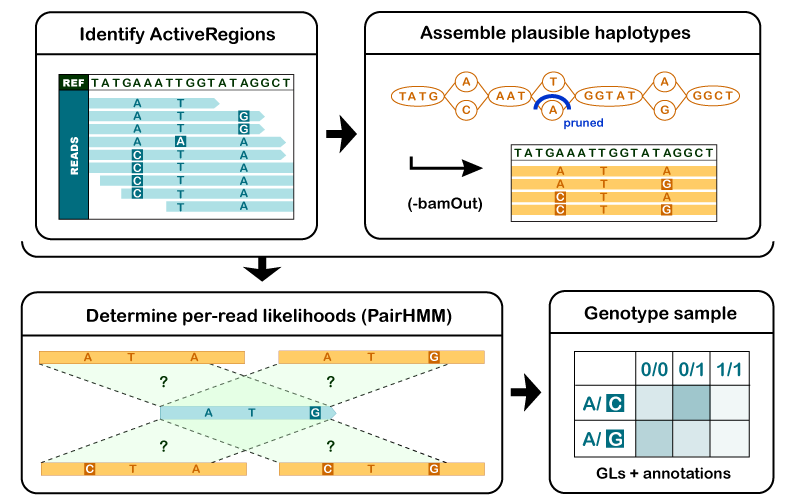{#fig-08-wgs-and-wes-002}

**1. 确定候选变异区域（ActiveRegion）。** 通过 reads 在参考基因组上的比对情况，筛出潜在变异区域。这一步只划定范围，不做判断。

**2. 对候选区域进行局部重组装，确定单倍型。** 对每个 ActiveRegion，利用**比对到该区域上的所有 reads** 构建一个类似于 de Bruijn 图的组装图，对区域做局部重新组装，枚举该区域中可能的单倍型序列；再用 Smith-Waterman 算法（第 4 章讲过的局部比对）把每条单倍型与参考重新比对，重新检出潜在变异位点。相比"直接看比对结果"，重组装能纠正比对阶段留下的偏移——对 indel 尤其有利：一条跨越 indel 的 read 在逐碱基比对中位置可能整体错位，重组装后它与哪条单倍型更匹配就一目了然。

**3. 计算各单倍型的似然值。** 对每个 ActiveRegion，用 PairHMM 算法把区域内每条 read 与每条候选单倍型两两比对，得到 read–单倍型似然矩阵 $(a_{ij})$，其中 $a_{ij} = P(r_i \mid H_j)$：

$$
\begin{array}{l|c|c|c|c}
\hline
 & H_1 & H_2 & .. & H_m \\
\hline
r_1 & a_{11} & a_{12} & .. & a_{1m} \\
r_2 & a_{21} & a_{22} & .. & a_{2m} \\
.. & .. & .. & .. & .. \\
r_n & a_{n1} & a_{n2} & .. & a_{nm} \\
\hline
\end{array}
$$ {#eq-08-wgs-and-wes-012}

::::: {.callout-warning .book-warning title="注意｜似然不等于概率"}

这个矩阵描述每条 read 在每个候选单倍型条件下的似然。软件随后把单倍型层面的证据映射到候选等位基因，并计算基因型似然。不能把跨 reads 的似然直接相加当成单倍型的概率；下面在条件独立假设下使用似然乘积进行教学推导，具体聚合规则以所使用的 GATK 版本实现为准。

:::::

PairHMM 是整个流程中计算量最大的部分，GATK 的性能优化常常以此为突破口——GPU 加速、把 Pair-HMM 模块烧录到 FPGA 芯片，也有从算法出发的加速工作[^ren-2018-gpu]。


**4. 计算候选位点的基因型后验。** 在步骤 3 的基础上，我们已经知道每条 read 对每种单倍型的支持程度。最后一步回到贝叶斯框架，计算候选位点上每种基因型的后验概率，选择最高的作为结果输出到 VCF。样本基因型 $G$ 的后验为：

$$
P(G \mid D) = \frac{P(G)P(D \mid G)}{\sum_i P(G_i)P(D \mid G_i)}
$$ {#eq-08-wgs-and-wes-013}

分母对所有基因型取相同的值，可以省略：

$$
P(G \mid D) \propto P(G)P(D \mid G)
$$ {#eq-08-wgs-and-wes-014}

::::: {.callout-warning .book-warning title="注意｜基因型先验与等位基因频率"}

其中 $P(G)$ 是基因型 $G$ 的先验概率，不能与单个等位基因的频率混为一谈。工具对先验的处理取决于模型和参数，不能假定 GATK 默认给所有基因型相同先验。

:::::

$P(D \mid G)$ 表示在基因型为 $G$ 的前提下，观察到测序数据 $D$（仅考虑该 ActiveRegion 范围）的条件概率。假设各条 read 相互独立：

$$
P(D \mid G)=\prod_j P(D_j \mid G)
$$ {#eq-08-wgs-and-wes-015}

其中 $D_j$ 是该样本测序数据中的第 $j$ 条 read。二倍体的每条 read 要么来自同源染色体 $H_1$、要么来自 $H_2$，用全概率展开：

$$
P(D_j \mid G) = P(H_1 \mid G)P(D_j \mid H_1) + P(H_2 \mid G)P(D_j \mid H_2)
$$ {#eq-08-wgs-and-wes-016}

一条 read 来源于两条同源染色体的概率均等，$P(H_1 \mid G)=P(H_2 \mid G)=\frac{1}{2}$：

$$
P(D_j \mid G)=\frac{P(D_j \mid H_1)}{2} + \frac{P(D_j \mid H_2)}{2}
$$ {#eq-08-wgs-and-wes-017}

这里把 $H_1$、$H_2$ 理解为它们各自对应的单倍型，则 $P(D_j \mid H_n)$ 是在特定单倍型下产生 read $D_j$ 的条件概率——正是步骤 3 中 PairHMM 算出的矩阵元素。代回 @eq-08-wgs-and-wes-015：

$$
P(D \mid G)=\prod_j \left( \frac{P(D_j \mid H_1)}{2} + \frac{P(D_j \mid H_2)}{2}\right)
$$ {#eq-08-wgs-and-wes-018}

到这里，整条推理链闭合了：reads 对单倍型的似然（PairHMM）→ read 对基因型的似然（两条同源染色体各半）→ 基因型的后验（贝叶斯）。VCF 里每条记录的基因型与置信度，就是这条链的输出。

最后说明"二等位"假设与多单倍型的关系。后面的分析中对每个变异位点只考虑二等位形式——若一个区域在群体中存在 $n$ 个变异位点，在只考虑二等位的前提下，该区域理论上共有 $2^n$ 种单倍型，但具体到要判断的某个位点，我们只区分参考与非参考两种状态。这是简化，也是主流工具的默认工作方式；更复杂的情形（多等位基因、复合杂合）需要额外的分析步骤。

## 单样本调用、gVCF与联合分型 {#sec-07-05}

理解单样本检测和多样本分型之间的关系。

[]{#src-0070-WGS-701}

### 全外显子组分析实战：从质控到注释 {#sec-07-05-wes-pipeline}

现在把 7.2–7.4 的准备串成一条完整的分析链。整体思路：下机序列经质控、比对到参考基因组、前处理得到"分析就绪"的 BAM，HaplotypeCaller 从中检出候选变异并给出基因型与置信度，存入 VCF；最后用 ANNOVAR 结合人群与功能数据库注释变异，得到可以开始生物学解读的结果。

本章示例所用软件（安装方式见第 2、3 章）：`fastp`、`FastQC`、`MultiQC`、`bwa`、`samtools`、GATK 4（本文示例为 4.6.2.0）与 ANNOVAR。注意 GATK 4.6 需要 Java 17 运行时：用 conda/micromamba 安装后，如果 `gatk` 报 `UnsupportedClassVersionError`，说明它找到的是系统里更旧的 Java，需要安装 openjdk 17 并通过 `JAVA_HOME` 指给 GATK。质控工具用 fastp（第 5、6 章同款）；如果你熟悉 Trimmomatic，本章流程同样适用，只需把过滤参数对应替换，其余步骤不变。

**第一步：原始数据质控。** 先对原始 FASTQ 跑 FastQC/MultiQC 了解数据状态，再过滤：

```{.bash .numberLines data-book-role="code"}
sample=NA12878
data=data/
mkdir -p fastqc fastp BAM VCF

# 原始数据整体质量（第 3 章已讲如何读报告）
fastqc -o fastqc/ ${data}${sample}_1.fastq.gz ${data}${sample}_2.fastq.gz
multiqc fastqc/ -o fastqc/

# 过滤：自动检测双端接头， sliding window 修剪低质量末端
fastp \
  -i ${data}${sample}_1.fastq.gz -I ${data}${sample}_2.fastq.gz \
  -o ${data}${sample}_1.clean.fq.gz -O ${data}${sample}_2.clean.fq.gz \
  --detect_adapter_for_pe --cut_front --cut_tail --cut_mean_quality 20 \
  -h fastp/${sample}.html -j fastp/${sample}.json
```

过滤后查看 fastp 报告中的保留率与 Q30 比例：保留率过低说明原始数据质量差，需要先回到数据本身找原因，而不是继续硬跑。本章教学子集上的实际结果：

```{.text data-book-role="output"}
fastp: reads 2000000 -> 1999982 (100.0%), q30rate 0.9609 -> 0.9628
```

200 万条 reads 过滤后保留 99.99%、Q30 比例 96.3%，说明这份子集的原始质量很好。

**第二步：比对与排序。** 比对时通过 `-R` 写入读组信息——`SM` 必须是真实样本名，`ID` 在同一样本内唯一，`LB` 标记文库名，`PL` 标记平台。这些字段不是注释：BQSR 按读组分别建模，`SM` 写错会直接影响后续统计：

```{.bash .numberLines data-book-role="code"}
# 比对并直接按坐标排序（管道省去中间 SAM 文件）
bwa mem -t 8 \
  -R '@RG\tID:NA12878_WES\tSM:NA12878\tLB:NA12878_lib1\tPL:ILLUMINA' \
  ref/GRCh38.fa \
  ${data}${sample}_1.clean.fq.gz ${data}${sample}_2.clean.fq.gz \
  | samtools sort -@ 4 -o BAM/${sample}.sorted.bam -

# 比对质量速查：比对率、重复概况、深度分布
samtools flagstat BAM/${sample}.sorted.bam
samtools coverage BAM/${sample}.sorted.bam
```

本章子集的 `flagstat` 摘要（节选）：

```{.text data-book-role="output"}
2001141 + 0 mapped (99.43% : N/A)
1965286 + 0 properly paired (98.27% : N/A)
1167 + 0 singletons (0.06% : N/A)
```

**第三步：标记重复。** GATK 的 `MarkDuplicates` 按比对位置与方向识别同一来源的片段，在 FLAG 中标记而不是删除：

```{.bash data-book-role="code"}
gatk MarkDuplicates \
  -I BAM/${sample}.sorted.bam \
  -O BAM/${sample}.sorted.markdup.bam \
  -M BAM/${sample}.markdup_metrics.txt \
  --CREATE_INDEX true
```

`markdup_metrics.txt` 中的重复率是 7.2.3 那组捕获指标之一：WES 高深度文库重复率偏高常见，但异常升高要怀疑 PCR 过度扩增或起始量不足。本章子集实测重复率 5.36%（53,294/993,663 读对），文库复杂度估计约 893 万——对 WES 文库属于正常偏好。

```{.text data-book-role="output"}
NA12878_lib1  READ_PAIRS_EXAMINED=993663  READ_PAIR_DUPLICATES=53294
              PERCENT_DUPLICATION=0.053637  ESTIMATED_LIBRARY_SIZE=8929119
```

**第四步：BQSR。** 按 7.3.2 的两步执行，输入 `BAM/${sample}.sorted.markdup.bam` 与 7.2.2 的 known-sites，输出 `${sample}.sorted.markdup.recal.bam`。

**第五步：变异检测。**

```{.bash .numberLines data-book-role="code"}
gatk HaplotypeCaller \
  -R ref/GRCh38.fa \
  -I BAM/${sample}.sorted.markdup.recal.bam \
  -O VCF/${sample}.raw.vcf.gz
```

这一步输出的 VCF 还没有经过过滤，是"候选 + 置信度"的原始集合；如何读、如何过滤，是 7.6 的主题。

**第六步：变异注释（ANNOVAR）。** ANNOVAR 是一款广泛使用的注释工具，学术用途免费，需在官网注册获取下载链接；解压后先为 hg38 下载数据库：

```{.bash data-book-role="code"}
# 注册下载并解压后，进入 annovar/ 目录；为 hg38 下载数据库（体积较大，按需选择协议）
annotate_variation.pl -buildver hg38 -downdb refGene humandb/
annotate_variation.pl -buildver hg38 -downdb avsnp151 humandb/
annotate_variation.pl -buildver hg38 -downdb gnomad_exome humandb/
```

数据库协议随时间更新（本节命令以 2026-10 官方可用版本为准，使用前查看 ANNOVAR 网站的最新列表），注释时按顺序组合：

```{.bash data-book-role="code"}
table_annovar.pl VCF/${sample}.filtered.vcf.gz annovar/humandb/ \
  -buildver hg38 -out VCF/${sample}.annovar \
  -remove \
  -protocol refGene,gnomad_exome,avsnp151 \
  -operation gx,f,f \
  -nastring . -vcfinput -polish
```

`-operation` 里每个协议对应一种操作类型（`gx` 基因区注释、`f` 逐变异过滤式注释），顺序与 `-protocol` 一一对应。输出中的 `Gene.refGene`、`ExonicFunc.refGene`、`gnomad_exome` 频率等列，就是 7.7 解读与查库的起点。

### gVCF 与联合分型 {#sec-07-05-gvcf-jointgenotyping}

上面的流程是**单样本**调用。当研究包含多个样本（家系、群体），逐样本独立调用再合并 VCF 是错误做法：每个样本独立判断"这个位点有没有变异"，低深度位点上单样本证据不足，样本间的信息无法互相支持。GATK 的答案是 **gVCF + 联合分型**：

```{.bash .numberLines data-book-role="code"}
# 1. 每个样本运行 HaplotypeCaller 时加 -ERC GVCF：输出不但记录检出变异的位点，
#    也记录未检出变异位点的置信区间与深度证据
gatk HaplotypeCaller -ERC GVCF \
  -R ref/GRCh38.fa \
  -I BAM/sampleA.sorted.markdup.recal.bam \
  -O VCF/sampleA.g.vcf.gz

# 2. 把多个样本的 gVCF 导入 GenomicsDB 数据库（示例为两个样本、限定 21 号染色体）
gatk GenomicsDBImport \
  --genomicsdb-workspace-path VCF/cohort_db \
  -L 21 \
  -V VCF/sampleA.g.vcf.gz -V VCF/sampleB.g.vcf.gz

# 3. 对数据库做联合分型，输出整个队列的 VCF
gatk GenotypeGVCFs \
  -R ref/GRCh38.fa \
  -V gendb://VCF/cohort_db \
  -O VCF/cohort.joint.vcf.gz
```

联合分型把所有样本在同一批次一起判断基因型：一个位点在某样本中深度不足时，其他样本的群体证据能帮助约束先验；罕见变异在单样本中似然不够强的，在多个样本一致出现时后验会被推向显著。这个设计还有工程上的好处——**增量扩展**：队列加入新样本时，只需对新样本跑 `HaplotypeCaller -ERC GVCF`，再重建数据库与联合分型，旧样本不必重跑比对与调用。代价是 gVCF 比 VCF 大得多（包含全部位点的证据），存储规划要预留空间。

什么时候可以不用联合分型？单样本检测（如个人基因组）、或只关心一个样本中高置信度的常见变异时，直接单样本调用的结果已经可用；对小队列（两三个样本）且不计划扩样，联合分型的收益有限。样本量、检测目标与计算资源一起决定流程的选择。

## VCF解读、过滤与质量评估 {#sec-07-06}

能区分候选位点与支持充分的结果。

### 逐列读懂 VCF {#sec-07-06-vcf-anatomy}

第 4 章逐列读过 SAM/BAM；VCF（Variant Call Format）是变异结果的对应格式。先看一条真实记录——本章示例数据 7.5 全链跑出的一个 PASS 杂合变异（列宽截取节选，INFO 只保留部分标签）：

```{.text data-book-role="data"}
#CHROM  POS      ID  REF ALT QUAL   FILTER INFO                    FORMAT             NA12878
chr21   9068512  .   C   T   214.64 PASS   DP=13;QD=16.51;SOR=1.609 GT:AD:DP:GQ:PL    0/1:6,7:13:99:222,0,132
```

各列含义如下：

| 列 | 名称 | 含义与读法 |
| :--- | :--- | :--- |
| 1 | CHROM | 染色体（命名系统与参考一致，见 7.2.2 的提醒） |
| 2 | POS | 变异起始位置（1 起算；indel 的定位规则见 VCF 规范） |
| 3 | ID | 已知变异编号（如 dbSNP 的 `rs` 号；`.` 表示未知） |
| 4 | REF | 参考基因组上该位置的碱基（或序列） |
| 5 | ALT | 检出的替代等位基因；`.` 表示未检出变异的 gVCF 区块 |
| 6 | QUAL | 该位点"存在变异"的对数概率（类似比对 MAPQ 的角色，不是碱基质量） |
| 7 | FILTER | 过滤结论：`.` 未评估；`PASS` 通过；否则为命中的过滤器名称 |
| 8 | INFO | 位点级统计（DP 总深度、QD 质量深度比、FS 链偏置等） |
| 9 | FORMAT | 后续样本列的字段说明 |
| 10+ | 样本 | 每个 sample 一列，按 FORMAT 顺序给出该样本的基因型与证据 |

: VCF 数据列速查 {#tbl-07-vcf-columns}

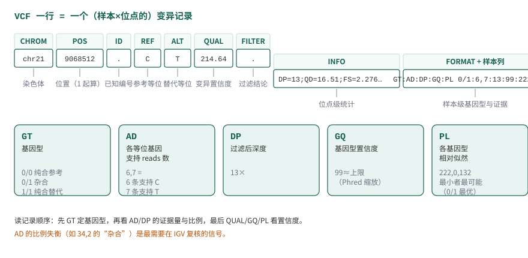{#fig-07-vcf-anatomy}

@fig-07-vcf-anatomy 把这条真实记录按列拆开标注，FORMAT 字段的展开见下文。

FORMAT 中最常用的字段是判断一条记录可信度的直接证据：

- **GT（genotype）**：等位基因型。`0/0` 纯合参考、`0/1` 杂合、`1/1` 纯合替代；`0|1` 竖线表示已定相（知道各来自哪条同源染色体）。GATK 用 `./.` 表示缺失。
- **AD（allelic depth）**：各等位基因的支持 reads 数（如 `6,7`：6 条支持参考 C、7 条支持替代 T）。这是"碱基比例"的原始形式——7.4 开头那个 G:A = 4:1 的例子，就是 AD 的直接读法。
- **DP（depth）**：该样本在该位点的过滤后深度。
- **GQ（genotype quality）**：基因型判断的置信度（Phred 缩放；99 常表示已到上限）。
- **PL（normalized likelihoods）**：各基因型似然的相对对数值（最小者归零），是 7.4 推导的 $P(S \mid G)$ 的身影。

读记录的顺序建议：先 GT 确定基因型判断，再 AD/DP 看证据量与比例是否支持这个判断，最后 QUAL/GQ/PL 看置信度。例如一条 `0/1` 记录若 AD 为 `34,2`，等位基因比例明显失衡，即使 GQ 高也值得在 IGV 里复核——杂合位点上两条同源染色体各自被随机抽中，观察比例应接近 1:1（7.4.2 的 $\frac{1}{2}$ 混合），严重偏离提示重复区域错配、污染或假基因问题。

### 过滤：硬过滤与 VQSR {#sec-07-06-filtering}

caller 输出的每条记录都是"候选"，FILTER 列的任务是把证据不足的标出来。两条路线：

**硬过滤（hard filtering）**：直接用 INFO 中的统计量设阈值。适合单样本或小队列（没有足够样本训练模型）。常用过滤器与 GATK 文档建议的起点：

| 过滤器 | 表达式示例 | 检出的问题 | 适用说明 |
| :--- | :--- | :--- | :--- |
| `LowQD` | `QD < 2.0` | 变异证据深度比低（堆得很深但支持的少） | QD=QUAL/DP，对高深度区域尤其有效 |
| `LowQUAL` | `QUAL < 30.0` | 总体置信度低 | indel 建议更严（如 `< 50`） |
| `HighSOR` | `SOR > 3.0` | 链偏置（变异只出现在一条测序链上） | 真变异应两条链都有支持 |
| `HighFS` | `FS > 60.0` | Fisher 精确检验的链偏置（另一口径） | indel 建议 `> 200` |
| `LowMQ` | `MQ < 40.0` | 比对质量低（多在重复/假基因区） | 对 SNV 有效 |
| `LowMQRankSum` | `MQRankSum < -12.5` | 替代等位基因的比对质量系统性更低 | 仅杂合位点有值 |
| `LowReadPosRankSum` | `ReadPosRankSum < -8.0` | 变异只出现在 read 末端 | 末端错误集中的信号 |

: 常用硬过滤参数（起点值，据 GATK 文档；实际阈值应结合自己数据的分布调整） {#tbl-07-hardfilters}

```{.bash .numberLines data-book-role="code"}
gatk VariantFiltration \
  -R ref/GRCh38.fa \
  -V VCF/${sample}.raw.vcf.gz \
  --filter-expression "QD < 2.0" --filter-name "LowQD" \
  --filter-expression "QUAL < 30.0" --filter-name "LowQUAL" \
  --filter-expression "SOR > 3.0" --filter-name "HighSOR" \
  --filter-expression "FS > 60.0" --filter-name "HighFS" \
  --filter-expression "MQ < 40.0" --filter-name "LowMQ" \
  --filter-expression "MQRankSum < -12.5" --filter-name "LowMQRankSum" \
  --filter-expression "ReadPosRankSum < -8.0" --filter-name "LowReadPosRankSum" \
  -O VCF/${sample}.filtered.vcf.gz
```

注意 `VariantFiltration` **不删除任何记录**，只把 FILTER 列从 `.` 改写为命中的过滤器名；下游分析用 `bcftools view -f PASS` 之类取出通过过滤的部分。本章子集（chr21 区间）的实测结果：

```{.text data-book-role="output"}
   620 PASS            # 通过全部过滤器
    13 LowMQ           # MQ < 40：比对质量低，多在重复/假基因区
    10 HighSOR         # SOR > 3.0：链偏置
# 合计 643 条原始记录，23 条被标记（同一条可命中多个过滤器则显示首个）
```

阈值表是起点不是标准答案——它们来自 GATK 对大量数据的经验总结，你的数据分布不同时（如 FFPE 样本、超深度 panel），应先看统计量分布再定阈值，并把最终采用的阈值记录进交付文档（7.8.3）。

**VQSR（Variant Quality Score Recalibration）**：用大量变异的统计量训练机器学习模型，给每条记录打分再分级。它需要成千上万的变异做训练数据，因此只适合大样本 WGS；单样本 WES 的变异数量不够训练，这就是为什么本章实战用硬过滤。两条路线的判断标准仍是同一句话：**模型需要的输入证据是否充分**。

### 质量评估 {#sec-07-06-quality-metrics}

过滤前后各有多少变异、被什么过滤器拦下，是必须对账的数字：

```{.bash data-book-role="code"}
# 各过滤器拦下的记录数
bcftools query -f '%FILTER\n' VCF/${sample}.filtered.vcf.gz | sort | uniq -c

# 只保留通过过滤的记录
bcftools view -f PASS VCF/${sample}.filtered.vcf.gz -Oz -o VCF/${sample}.pass.vcf.gz
```

除了流水账，还有一组**全局指标**可以从整体上检查结果是否"像真的"：

- **Ti/Tv 比**：转换（transition，嘌呤↔嘌呤或嘧啶↔嘧啶）与颠换（transversion）的数量比。真胚系变异因突变机制的生化偏好，全基因组约 2.0–2.1、外显子约 3.0–3.3；假变异（错误）没有这种偏好，混入越多 Ti/Tv 越低。**它检查的是整体，不指向任何具体位点。**
- **het/hom 比**：杂合与纯合比例。远离群体预期提示污染、性别弄错或过滤过度。
- **indel/SNV 比**：插入缺失与 SNV 数量比例，异常偏大常与比对错误有关。

```{.bash data-book-role="code"}
# Ti/Tv、het/hom 等全局统计
bcftools stats VCF/${sample}.pass.vcf.gz | grep -E '^TSTV|^SN|^IDD'
```

本章子集的实测输出（`TSTV` 行依次为：转换数、颠换数、比值）：

```{.text data-book-role="output"}
TSTV  0  413  157  2.63  413  157  2.63
SN    0  number of records:  620
SN    0  number of SNPs:      570
```

Ti/Tv = 2.63 落在合理区间（外显子胚系约 3.0 上下的口径、小子集区域性波动较大）；要强调的是这个数字来自**教学子集的 chr21 区间**，只能说明"结果量级正常"，不能外推为全基因组的检测质量。

指标异常时的处理顺序：先检查数据与流程（比对率、重复率、BQSR 是否正常），再看过滤阈值是否合理，最后才考虑生物学解释。把"结果指标异常"直接归结为"样本特殊"，是最常见也最危险的跳步。

## 变异注释与证据分层 {#sec-07-07}

区分检测结果、功能预测、数据库记录和实际证据。

[]{#src-0070-WGS-796}

### 变异注释在做什么 {#sec-07-07-annotation-what}

检测告诉我们"哪里变了"，注释回答"这个变化可能意味着什么"。7.5.1 末尾 ANNOVAR 的输出就是注释的产物：把变异坐标放到基因模型上，得到所在基因（`Gene.refGene`）、区域（`Func.refGene`：外显子/内含子/剪接区等）、编码后果（`ExonicFunc.refGene`：同义/错义/移码等），再挂上人群频率（`gnomad_exome`）与已知编号（`avsnp151`）。

使用注释结果前要注意两点。其一，**注释依赖转录本选择**：同一个基因有多个转录本时，变异可能在一个转录本的外显子、另一个转录本的内含子；不同工具默认的转录本集合不同，结论可能不同，比较多个来源的结果时要先对齐转录本。其二，`ExonicFunc` 这类功能描述是对编码后果的**分类**，不是致病性判断——"nonsynonymous"只说明氨基酸改变了，是否有害需要下面的证据分层来判断。

### 临床与疾病数据库 {#sec-07-07-databases}

[]{#src-0070-WGS-804}

注释之后，把变异放到已有知识里查证。四个常用数据库各司其职：

**OMIM**（Online Mendelian Inheritance in Man，https://omim.org/ ）是人类孟德尔遗传的综合数据库，系统整理基因—表型关系，条目由专业团队持续维护，是查询"这个基因与哪些遗传病有关"的首选。基因页面给出功能概述、表型关联、相关文献与外部数据库入口。

**ClinVar**（https://www.ncbi.nlm.nih.gov/clinvar/ ）是 NCBI 维护的变异—临床意义数据库：研究机构提交变异的解释，连同支持证据汇总公开。每条记录的**复审状态（review status）用 0–4 星共五个等级**表达证据强度：0 星（未提供断言标准）、1 星（单一提交者提供标准）、2 星（多个提交者结论一致）、3 星（专家小组复审）、4 星（专业执业指南复审）。同样标注"致病"的记录，1 星与 4 星的证据分量完全不同——查库时先看星级的含义，再采信结论。

**COSMIC**（Catalogue Of Somatic Mutations In Cancer，https://cancer.sanger.ac.uk/cosmic ）主要记录癌症相关的**体细胞**突变。它对基因的收录分两个层级：Tier 1 有明确的癌症相关活动记录与突变证据，Tier 2 在癌症样本中大量检出但与癌症的因果意义尚未明确。本章处理的是胚系变异，COSMIC 的用途是交叉参考：一个胚系检出的基因若同时是 COSMIC 癌基因，其体细胞突变谱可以为功能解读提供线索。数据库持续更新（2026-10 核查时最新版本为 v104），引用具体数字时应以官网当前发布为准。

**BRCA Exchange**（https://brcaexchange.org/ ）整合 ClinVar、LOVD 等来源，专门收录乳腺癌易感基因 BRCA1/BRCA2 的变异注释。BRCA 基因研究深入、变异众多、没有集中热点，逐位点权威注释的需求正是这类"专基因数据库"存在的理由；它的分类体系来自 ENIGMA 专家组的统一标准（相当于 ClinVar 的 3 星以上口径）。

::: {.callout-note .book-core title="核心知识｜证据分层：从检测到结论"}

把"一个变异"变成"一个临床结论"，中间隔着几层强度不同的证据，不能跨层直通：

1. **检测结果**：caller 说这个位点基因型可信（QUAL/GQ/AD 支持）——这是本章前半的产出；
2. **功能注释**：变异改变了编码序列的哪部分（注释工具给出）——只是"可能影响功能"的分类；
3. **数据库收录**：ClinVar/OMIM 等记录过这个变异或基因——收录不等于致病，要看复审等级与提交证据；
4. **致病性判定**：按 ACMG/AMP 等指南把人群频率、功能预测、家系共分离、表型匹配等多条证据线组合评级（致病/可能致病/意义未明 VUS/可能良性/良性）。

只有第 4 层是结论，而它依赖前面每一层。意义未明（VUS）在罕见病分析中大量出现，把 VUS 当致病报告是临床解读的经典错误。

:::

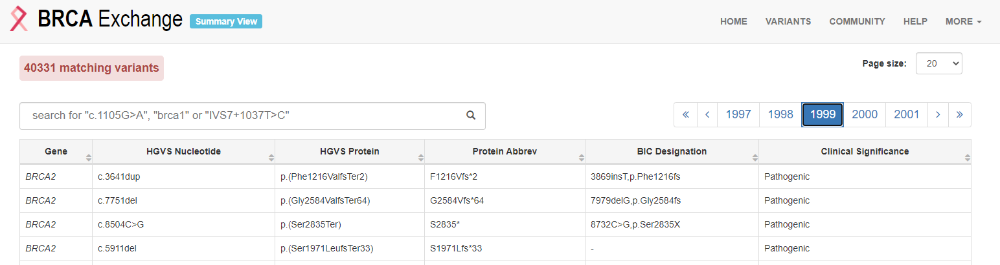{#fig-08-wgs-and-wes-007}

@fig-08-wgs-and-wes-007 是 BRCA Exchange 的变异浏览页面（截图取自 2020 年前后的网站版本），每条记录给出变异坐标、临床分类与证据来源。

### 数据库使用案例 {#sec-07-07-use-cases}

[]{#src-0070-WGS-816} []{#topic-07-774} []{#topic-07-783}

用两个从本章示例数据出发的例子演示查证动作。

**按结果找基因：从 VCF 注释到 OMIM。** 假设从注释结果中挑出一个值得追的变异：4 号染色体第 81046034 位 C→T，GT=1/1，注释为 `Func.refGene=exonic; Gene.refGene=BMP3; ExonicFunc.refGene=nonsynonymous_SNV`——BMP3 基因编码区的一个纯合错义变异。下一步到 OMIM 检索 `BMP3`：基因页给出已知功能、相关表型与文献；如果该基因有明确的孟德尔表型且与你的样本表型相符，再回到变异本身查 ClinVar 的收录与星级、gnomAD 的人群频率（纯合罕见 + 表型相符 + 功能已知，才构成较强的候选）。OMIM 界面左侧还链接外部数据库，可继续查蛋白质、动物模型与细胞通路信息。

**按基因找变异：从 COSMIC 到 VCF。** 反过来，研究癌症相关基因时，先从 COSMIC 的 Cancer Gene Census（CGC，https://cancer.sanger.ac.uk/census ）拿癌症基因目录，再在自己的 VCF 里检索这些基因：

```{.bash data-book-role="code"}
# 在注释结果中查找 MSH6 基因的记录（第 1 列不是注释头的行）
grep -v "^#" VCF/NA12878.annovar.hg38_multianno.txt | grep "MSH6"
```

以结直肠癌（colorectal cancer）为例，在 CGC 检索 `colorectal` 能得到相关基因列表；关注其中的 MSH6（DNA 错配修复基因），在 VCF 注释结果里检索到若干变异后，逐条按 7.7.2 的分层去查证——而不是"检出到癌基因 = 与癌症有关"。

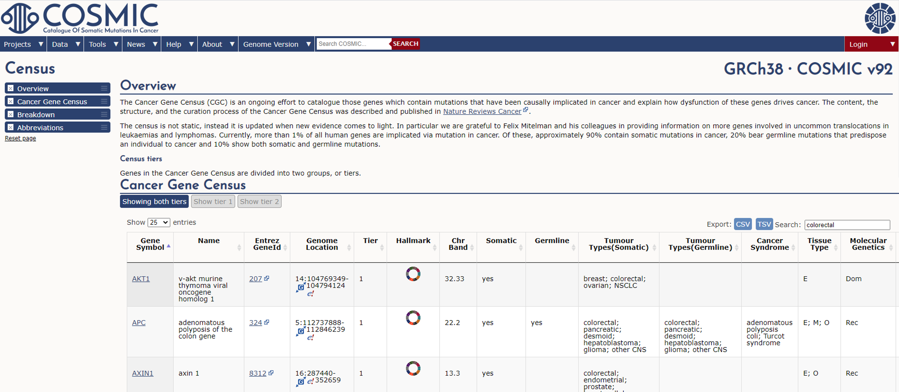{#fig-08-wgs-and-wes-008}

@fig-08-wgs-and-wes-008 与 @fig-08-wgs-and-wes-009 是以上操作在 COSMIC 中的对应界面（截图取自 2020 年前后的网站版本，以现行网站布局为准）：在 CGC 页面按关键词过滤基因目录，进入基因页面后可以看到该基因在癌症中的突变概览、分布与文献。

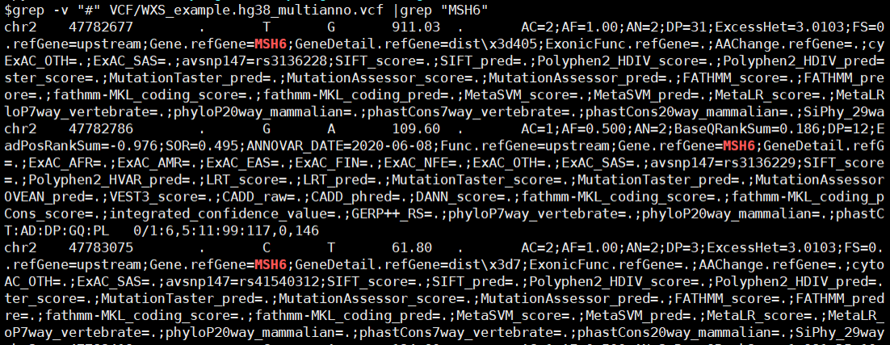{#fig-08-wgs-and-wes-009}

在 COSMIC 的基因页面还能进一步查看编码蛋白质的三维结构：COSMIC-3D（https://cancer.sanger.ac.uk/cosmic3d/ ）提供交互式页面，可以旋转缩放蛋白结构、查看错义突变在结构上的位置分布，并跳转到 PDB 查看原始结构数据——把"突变列表"变成"突变在蛋白上的分布"，是评估功能影响的一个视角（当然，仍属第 2 层证据，不是致病结论）。

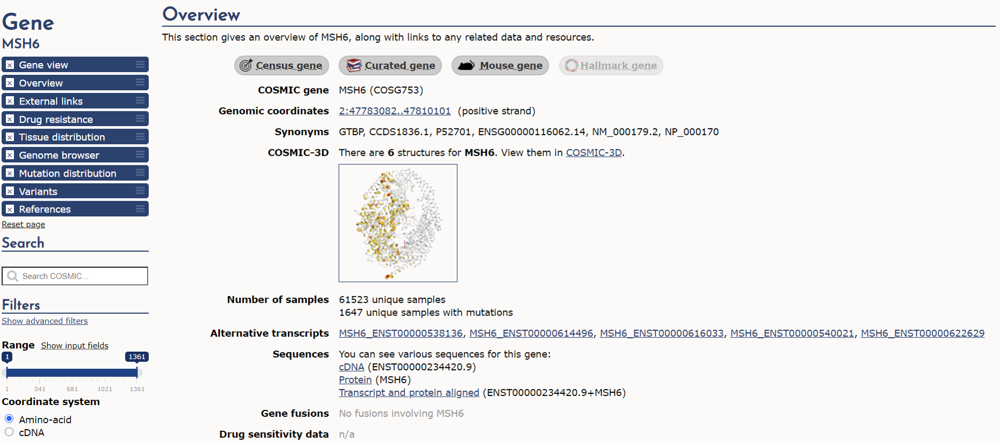{#fig-08-wgs-and-wes-010}

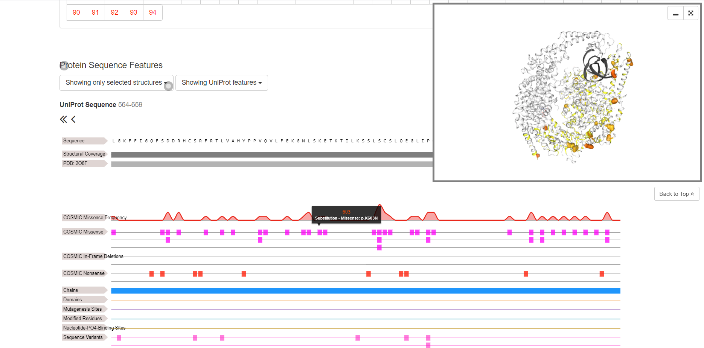{#fig-08-wgs-and-wes-011}

### 通路分析与公共数据验证 {#sec-07-07-pathways-validation}

[]{#src-0070-WGS-840} []{#src-0070-WGS-850}

拿到一组候选基因后，还有两类常见后续，这里作为方向概览，不展开操作：

**通路与功能富集。** 第 5 章用 clusterProfiler 做过 GO/KEGG 富集分析，同样的方法适用于变异候选基因列表。KEGG PATHWAY（https://www.genome.jp/kegg/pathway.html ）把基因按代谢与信号通路组织，六大类（细胞过程、环境信息处理、遗传信息处理、人类疾病、新陈代谢、生物体系统）逐级细分；Metascape（https://metascape.org/ ）则一站整合 GO、KEGG、蛋白互作等多类资源，适合对基因列表做快速注释与富集，每月更新其整合的数据库。

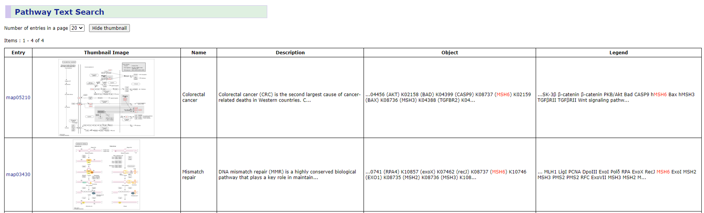{#fig-08-wgs-and-wes-012}

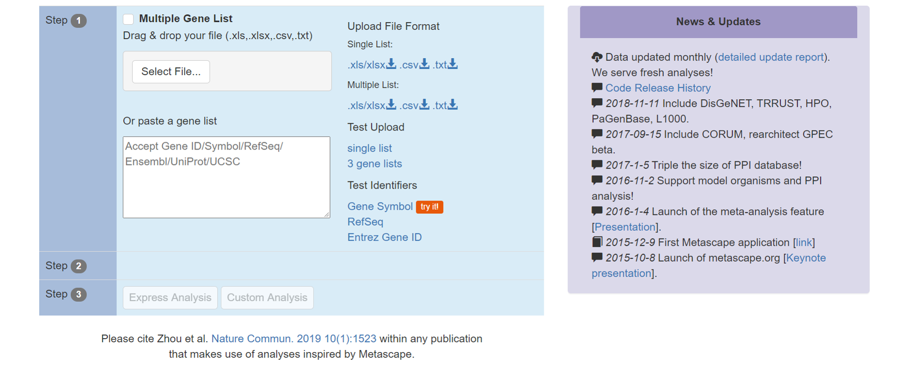{#fig-08-wgs-and-wes-013}

**公共数据交叉验证。** TCGA（The Cancer Genome Atlas，入口为 NCI 的 GDC Data Portal：https://portal.gdc.cancer.gov/ ）存储大量肿瘤样本的多组学数据（表达、突变、拷贝数、甲基化与临床信息），适合把自己的结果放到同类样本中对比；CCLE（Cancer Cell Line Encyclopedia，https://sites.broadinstitute.org/ccle ）提供上千种癌症细胞系的基因组与药理数据，是体外模型选择的常用参考。使用这类资源时先明确自己的问题属于哪一层——例如胚系分析的结果不能直接与 TCGA 的体细胞突变谱比较口径，队列与过滤标准不同时的"验证"只是参考。

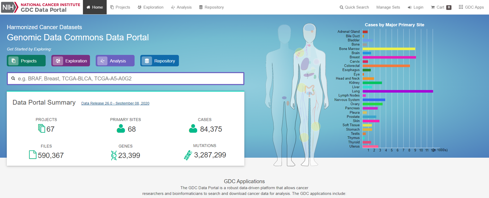{#fig-08-wgs-and-wes-014}

## IGV复核、基准评价与完整交付 {#sec-07-08}

评估分析流程的准确性并报告其检测边界。

### 用 IGV 复核候选变异 {#sec-07-08-igv-review}

第 4 章已经装好 IGV、载入过 BAM。变异分析的复核动作是：同时载入参考基因组、BAM（`.recal.bam` 及其索引）与 VCF，跳到候选变异位置，亲眼看证据。重点看什么：

{#fig-07-igv-review}

- **reads 数量与颜色**：支持参考与替代等位基因的 reads 各多少条（对照 VCF 的 AD），有没有明显聚集在一条链上（对照 SOR/FS 过滤器在防的问题）；
- **碱基质量**：替代等位基因的碱基质量值是否整体偏低（IGV 里低质量碱基显示为暗淡颜色）；
- **比对质量与灰条**：reads 上灰色小条标记比对质量低的区域，变异恰好落在一片灰条里时要怀疑比对错误；
- **read 位置**：变异是否集中在 read 末端（ReadPosRankSum 在防的问题）；
- **周边环境**：是否落在重复区域、假基因附近，或 SNP 密集得异常的区域。

@fig-07-igv-review 是本章示例数据中一个候选杂合变异（chr21:9068512 C>T，即 7.6.1 的那条记录）的复核视图，按实测 BAM 的 27 条 reads 绘制。养成"下结论前看一眼"的习惯，比任何自动化过滤器都更能建立对结果的判断力——过滤器的阈值是别人的经验，IGV 里的证据是你自己的。

### 基准评价 {#sec-07-08-benchmarking}

单个样本分析的质量可以逐位点复核，流程整体的可信度需要**基准（benchmark）**：用一份"答案已知"的数据跑你的流程，看能对多少。GIAB（Genome in a Bottle，NIST 主导）为 NA12878 等样本发布了高置信度真值集——由多种平台、多个中心的数据交叉验证得到的高置信变异集合。本章示例数据正是 NA12878，这使得流程评价可以直接落地：

- 把你的 PASS 变异集与 GIAB 高置信集比较，得到**灵敏度**（真值里你检出了多少）与**精确度**（你检出的里多少在真值中）；
- 常用工具如 `hap.py`/`vcfeval` 处理区间与表示差异，避免把"同一变异不同写法"误判为错误；
- 高置信集只覆盖其定义的**高置信区域**；比较结果只代表"在这类区域上的表现"，外推到全基因组要谨慎。

没有真值集的物种或样本，就用 7.6.3 的全局指标（Ti/Tv、het/hom、过滤比例）做自检——证据弱一档，但总比只看"跑完没报错"强。

### 完整交付与报告 {#sec-07-08-deliverables}

分析的终点不是 VCF 文件，而是一份**可追溯**的结果说明。一个胚系小变异分析的完整交付应包括：

- **数据来源**：样本编号、测序数据 accession（如 SRR8381428）、参考基因组与注释版本、known-sites 资源版本；
- **软件与参数**：每个工具的名称、版本、关键参数（过滤阈值尤其要写明依据）；
- **过程指标**：质控保留率、比对率、重复率、深度统计、过滤前后变异数、全局质量指标（Ti/Tv 等）；
- **结果与边界**：最终变异列表及其注释、检索过的数据库与版本、未覆盖区域或深度不足区域的说明、结论适用的范围（哪些变异类型、哪些区域、什么置信水平）；
- **复核证据**：关键变异的 IGV 截图或等价的记录。

这份清单也是与 AI 协作的核对表：让 AI 复核你的分析或给出方案时，要求它先复述这些要素——数据从哪来、用什么版本、检查过什么指标、结论边界在哪。答不上来的环节，就是需要你自己回到数据去验证的环节。至此，从"一叠 FASTQ"到"能对结论负责的小变异分析"，本章走完了全链；判断力不在于记住每个命令，而在于每个环节都能回答"为什么这样做、怎么检查、还能相信到什么程度"。

[^choi-2009]: Choi M, Scholl UI, Ji W, et al. Genetic diagnosis by whole exome capture and massively parallel DNA sequencing. PNAS 106(45):19096–19101 (2009). doi:10.1073/pnas.0910672106。
[^sakharkar-2004]: Sakharkar MK, et al. Distributions of Exons and Introns in the Human Genome. In Silico Biology 4:387–393 (2004)。
[^goodwin-2016]: Goodwin S, McPherson JD, McCombie WR. Coming of age: ten years of next-generation sequencing technologies. Nature Reviews Genetics 17:333–351 (2016)。
[^meynert-2014]: Meynert AM, Ansari M, FitzPatrick DR, Taylor MS. Variant detection sensitivity and biases in whole genome and exome sequencing. BMC Bioinformatics 15:247 (2014). doi:10.1186/1471-2105-15-247。
[^lord-2019]: Lord J, et al. Prenatal exome sequencing analysis in fetal structural anomalies detected by ultrasonography (SHAPE study). New England Journal of Medicine 380:2468–2475 (2019)。
[^ng-2010]: Ng SB, et al. Exome sequencing identifies the cause of a mendelian disorder. Nature Genetics 42(1):30–35 (2010). doi:10.1038/ng.499。
[^gc-capture]: G、C 碱基之间由 3 个氢键连接，双链更稳定、不易被打断，GC 含量高的区域通常片段偏大；PCR 变性时不易解开，解开后单链也容易自身粘合形成二级结构，聚合酶对高 GC 片段的扩增效率因此下降，高 GC 外显子的测序深度系统性偏低[^meynert-2014]。
[^likelihood-form]: 统一的形式是 $P(S_i \mid g)=P(I_i{=}1)^{I_i}\cdot P(I_i{=}0)^{1-I_i}$：指数充当"开关"，留下实际发生的那个事件的概率。不同基因型下"观察到参考碱基"的概率不同，最终公式因此不同。
[^ren-2018-gpu]: Ren S, et al. Efficient Acceleration of the Pair-HMMs Forward Algorithm for GATK HaplotypeCaller on GPU. Cancer Informatics 16:1176934318760543 (2018)。
