# 碱基不平衡测序数据的分析 {#sec-ch08}

::: {.hero-book .book-chapter-summary}

## 本章提要 {#chapter-summary-08 .unnumbered}

本章先讲 DNA、再讲 RNA：8.1–8.3 从 5mC 甲基化的生物学与 BS-seq 技术出发，沿 Dnmt 三敲小鼠胚胎干细胞系列的真实 WGBS 数据走完比对、甲基化提取、位点定量与差异甲基化区域分析；8.4–8.5 转向 mRNA 修饰版图与 m6A 测序技术的发展，看 GLORI 如何把 METTL3 敲低的效应读成逐位点的修饰比例。两条线共享同一个数据本质——化学转化改写了 reads 的碱基组成，第 3、4 章的质控与比对经验需要为此重建。阅读时请带着三个问题：化学转化让 reads 与参考基因组之间产生了怎样的系统性错配，标准流程的哪些前提因此失效？转化率、对照、M-bias 校正与 SNP 排除，每一步在控制什么偏差？一个修饰比例或差异区域能支持什么结论，离"调控了功能"还差哪些证据？

:::

## DNA 上的甲基化修饰 {#sec-08-01}

认识 5mC 这类修饰的生物学含义，再决定用什么技术去测它。

### 从 5mC 到 5caC：胞嘧啶修饰家族与动态循环 {#sec-08-01-cytosine-family}

第 6 章分析 NRF1 与 DNA 甲基化的竞争时我们曾提到：Dnmt 三敲（TKO）细胞失去甲基化后，NRF1 多结合了数千个位点。当时关注的是甲基化有无与结合变化的关系；现在先看甲基化在化学上究竟是什么。

在哺乳动物基因组里，DNA 甲基化几乎都发生在胞嘧啶上：DNA 聚合酶接入的是普通胞嘧啶 C，而**DNA 甲基转移酶（DNMT）**可以在复制完成后把一个甲基共价连接到胞嘧啶碱基环的第 5 位碳原子上，生成 **5-甲基胞嘧啶（5-methylcytosine，5mC）**。这个反应主要发生在 CpG 二核苷酸（C 后面紧跟 G 的位点）上。人体细胞基因组中约 70%–80% 的 CpG 位点是甲基化的，5mC 约占全部碱基的 1%[^bird-2002]。两类甲基转移酶分工明确：**DNMT3A/3B 负责从头甲基化**（de novo），在发育和干细胞中建立新的甲基化模式；**DNMT1 负责维持甲基化**（maintenance），在复制叉上识别半甲基化的 CpG、把亲本链的甲基化状态复制到新合成链上[^lyko-2018]。TKO 细胞敲除的正是 Dnmt3a/3b 加上维持酶 Dnmt1，这三种酶同时缺失，甲基化就无法维持。

甲基化一旦写上，如何去掉？2009 年之后的研究逐步揭示了这一过程。**TET 蛋白**（TET1/2/3）是一类依赖铁离子和 α-酮戊二酸的加双氧酶，能把 5mC 依次氧化为 **5-羟甲基胞嘧啶（5hmC）**、**5-甲酰胞嘧啶（5fC）**和 **5-羧基胞嘧啶（5caC）**[^tahiliani-2009][^ito-2011]；其中 5fC 和 5caC 可以被 DNA 糖苷酶 TDG 切除，启动碱基切除修复，把这位点换回未修饰的 C——这就是**主动去甲基化**通路[^he-2011-tet]。除了这条主动通路，复制时不加甲基、让甲基化在细胞分裂中被逐步稀释的**被动去甲基化**同样普遍。@fig-08-dna-modification-cycle 概括了这个写入—氧化—切除的完整循环。

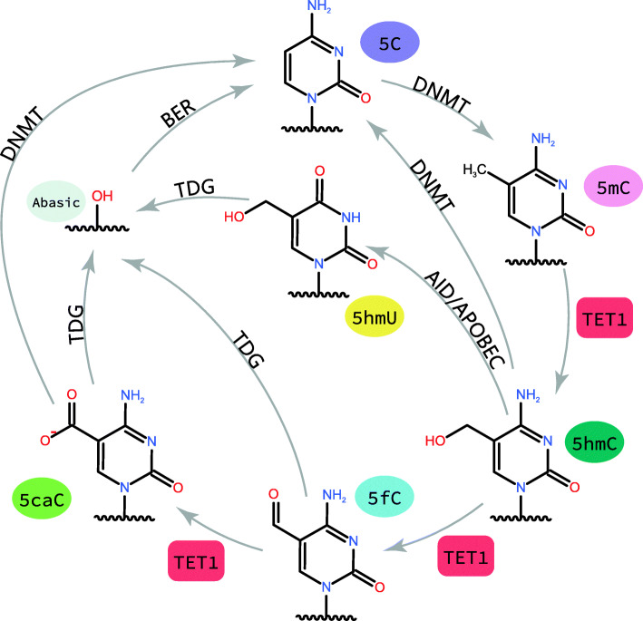{#fig-08-dna-modification-cycle}

把这个家族放在一起看，分析时需要注意一个区别：**"甲基化"不是一个化学状态，而是一族状态**。5hmC 在胚胎干细胞和神经元中相当丰富，并且有自己的功能；一个实验测到的"C 修饰信号"究竟只算 5mC，还是把 5hmC 也混在其中，取决于所用技术能不能把它们分开——这决定了 8.1.3 里各技术的取舍。

### 5mC 的生物学功能：沉默、发育与疾病 {#sec-08-01-functions}

甲基化在基因组里做什么？最经典的关联是**启动子 CpG 岛的高甲基化与基因沉默**。CpG 岛（CpG island，CGI）是 CpG 密度高于基因组平均的短区域，约 60%–70% 的人类基因启动子带有 CpG 岛；管家基因的启动子 CpG 岛在正常细胞中通常保持未甲基化，而肿瘤抑制基因启动子 CpG 岛的异常高甲基化与转录失活高度相关[^deaton-bird-2011]。注意这里的因果方向：甲基化与沉默"认同"，未必每次都是甲基化导致沉默——沉默的染色质有时反而招来甲基化。这一点在 8.6.2 讨论证据分层时还会回来。

第二类证据来自**发育**。哺乳动物一生中有两波全基因组的去甲基化—再甲基化浪潮：受精后，父本基因组的 5mC 被 TET3 快速氧化、连同母本基因组一起大幅去甲基化，在早期胚胎中重建；原始生殖细胞（PGC）发育过程中也经历一轮大范围擦除，随后在配子和着床后重新建立甲基化图谱[^reik-2007][^smith-2012-embryo][^seisenberger-2012]。@fig-08-dev-methylation-waves 把这两波动态画成一条贯穿生命周期的曲线。发育重编程的存在说明甲基化组是**可以整体重置的**，也解释了为什么不同组织、不同发育阶段的甲基化图谱差异巨大——比较任何两组甲基化数据，先确认细胞类型是否可比。

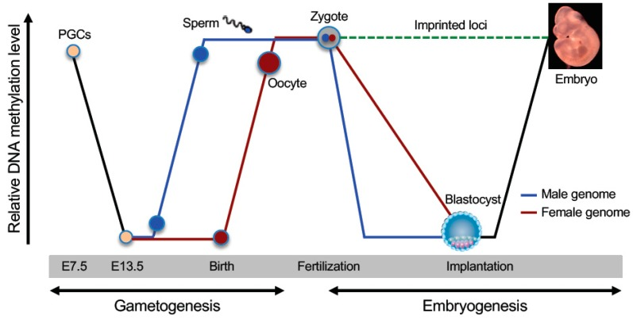{#fig-08-dev-methylation-waves}

第三类是**疾病与转化应用**。癌细胞呈现"全局低甲基化 + 局部 CpG 岛高甲基化"的双重异常图谱（@fig-08-cancer-methylation）：前者伴随基因组不稳定，后者沉默肿瘤抑制基因。此外，甲基化模式在癌变早期就出现、而且稳定存在于循环游离 DNA（cfDNA）中，使它成为**早期诊断标志物**的候选。例如，SEPT9 血浆甲基化检测在前瞻性研究中对结直肠癌的敏感性为 48.2%、特异度 91.5%[^church-2014]，2016 年成为首个获 FDA 批准的基于血液的结直肠癌筛查检测；随后的 cfMeDIP-seq 把多种癌型的 cfDNA 甲基化图谱用于肿瘤检测[^shen-2018]；更大规模的靶向亚硫酸氢盐测序在验证集中做到 99.3% 的特异度和约 67% 的敏感度（12 种癌型 I–III 期）[^liu-2020-galleri]。

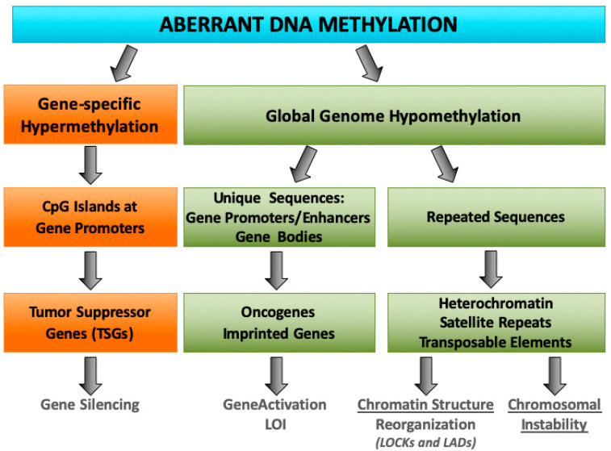{#fig-08-cancer-methylation}

::: {.callout-warning .book-warning title="注意｜同一个甲基化信号，位置不同含义不同"}

启动子 CpG 岛高甲基化通常与基因沉默关联，但基因体（gene body）甲基化反而常见于活跃转录的基因，增强子区域的甲基化状态又与活性呈负相关。看到一个"高甲基化"或"低甲基化"的结论，第一步先问它发生在基因组的什么位置；把启动子区间的规律套到基因体上，是解读甲基化数据时最常见的错误之一。

:::

### 测 5mC 的技术路线与 BS-seq 的地位 {#sec-08-01-technologies}

明确了要测什么，下一个问题是拿什么测。让 5mC 在测序数据里"现形"的关键技术出现于 1992 年：**亚硫酸氢盐（bisulfite）处理**。单链 DNA 经亚硫酸氢盐处理后，未甲基化的胞嘧啶 C 被化学脱氨变成 U（PCR 扩增后读作 T），而 5mC 由于甲基的保护几乎不发生反应、仍然读作 C[^frommer-1992]。于是测序 reads 里的 C/T 比例直接编码了每个位点的甲基化状态——原文标题称之为"阳性显示 5mC"。基于这一化学反应的测序统称 **BS-seq**（bisulfite sequencing），全基因组版本就是 **WGBS**。

@tbl-08-dna-methylation-methods 把测 5mC 家族的主要技术放在一起比较。

| 技术 | 测什么 | 文库与转化特点 | 适用与代价 |
| :--- | :--- | :--- | :--- |
| **WGBS**（全基因组亚硫酸盐测序） | 全基因组单碱基 5mC（含 5hmC，二者不可分） | 亚硫酸盐转化；ENCODE 现行标准：每重复 30×、读长 ≥100 bp、≥2 个生物学重复、转化率 ≥98% | 覆盖最全；成本与数据量为普通 WGS 的数倍 |
| **RRBS**（简化代表性亚硫酸盐测序） | CpG 岛及附近区域 | MspI 酶切富集 CpG 岛片段后转化；约 5% 的测序量覆盖约 90% 的 CpG 岛[^meissner-2008] | 大队列/profile 首选；只看酶切位点附近 |
| **EM-seq**（酶法甲基测序） | 与 WGBS 相同的信号类型 | TET2+T4-BGT 保护 5mC/5hmC，APOBEC3A 酶法脱氨其余 C；避免亚硫酸盐对 DNA 的断裂损伤，低输入低深度时覆盖更均匀[^vaisvila-2021] | 样品量少、质量差时优于 WGBS |
| **oxBS** | 区分 5mC 与 5hmC | KRuO4 把 5hmC 氧化为 5fC（亚硫酸盐处理后读作 T），与普通 BS 文库对照可拆开两种修饰[^booth-2012] | 需要成对文库；关心 5hmC 时使用 |
| **TAB-seq** | 单碱基 5hmC | β-葡萄糖基转移酶保护 5hmC，TET2 把 5mC 氧化为 5caC 后亚硫酸盐处理[^yu-2012-tab] | 专门测 5hmC |
| **ONT 直接检测** | 5mC（CpG 语境为主） | 长读长电信号直接识别修饰，无需化学转化（第 3 章 3.4 提过纳米孔的这一能力） | 免转化、长读长；调用精度依赖模型，5hmC 等修饰缺乏独立基准评测 |

: 测 DNA 5mC 家族的主要技术路线 {#tbl-08-dna-methylation-methods}

注意表里反复出现的一行小字：**WGBS/EM-seq/RRBS 分不开 5mC 与 5hmC**——亚硫酸盐化学对两者都不脱氨，它们的信号都读作"甲基化样的 C"。只有在 5hmC 极少的组织里，"BS-seq 信号 ≈ 5mC"这个近似才安全；胚胎干细胞、神经元这类 5hmC 丰富的样本，要回答"究竟哪种修饰"必须配合 oxBS 或 TAB-seq。选择技术时，需要先确定是否必须区分这两种修饰。

::: {.callout-note .book-core title="核心知识｜碱基不平衡"}

亚硫酸盐转化把基因组中绝大多数未甲基化的 C 变成了 U（读作 T）。这意味着 BS-seq 的 reads 与参考基因组之间存在**系统性的 C→T 错配**，reads 的四碱基组成严重偏离参考基因组——A、T 占比升高，C 大量消失。我们把这个现象称为**碱基不平衡**。这种变化携带着甲基化信息，不能当作普通噪声处理；但它同时让第 3 章的常规质控经验和第 4 章的比对假设不再适用——常规比对器假设错配是随机罕见的，而这里几乎每条 read 都带着成串"假错配"。本章 DNA 线（8.2–8.3）和 RNA 线（8.5）的分析工具，都是围绕"如何把系统性错配变成可定量信号"重建的。

:::

::: {.callout-note .book-extension title="拓展阅读｜亚硫酸盐反应的三步化学" collapse="true"}

亚硫酸氢盐转化分为三步：亚硫酸氢根对胞嘧啶 C5–C6 双键的可逆加成、胞嘧啶水解脱氨生成尿嘧啶亚磺酸盐、以及碱性条件下脱磺酸生成尿嘧啶 U。5mC 的 5 位甲基增加空间位阻并降低双键反应活性，使加成一步难以发生，从而在同样条件下"幸存"。转化效率对 pH、温度、时间敏感，通常能达到 98%–99% 以上，但永远达不到 100%——剩下的那一两个百分点，是 8.2 转化率质控的重点。

:::

## BS-seq 的数据分析 {#sec-08-02}

分析顺序与第 5、7 章相同：明确数据 → 质控 → 比对 → 前处理 → 逐位点计数，只是每一步都要重新考虑"化学转化改变了什么"。

### 示例数据与路线总览 {#sec-08-02-example-data}

DNA 线的示例数据是 8.1 提到的 Dnmt 三敲（TKO）系列小鼠胚胎干细胞 WGBS，来自 GEO 数据集 **GSE67867**（Domcke 等，2015）[^domcke-2015]——正是第 6 章 NRF1 竞争实验所用的同一批细胞系。三个样本覆盖了"几乎无甲基化 → 低甲基化 → 高甲基化"的完整谱系（@tbl-08-wgbs-samples）：

| 样本 | 登记号 / Run | 文库 | 说明 |
| :-- | :-- | :-- | :-- |
| TKO | GSM1891661 / SRR2500903 | WGBS，单端 50 bp | Dnmt1/3a/3b 三敲，甲基化几乎完全丧失 |
| to2i | GSM1891662 / SRR2500904 | WGBS，双端 100 bp | 野生型，2i 培养基（低甲基化状态） |
| toSerum | GSM1891663 / SRR2500905 | WGBS，双端 100 bp | 野生型，血清培养（高甲基化状态） |

: 本章 DNA 线示例样本（GSE67867，mm10/mm9 坐标见 8.3 说明） {#tbl-08-wgbs-samples}

出于运行时间的考虑，本章的命令演示使用 to2i 样本的**教学子集**（前 200 万对 reads，约占全数据的 1%）；全数据约 1.92 亿对 reads、全基因组约 14× 覆盖。与第 7 章相同的提醒：子集上"流程能走通、比例类指标可信，深度类指标不能外推"。参考基因组使用 UCSC mm10（下载与第 7 章 GRCh38 同路）。

@fig-08-bs-pipeline 给出全章 DNA 线的路线图——与第 7 章的流程图一样，每一步标注输入、输出与目的。与 WGS 链逐行对比，你会发现差异集中在两处：比对之前（参考基因组要先转换）与比对之后（从错配里提取甲基化，而不是从一致性里提取变异）。

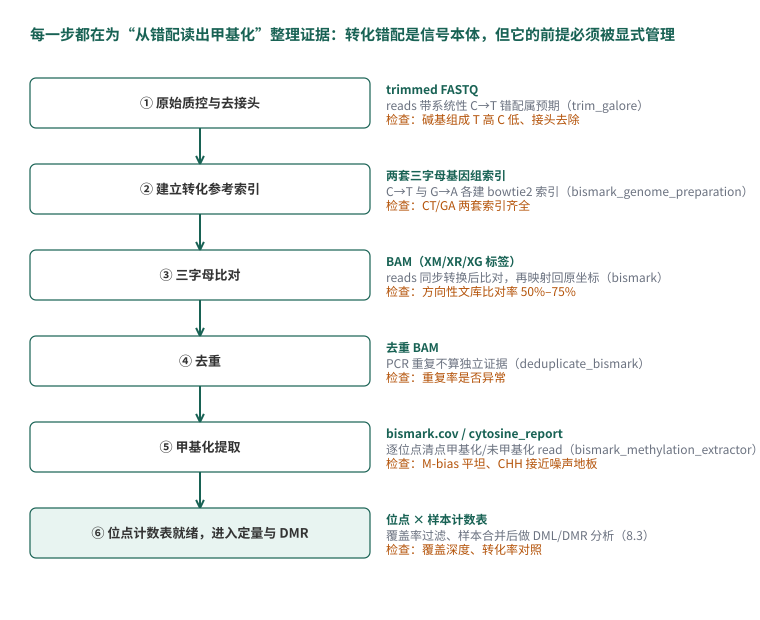{#fig-08-bs-pipeline}

### 转化如何写进 reads：质控时看什么 {#sec-08-02-chemistry-in-reads}

先看参考基因组上的一个 C 位点（@fig-08-bisulfite-conversion-principle）：原始 DNA 中未甲基化的 C 经亚硫酸盐处理变为 U，PCR 与测序后读作 T；5mC 在处理后保留，测序仍读作 C。参考序列只记录这个位置是 C，不记录甲基化状态，因此将 reads 对齐后，可以通过该位点读到的 C 和 T 计数来估计甲基化比例。图中 5 条有效覆盖来自不同原始分子，其中 3 条读 C、2 条读 T，比例估计为 $3/(3+2)=60\%$；它的统计不确定性将在 8.3 讨论。

把它推到全基因组尺度——小鼠基因组约 20% 的碱基是 C，其中绝大多数未甲基化——BS-seq 的 reads 相对参考基因组带有**成串的系统性 C→T 错配**，reads 自身的碱基组成也严重偏向 A/T。

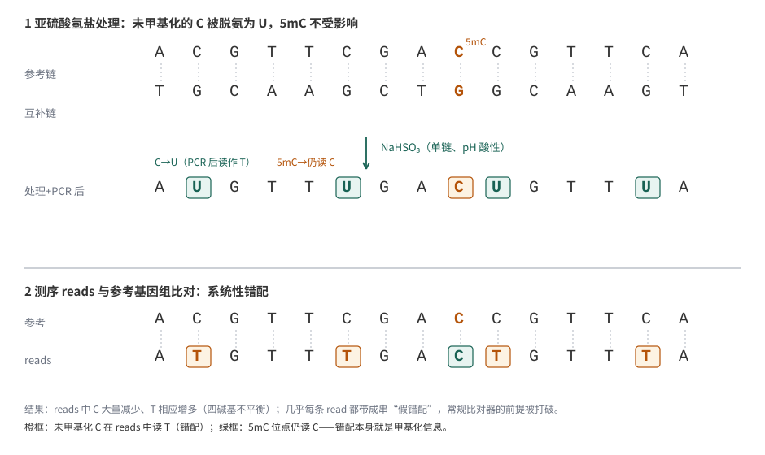{#fig-08-bisulfite-conversion-principle}

因此第 3 章 FastQC 的常规模块在 BS-seq 上要按新预期解读：

- **每碱基序列含量（Per base sequence content）**：四条线不再互相平行，T 显著高于 C——这是转化成功的表现，不是污染警报；反倒是 C 正常、T 不高的文库值得怀疑（转化失败）。
- **每碱基质量与接头**：与普通 DNA-seq 相同，转化对测序质量本身没有影响；接头照常需要去除。
- **重复序列**：BS-seq 的 PCR 重复率天然偏高（转化后序列复杂度下降），阈值判断要比 WGS 放宽。

去接头与常规 RNA-seq 一样交给 trim galore：

```{.bash .numberLines data-book-role="code"}
trim_galore --paired --length 20 -j 4 -o trimmed/ \
  SRR2500904_to2i_1.fq.gz SRR2500904_to2i_2.fq.gz
```

to2i 子集上：R1 有 41.9%、R2 有 44.0% 的 reads 带接头（文库片段短于 2×100 bp 读长，读穿了插入序列），因任一端短于 20 bp 而被丢弃的 read 对占 0.90%。

### 为什么不能直接用 BWA {#sec-08-02-why-not-bwa}

带着 @fig-08-bisulfite-conversion-principle 下半部分的错配去看第 4 章的比对假设：BWA 这类比对器为随机罕见错配设计打分——一条 100 bp 的 read 上散布三五个错配可以容忍，但一条几乎每个 CpG 都错配、C 位点成串变 T 的 read，会被判为"不可能来自参考基因组"。程序可能不报错，却给出错误结果：reads 被丢弃、或者勉强贴到错误位置，比对率大跌、甲基化估计系统性偏移。

@fig-08-three-letter-alignment 展示了一个最小的示例：reads `TTTAGTT` 对参考 `CTCAGTC` 有三处成串错配；把两边同时做 C→T 转换后，reads 与"转化参考"完美匹配。**原来的错配仍有甲基化信息；比对时对两边作相同转换，使它们能够对齐**。

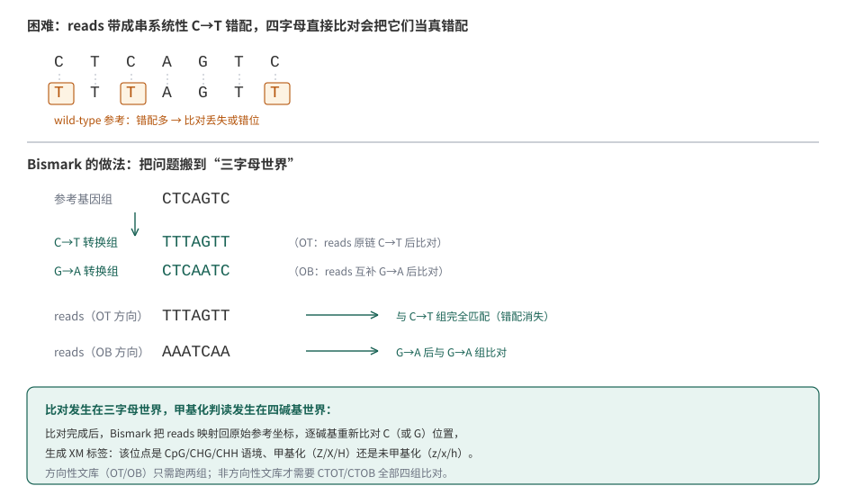{#fig-08-three-letter-alignment}

解决方法主要分为两类：

- **双参考三字母比对**：预先把参考基因组转换成两套"三字母基因组"（C→T 一套、G→A 一套，A/T/G 只剩三个字母），reads 也按方向转换后用 bowtie2 比对，比对结果映射回原坐标。Bismark 是这一族的代表，也是本章主线。
- **WIL/通配符比对**：把参考基因组里的 C 换成通配符 Y（既能匹配 C 也能匹配 T），reads 原样比对。BWA-meth（`bwa-meth`）是这一族的代表，直接复用 BWA 索引语义，速度常占优。

两种方法的共同思路是：**先在比对层面"原谅"转化错配，再在甲基化提取层面精确清点每个 C 位点读到了 C 还是 T**。选哪个主要看实验室习惯与下游工具链；本章用 Bismark。

### 比对：Bismark 的运行与输出 {#sec-08-02-bismark}

第一步是建立亚硫酸盐参考索引——把 mm10 分别转换成 C→T 与 G→A 两套基因组并各建一个 bowtie2 索引（本机 8 线程约 20 分钟、约 9 GB 磁盘）：

```{.bash .numberLines data-book-role="code"}
# bismark_genome 会生成 Bisulfite_Genome/CT_conversion 与 GA_conversion 两个索引
bismark_genome_preparation --bowtie2 --parallel 8 bismark_genome
```

建立索引后进行比对：

```{.bash .numberLines data-book-role="code"}
bismark --genome bismark_genome \
  -1 trimmed/SRR2500904_to2i_1_val_1.fq.gz \
  -2 trimmed/SRR2500904_to2i_2_val_2.fq.gz \
  --parallel 8 -o bismark_out/
```

这里没有出现"方向性文库"参数——现代甲基化文库（包括本数据）都是**方向性文库**（directional library），Bismark 默认只做 OT/OB 两组比对；只有罕见的非方向性文库才需要显式加 `--non_directional`。双端默认参数（`--no-mixed --no-discordant --dovetail --maxins 500`）由 Bismark 自动传给 bowtie2，一般无需改动。

to2i 子集（198 万对 reads）的比对报告（`*_bismark_bt2_PE_report.txt`）：

```{.text data-book-role="output"}
Sequence pairs analysed in total:                    1981956
Number of paired-end alignments with a unique best hit:  1193383
Mapping efficiency:                                 60.2%
Sequence pairs with no alignments under any condition:   646541
Sequence pairs did not map uniquely:                 142032
```

**60.2% 的比对率处于 WGBS 的正常范围内，但偏低**。第 7 章 WGS 动辄 99% 的映射率在这里不可能出现，原因有三层：转化大幅降低序列复杂度，可区分的序列变少了；方向性文库只允许 reads 以两种方向组合比对，其余组合天然丢弃；转化不完全或质量差的 reads 带着与两套转化参考都合不上的错配。经验范围是**方向性 WGBS 的唯一比对率落在 50%–75% 之间**；低于 50% 时先怀疑转化或文库问题，而不是急着换参数。

BAM 里每条比对多了三个 Bismark 专属标签，后续提取甲基化信息时会用到它们：

| 标签 | 含义 |
| :-- | :-- |
| `XM` | 逐碱基甲基化调用串：Z/z 表示 CpG 位点甲基化/未甲基化，X/x 表示 CHG，H/h 表示 CHH，U/u 表示无法判定语境，`.` 表示该位置不是 C（或比对不准） |
| `XR` | 该 read 的转化率（如 `CT=0.98` 即 read 中 98% 的非 CpG C 被转化读作 T） |
| `XG` | 该 read 对应的参考转化方向（`CT` 或 `GA`），即比对进了哪套三字母基因组 |

### 去重与插入长度：BS-seq 的前处理 {#sec-08-02-dedup}

```{.bash .numberLines data-book-role="code"}
# 去重必须用识别 Bismark 输出的工具：同一对 read 在 OT/OB 世界里的坐标
# 与普通 BAM 不同，picard MarkDuplicates 会把方向性组合判错
deduplicate_bismark -p --bam -o to2i_dedup \
  bismark_out/SRR2500904_to2i_1_val_1_bismark_bt2_pe.bam
```

```{.text data-book-role="output"}
Total count of deduplicated leftover sequences:  1167873 (97.86% of total)
```

子集的重复率只有 2.14%——这符合预期：200 万对 reads 摊到 27 亿碱基的基因组上约 1×，物理上很难重复。全深度数据的重复率会明显更高（PCR 重复 + 文库复杂度上限），正式分析中这一步不可省略。

插入长度分布（从去重后 BAM 的 TLEN 统计）：中位数 190 bp，四分位区间 167–224 bp，95 分位 296 bp——典型超声片段化文库，与第 7 章 WGS 的形状一致。

### 甲基化提取：从 BAM 到逐位点计数 {#sec-08-02-extractor}

```{.bash .numberLines data-book-role="code"}
bismark_methylation_extractor \
  --paired-end \
  --ignore_r2 2 \
  --bedGraph --cytosine_report \
  --genome_folder bismark_genome \
  -o meth_extract/ to2i_dedup.deduplicated.bam
```

三个参数值得展开：`--paired-end` 按双端规则拼接两条 read 的甲基化调用（重叠区只计一次，本版本默认 `--no_overlap`）；`--ignore_r2 2` 跳过 R2 的前 2 个碱基——它们的甲基化状态会在文库构建时被末端修复反应**体外改写**，不是体内信号（R1 末端同样道理，看 M-bias 决定要不要 `--ignore`）；`--bedGraph --cytosine_report` 同时输出浏览器轨迹与全基因组逐位点计数表。

提取结束时的总结报告：

```{.text data-book-role="output"}
Total number of C's analysed:    38980823

Total methylated C's in CpG context:    473117
Total methylated C's in CHG context:    434944
Total methylated C's in CHH context:   1469651

C methylated in CpG context:    26.3%
C methylated in CHG context:     4.8%
C methylated in CHH context:     5.2%
```

这三个数字要分开读：**CpG 26.3% 是真实的甲基化水平**（2i 培养的 mESC 处于整体低甲基化状态，血清培养的对照约 68%——8.3.2 用全数据核实）；**CHG 4.8% 与 CHH 5.2% 是"噪声地板"**——mESC 中真实的非 CpG 甲基化不到 1%，这里多出来的部分主要是转化不完全的 C（约 5% 的 C 没能变成 U 却被读成了 C）。换句话说，非 CpG 语境的甲基化率正是**转化率的镜子**：转化效率 95% 时，CHH 会显示出约 5% 的假甲基化。这正是为什么转化率质控如此重要，也解释了为什么亚硫酸盐流程普遍要求 lambda DNA 外参或非 CpG 语境作为转化对照（8.3 展开）。

M-bias 图检查"甲基化调用是否随 read 位置漂移"（@fig-08-mbias-real）：横轴是 read 内位置，纵轴是该位置所有 C 的平均甲基化率。

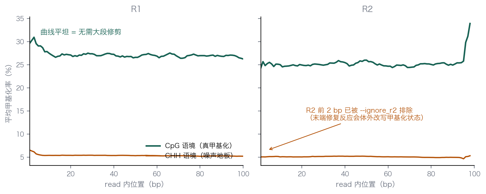{#fig-08-mbias-real}

本数据曲线整体平坦（CpG 稳定在 25%–30%，CHH 稳定在 5%–6%），说明没有需要修剪的末端偏差；R2 前两位的体外改写已在命令中排除。如果曲线末端翘起或塌陷，就用 `--ignore` / `--ignore_3prime` 把失真区段剪掉再重新提取——与第 3 章"先看质控图再决定修剪策略"是同一个习惯。

meth_extract/ 目录下的输出用途不同，后续分析都会用到：

| 文件 | 内容 | 用途 |
| :-- | :-- | :-- |
| `*.bismark.cov.gz` | 每个位点的坐标、甲基化百分比、甲基化/未甲基化 read 数 | 8.3 定量分析的输入；IGV 可直接加载 |
| `*.bedGraph.gz` | 坐标 + 甲基化百分比 | 基因组浏览器轨迹 |
| `*CpG_report.txt`（`--cytosine_report` 生成） | 全基因组每个 CpG：坐标、链、计数、三碱基语境 | 逐位点全表；文件很大（本子集约 1.2 GB），包含未覆盖位点（计数为 0） |
| `CpG_OT/OB、CHG_OT/OB、CHH_OT/OB.txt` | 按语境与方向分开的原始计数 | 检查 OT/OB 平衡、特定语境分析 |
| `*splitting_report.txt` | 各语境的计数汇总 | 报告与记录 |
| `*M-bias.txt` | M-bias 数据 | 画 @fig-08-mbias-real |

至此，Bismark 已将 FASTQ 转为逐位点计数表。8.3 节将使用这张表进行定量与差异分析。

## 甲基化定量与差异甲基化区域 {#sec-08-03}

8.2 的输出是一张位点计数表；本节回答三个问题：哪些位点的比例可信（8.3.1），样本整体长什么样（8.3.2），两组之间的差异如何统计（8.3.3–8.3.4）。

### 从 coverage 到可信位点：比例与置信区间 {#sec-08-03-coverage}

无论数据来自我们自己的 bismark 链（`bismark.cov`）还是论文处理表，一个甲基化位点的原始信息都只有两个数：覆盖 reads 数 $N$ 与其中读作"甲基化 C"的条数 $X$。位点比例的估计就是：

$$\hat{p} = \frac{X}{N}$$ {#eq-08-methy-ratio}

同样的比例估计，背后的覆盖条数可以差很多。把去重并避免双端重叠重复计数后的有效观测近似看作独立伯努利试验，$X \sim \mathrm{Binomial}(N,p)$，就可以用 Clopper–Pearson 精确法计算双侧 95% 置信区间。读 @fig-08-binom-ci 时，先看每行的 C 计数与覆盖条数，再看圆点和横线：圆点是观察到的比例，横线是置信区间。

A 图中，$3/5$、$30/50$、$300/500$ 都等于 60%，但区间分别约为 14.7%–94.7%、45.2%–73.6%、55.6%–64.3%。覆盖越高，抽样不确定性越小，估计越精确。B 图则说明为什么“没有观察到 C”不等于“真实比例确定为零”：$0/5$ 的区间仍为 0%–52.2%，$0/30$ 的区间为 0%–11.6%。这些区间只描述二项抽样的不确定性，不包含转化误差或生物学重复之间的差异。

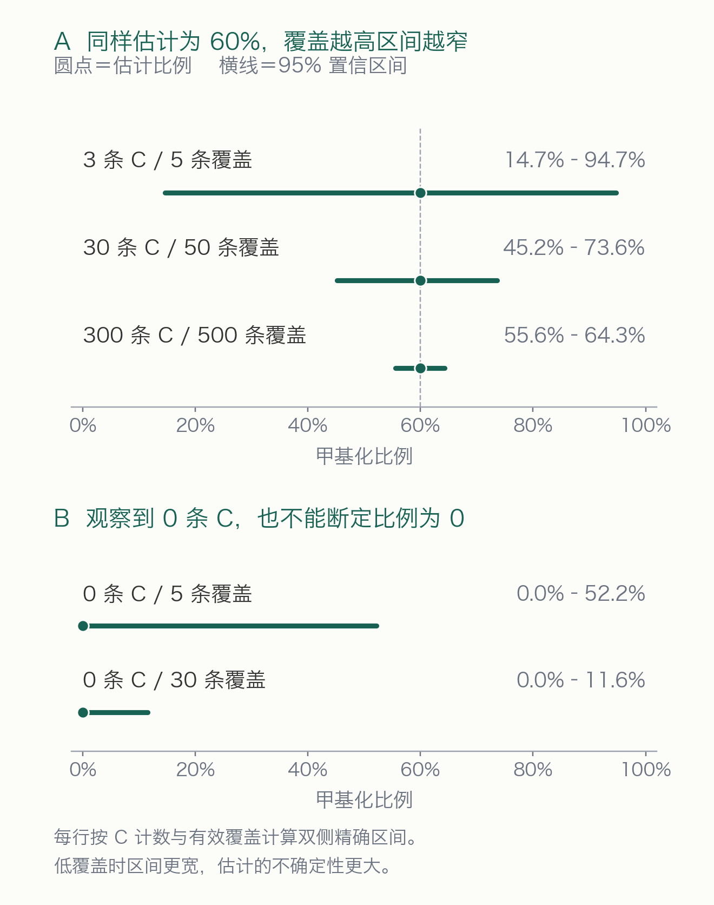{#fig-08-binom-ci width="600"}

除了抽样噪声，甲基化数据还有一层**下限噪声**：转化不完全的 C 会冒充甲基化。转化率 98% 时，一个真正 0% 甲基化的位点期望仍读到约 2% 的"甲基化"——所以低比例区间的解读要结合转化率（8.3.2 用空白对照实测）。

实践上由此得到两条过滤规则：**覆盖阈值**（常用 $N \geq 5$ 或 $\geq 10$，教学与正式分析按精度需求定）；**比例解读阈值**（低于转化残留下限的读数一律不当作信号）。本章后续分析取 $N \geq 5$。

### 全局甲基化水平：样本画像与一个公共数据陷阱 {#sec-08-03-global}

进入差异分析前，先看每个样本的整体水平——这是甲基化版的"样本探索"（对应第 5 章 5.5 的 PCA 之前先看库总量）。把所有 CpG 位点按覆盖加权平均，就得到全局 CpG 甲基化水平。对 GSE67867 的三个样本（论文随文的 QuasR 处理表，仅含 CpG、双链计数已合并；@tbl-08-global-methylation）：

| 样本 | 覆盖加权全局 CpG 甲基化 |
| :-- | :-- |
| toSerum（血清培养野生型） | 68.5% |
| to2i（2i 培养野生型） | 25.1% |
| TKO（Dnmt 三敲） | 2.9% |

: 三个样本的全局 CpG 甲基化水平（全表覆盖加权；mm9） {#tbl-08-global-methylation}

三个数值反映了不同条件下的甲基化状态（@fig-08-global-methylation 左）：血清培养的胚胎干细胞保持高甲基化；换成 2i 培养基后整体去甲基化（约 68% → 25%，对应 8.1.2 说的发育重编程在体外的重演）；把三个 DNMT 全部敲掉，甲基化几乎归零。右边逐位点的对比图更直观：约 1200 万个两样本共有 CpG 里，大量位点从血清中的高比例降到 2i 中的低比例——**全基因组尺度的去甲基化**，而不是少数位点的事件。

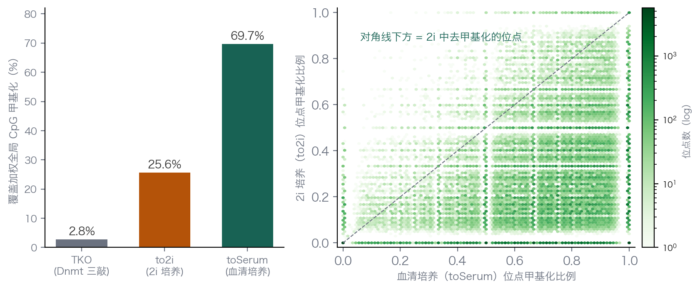{#fig-08-global-methylation}

TKO 的 2.9% 还有一个分析学用途：它是**空白对照**。Dnmt 全敲后真实甲基化接近零，残余的 2.9% 主要就是转化不完全等噪声的贡献——这套数据的有效转化率约 97% 或更高（8.2 快速链测到的 CHH 约 5% 偏高，包含了低质量碱基与末端效应的贡献，两个口径合起来把真实转化率夹在 95%–97% 之间）。

::: {.callout-warning .book-warning title="注意｜先查 Genome_build，再碰公共数据"}

这批处理表给我们的第一个教训不是生物学，而是坐标系：GEO 页面写明 `Genome_build: mm9`（QuasR 处理），而 8.2 我们自己的链用的是 mm10。把 mm9 的位点坐标拿去和 mm10 的基因注释对齐，每个位点都会落到错误的位置——而且**不会报错**，只会悄悄产出完全错误的结果。本节因此分两条口径处理：8.2 的 bismark 链（mm10）负责流程教学，本节的全局与差异分析用论文的 mm9 处理表、只与 mm9 注释配对。拿到任何公共处理数据，第一件事确认参考版本；同一个项目里出现两个版本时，明确每张表属于哪个版本。

:::

### 差异的统计单位：从 DML 到 DMR {#sec-08-03-dml-dmr}

两组样本间"这个位点甲基化变了吗"的检验，直觉模型仍然是 8.5.4 用过的两比例比较（比较两组各自的 @eq-08-methy-ratio）——但甲基化数据有两个特殊之处，直接套 Fisher 检验会出问题：

第一，**过度离散（overdispersion）**。reads 不是独立的伯努利试验：同一个分子克隆的 reads 相关、细胞的甲基化状态本身有异质性。实测方差常大于二项分布的预期，直接按二项模型检验，p 值会偏小。

第二，**单位选择**。单个 CpG 的覆盖通常只有几到几十条，单个位点的置信区间较宽；但相邻 CpG 的甲基化高度相关——差异往往以区域为单位出现（启动子、CpG 岛）。把相邻位点的证据聚合起来，既提高统计功效，也更贴近"差异发生在调控区域"的生物学问法。

由此形成两级统计单位：

- **DML（differentially methylated locus，差异甲基化位点）**：逐位点检验，模型用 β-二项分布吸收过度离散（DSS 的做法），并可用平滑借用相邻位点信息；
- **DMR（differentially methylated region，差异甲基化区域）**：把显著且方向一致的相邻 DML 连成区域（参数如最少 CpG 数、最小长度、合并距离），报出"哪一段、差多少、朝哪个方向"。

判断"差异"时还要同时看**幅度**：统计显著但差 2% 的位点，在 68% 对 25% 的全局背景下几乎肯定不是主要变化。DSS 的 `callDML`/`callDMR` 都接受一个 $\delta$ 参数（如 0.1 表示至少差 10 个百分点）——把"统计上检出"与"幅度上重要"分开声明，是报告差异分析时需要说明的区别。

需要注意，本数据每个条件只有**一个** WGBS 样本，DSS 在无重复时依靠经验先验估计离散度，检验的可信程度受到限制；正式研究需要生物学重复。我们把它当作"流程与解读"的教学案例，而不是这项具体数据的最终结论。

### DSS 实战：to2i 对 toSerum 的差异甲基化 {#sec-08-03-dss}

分析用 DSS（Bioconductor 的 R 包，为无重复与少重复甲基化数据设计的 β-二项模型）。输入正是 8.3.2 的合并表，`makeBSseqData` 要求的 `chr/pos/N/X` 四列与它天然对齐——这也提醒我们：**拿到公共处理表先看列定义**，QuasR 的 `nTot/nMeth` 与 Bismark 的 `countM/countU` 说的本来就是同一件事。

```{.r .numberLines data-book-role="code"}
library(DSS)
d <- read.delim("cpg_mm9.tsv")   # chr pos N_to2i X_to2i N_toSerum X_toSerum ...

# 两个样本各做成一个 chr/pos/N/X 数据框，N=覆盖、X=甲基化计数
bsseq <- makeBSseqData(
  list(data.frame(chr = d$chr, pos = d$pos, N = d$N_to2i,    X = d$X_to2i),
       data.frame(chr = d$chr, pos = d$pos, N = d$N_toSerum, X = d$X_toSerum)),
  c("to2i", "toSerum"))

# 逐位点检验：beta-binomial + 平滑借用相邻位点信息
dml <- DMLtest(bsseq, group1 = "toSerum", group2 = "to2i",
               smoothing = TRUE)

dmls <- callDML(dml, delta = 0.1, p.threshold = 1e-5)   # DML
dmrs <- callDMR(dml, delta = 0.1, p.threshold = 1e-5,
                minCG = 5, minlen = 50, dis.merge = 500) # DMR
```

12,386,781 个共有 CpG 进入检验，检出的差异数量很多：

```{.text data-book-role="output"}
DML (|diff|>0.1, p<1e-5):  6121903
DMR:                       376237
DMR direction:  toSerum > to2i:  376231    to2i > toSerum:  6
```

约一半的 CpG 是 DML、37 万多个 DMR——如果预期只有少数调控元件发生 focal 变化，这样的数量就明显异常；但本数据的背景是：**2i 诱导的是全基因组尺度的去甲基化**（8.3.2 的 68% → 25%），差异不是零星位点，而是大片区域的甲基化比例整体下降。差异方向的不对称也支持这一判断：376,231 个 DMR 朝"血清高于 2i"的方向，只有 6 个反向——写入酶撤走、培养条件切换只会单向地擦除甲基化，反向的 6 个更接近检验噪声。

这个例子提醒我们，**DMR 数量本身没有固定好坏，必须放回生物学语境**。局灶性变化的研究（比如某个转录因子敲除后数百个 DMR）里，37 万个 DMR 意味着流程或分组出了问题；全基因组重编程的研究里，它就是预期结果。区分两者的依据不是统计阈值，而是 8.3.2 那张全局画像。

@fig-08-dmr-example 放大一个具体的 DMR：chr14 上约 260 bp 的区域，8 个 CpG 在血清样本中平滑比例稳定在 96%–97%，2i 样本中降到 5%–7%，差约 91 个百分点。逐位点看，两条曲线的形状高度平行——区域级的"整体下移"，正是区域聚合统计想要捕捉的形态。

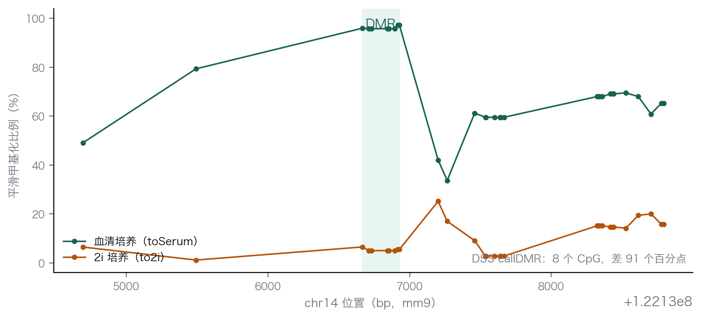{#fig-08-dmr-example}

结果到此，"哪里有差异"有了答案；"差异意味着什么"则要接着问位置——DMR 落在启动子、增强子还是基因体？与第 6 章 NRF1 的结合变化是否吻合？这些注释型问题用第 6 章的区间交集工具（`bedtools intersect` 等）接在本表之后即可，本章不再展开，但 8.6.2 的跨层整合会回到这条链上。

## RNA 上的甲基化修饰 {#sec-08-04}

从 DNA 转到 RNA：修饰的种类更多，定量更难，直到最近几年才有了单碱基的答案。

### mRNA 上的修饰版图：m6A、m1A、m6Am 与 m5C {#sec-08-04-modification-landscape}

转向 RNA 修饰时，需要先注意：**mRNA 上的修饰研究比 DNA 更"年轻"，也更容易被技术假象误导**。认识它们要从化学结构开始——修饰之间的差别往往就是碱基环上的一两个甲基，但位置不同，化学后果完全不同。@fig-08-rna-modification-landscape 沿一条 mRNA 摆放了主要修饰的结构式，请对照它逐个认识。

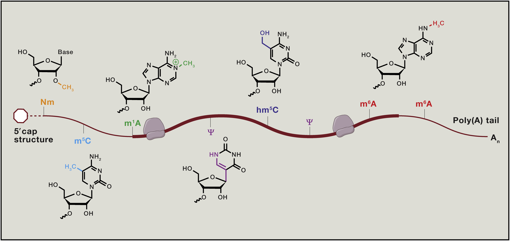{#fig-08-rna-modification-landscape}

- **m6A（N6-甲基腺嘌呤）**：结构上看，腺嘌呤环**外侧** 6 位氨基上的一个氢被甲基取代（N6 位）。这个位置不参与 Watson–Crick 配对——所以 m6A 不破坏 A:U 配对，却改变了碱基的氢键供体格局，让 YTH 结构域这类"读取器"能够专门识别它。m6A 是 mRNA 上最丰富的内部修饰，约占全部腺苷的 0.2%–0.6%[^roundtree-2017]，几乎只出现在 DRACH 基序（D=A/G/U，R=A/G，H=A/C/U）中，沿转录本富集在终止密码子附近和 3′ 非翻译区[^dominissini-2012][^meyer-2012]。它是本章 RNA 线的主角。
- **m6Am**：结构上是"双重修饰"——帽子后**第一个转录核苷酸**的腺嘌呤既有 N6 甲基（与 m6A 同位），核糖 2′-O 又有一个甲基（2′-O-甲基化，即 Nm）。它由写入酶 **PCIF1**（又称 CAPAM）催化[^akichika-2019][^sendinc-2019]。离转录起始只有一两个核苷酸，与内部 m6A 的调控语境完全不同；定量研究显示它的修饰比例（化学计量）通常远高于内部 m6A——这一点在 8.5 讨论"修饰比例"时是一个重要对照。它也是 FTO 底物偏好争议的主角（8.4.2）。
- **m1A（N1-甲基腺嘌呤）**：甲基加在腺嘌呤环**内侧**的 N1 位——这个位置恰好参与 Watson–Crick 配对，所以 m1A 会干扰配对、拖慢翻译和逆转录。这一化学性质直接关联它的检测争议：mRNA 上是否存在丰富、动态的 m1A 曾引起很大争论——2016 年有研究宣称 5′UTR 区域存在大量动态 m1A，随后的单碱基图谱显示胞质 mRNA 中 m1A 稀少、主要见于线粒体 mRNA[^safra-2017]，而 5′UTR 的"m1A 信号"大部分被证明是**抗体交叉反应造成的假象**[^grozhik-2019]。
- **m5C（5-甲基胞嘧啶）**：结构与 DNA 的 5mC 相同——胞嘧啶环 5 位碳上的甲基。这决定了它的检测方式：RNA 的 m5C 恰好可以用与 DNA 完全相同的亚硫酸盐化学来测，是"碱基不平衡"思想最早的 RNA 应用。它在 mRNA 上含量很低，在 tRNA 中则非常丰富[^squires-2012]。

::: {.callout-warning .book-warning title="注意｜抗体是把双刃剑"}

m1A 的争议提示我们：**抗体免疫沉淀类方法给出的是"富集信号"，不是化学鉴定**。抗体可能在结构相似的修饰之间交叉反应，甚至与非特异 RNA 结合；把 IP 富集峰直接解读为某种修饰的存在，在多个修饰领域都曾导致错误判断。用无抗体的化学转化法（如 GLORI）或用合成 RNA 对照做系统性校准，是避免这类错误的两条路[^zhang-2021-calibration]。

:::

### m6A：含量最丰富、研究最热的修饰 {#sec-08-04-m6a-biology}

m6A 在 1974 年就已从 mRNA 中被发现[^desrosiers-1974]，此后沉寂了近四十年——已知存在、不知意义，因为没有人知道这个修饰能不能被动态调控。转折点来自华人科学家何川实验室：2010 年他提出"RNA 表观遗传学"（RNA epigenetics）的概念框架[^he-2010-concept]；2011 年，贾桂鑫等发现肥胖风险蛋白 **FTO 对 RNA 中的 m6A 具有去甲基化活性**[^jia-2011]——甲基化可以被"擦除"，说明它是一个可逆的、有调控潜力的标记，而不只是化学惰性的装饰。这项开创性工作推动了表观转录组学的发展。（后续研究又补充了这一认识：后来研究发现 FTO 对帽子区的 m6Am 活性其实更高[^grozhik-2017]，但它确立的"RNA 甲基化可逆"的概念已经成为领域基石。）2012 年，两个团队独立绘制了首张转录组范围的 m6A 图谱：Dominissini 等与 Meyer 等分别以抗体免疫沉淀加测序（m6A-seq / MeRIP-seq）发现 m6A 富集于数千个转录本的终止密码子附近与 3′UTR[^dominissini-2012][^meyer-2012]。

此后，参与 m6A 调控的分子机制逐渐明确，习惯上用三个角色概括：

- **写入器（writer）**：METTL3–METTL14–WTAP 等组成的甲基转移酶复合体，伴随转录在核内给 DRACH 基序加甲基；**只有 METTL3 具有催化活性**，METTL14 起结构支撑与底物识别作用[^roundtree-2017]。
- **擦除器（eraser）**：FTO 和 ALKBH5 两个去甲基化酶（上文提到的 FTO 即其一）。
- **读取器（reader）**：YTH 结构域家族蛋白（YTHDF1/2/3、YTHDC1/2 等）识别 m6A 并决定下游命运——影响翻译效率、mRNA 稳定性或剪接输出[^zaccara-2019]。

::: {.callout-note .book-core title="核心知识｜写入—擦除—读取"}

修饰调控的通用框架：**写入器**建立修饰，**擦除器**移除修饰，**读取器**结合修饰并把化学标记翻译成生物学后果。三个角色齐备，修饰才构成一个可调控的信息层。这个框架同样适用于 DNA 甲基化（DNMT 写入、TET 介导的氧化移除、甲基结合蛋白读取），是本章两条线共用的组织方式。

:::

还记得第 5 章的示例项目吗——METTL3 敲降的 HEK293T 细胞 vs 对照，各两个重复的 RNA-seq。当时我们看到的是**表达层**：写入酶减少后，一批基因的 mRNA 水平变化了。但表达变化是修饰变化的**下游表型之一**：METTL3 敲低后，哪些转录本的哪些位点失去了修饰？修饰比例从多少降到多少？这些问题表达谱答不了——要逐位点读出 m6A 的"含量"，需要 8.5 的 GLORI 数据。第 5 章与本章因此构成同一生物学干预的两层观测：表达层与修饰层。

### m6A 测序技术发展：从富集到单碱基定量 {#sec-08-04-m6a-methods}

从 2012 年的抗体富集到今天，m6A 测序走过了一条"分辨率从模糊到单碱基、信息从有无到定量"的路。@tbl-08-m6a-methods 按时间顺序列出主要方法。

| 方法（年份） | 原理 | 分辨率 | 能否定量修饰比例 | 主要局限 |
| :--- | :--- | :--- | :--- | :--- |
| m6A-seq / MeRIP-seq（2012） | m6A 抗体免疫沉淀富集片段，测 IP/Input 富集 | 约 100–200 nt | 不能，只给"哪里富集" | 抗体依赖；分辨率受限[^dominissini-2012][^meyer-2012] |
| miCLIP（2015） | 抗体交联诱导截断/突变定位 | 名义单碱基 | 难以给出计量 | 抗体依赖、位点偏置[^linder-2015] |
| DART-seq（2019） | APOBEC1–YTH 融合蛋白在 m6A 附近诱导 C→U 编辑，无需抗体 | 簇级/近单碱基 | 不能直接定量 | 融合蛋白表达与编辑效率影响信号[^meyer-2019-dart] |
| m6A-REF-seq / MAZTER-seq（2019） | MazF 核酸酶在 ACA 位点的切割被 m6A 阻碍 | 单碱基 | 可相对定量 | 只覆盖 ACA 基序中的 m6A[^zhang-2019-mazf] |
| eTAM-seq（2023） | 进化 TadA 脱氨酶把未修饰 A 转为 I | 单碱基 | 部分 A 位点可定量 | 脱氨不完全，计量需校正[^tang-2023-etam] |
| **GLORI（2022/2023）** | 乙二醛+亚硝酸盐化学脱氨（见下文） | **单碱基** | **绝对定量** | 需要高深度；SNP 混杂必须排除[^liu-2023-glori] |

: m6A 测序方法的发展：从富集到单碱基定量 {#tbl-08-m6a-methods}

富集法只回答"哪里有"，回答不了"有多少"——IP 富集倍数取决于抗体亲和力、片段长度和表达量，换算不出修饰比例。真正做到**单碱基分辨 + 绝对定量**的是北大伊成器、王晶团队合作发展的 **GLORI**（GlyoxaL and nitrIte-mediated deamination）[^liu-2023-glori]，它的化学原理（@fig-08-glori-chemistry）与前文介绍的转化思路相近：

- **乙二醛（glyoxal）**先与 m6A（以及鸟嘌呤 G）形成稳定的环状加合物，**保护**它们不被后续反应破坏；
- **亚硝酸盐**在酸性条件下把所有**未修饰的 A 脱氨**为次黄嘌呤 I——PCR 和测序时读作 **G**；
- 于是 m6A 位点表现为 reads 中**残留的 A**：某个位点上 A 占 (A+G) 的比例，就是该位点 m6A 修饰比例的直接估计。

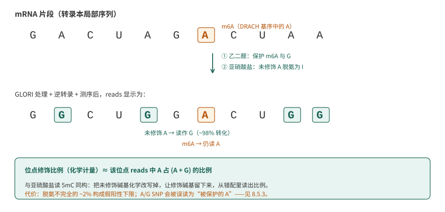{#fig-08-glori-chemistry}

GLORI 的未修饰 A 脱氨效率约为 98%，论文自述"概念上与亚硫酸盐定量 DNA 5mC 同构"——把未修饰碱基化学改写掉、让修饰碱基留下来，再从测序错配里读出比例。这正是 8.1 定义过的"碱基不平衡"在 RNA 上的重演：C→T 换成了 **A→G**。后续的低输入版本（GLORI 2.0/3.0）已能从数千甚至数百个细胞做甲基化组[^sun-2025-glori2]。8.5 将沿一条真实的 GLORI 数据走完它的分析链——你会看到三字母比对、转化率、SNP 排除这些 8.2 的思想如何一一复用。

## GLORI 数据分析 {#sec-08-05}

沿用 8.2 节的分析思路，先了解 RNA 数据的特点，再进行质控、定量、差异分析和结果解读。

### 示例数据与整体路线 {#sec-08-05-example-data}

RNA 线的示例数据来自 GLORI 原论文（Liu 等，2023）随文发布的 GEO 数据集 **GSE210563**[^liu-2023-glori]。论文在多个细胞系与处理条件下做了 GLORI 文库；本章选取其中一组设计完整的敲低实验：HeLa 细胞中用 siRNA 敲低写入酶 **METTL3**，与转对照 siRNA 的对照相比，各两个生物学重复（@tbl-08-glori-samples）。

| 样本 | 登记号 | 文库 | 重复 |
| :-- | :-- | :-- | :-- |
| siMETTL3-1 / siMETTL3-2 | GSM6432607 / GSM6432608 | GLORI（35 bp 读长） | METTL3 敲低，2 个 |
| Hela-siNC-1 / Hela-siNC-2 | GSM6432627 / GSM6432628 | GLORI（35 bp 读长） | 对照 siRNA，2 个 |

: 本章 RNA 线示例样本（GSE210563，HeLa，hg38 坐标） {#tbl-08-glori-samples}

这组数据与第 5 章构成呼应：第 5 章在 HEK293T 中分析了 METTL3 敲低的**表达层**（RNA-seq 的 counts 与差异表达），本章在 HeLa 的 GLORI 数据中读**同方向干预的修饰层**——写入酶减少后，哪些位点的 m6A 比例下降了。注意口径：两层观测来自不同细胞系的两项研究，是同一生物学问题的平行印证，不是同批样本的两端；结合两层结果，可以更完整地观察干预后的分子变化。

分析路线与 8.2 的 BS-seq 链一一对应（@fig-08-glori-pipeline）：

- **原始数据质控**：FastQC 看碱基组成——GLORI 文库的 reads 中 A 应当大规模消失（8.5.2）；
- **比对**：reads 与参考基因组（STAR，剪接感知，因为测的是 mRNA）比对、去重；
- **逐位点计数**：每个 A 位点统计 reads 中的 A 与 G，得到修饰比例；
- **位点过滤**：覆盖深度、已知的 A/G SNP 位点排除（8.5.3）；
- **定量与差异**：组内重复一致性、组间逐位点检验（8.5.4）。

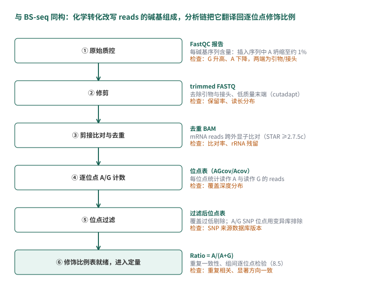{#fig-08-glori-pipeline}

这里先说明实际分析范围：本章从论文提供的**位点级处理表**（GEO 随文补充文件，每个样本约 6.2–6.5 万个检出位点）开始做定量与差异分析，这一步是实测运行；从 FASTQ 到位点表的 GLORI-tools 完整流程（STAR 比对、去重、位点统计与过滤）本章按官方文档介绍其步骤与关键参数（文档级演示），没有逐条运行——它需要人类基因组的 STAR 索引与较长机时，而其每一步的输出正是我们手上这张表。对任何公共数据，先看作者提供了哪一级的处理结果、从哪一级接手分析，都是第一个要回答的问题。

### 文库质控：A 的坍缩与转化率 {#sec-08-05-qc}

GLORI 文库的第一眼质控就是第 3 章 FastQC 的"每碱基序列含量"（Per base sequence content）模块——但要带着完全不同的预期去看。取数据集中一个 GLORI 文库（293T 细胞，SRR21356251）的前约 79 万条 reads，逐位置统计四种碱基的比例（@fig-08-glori-basecomp）：

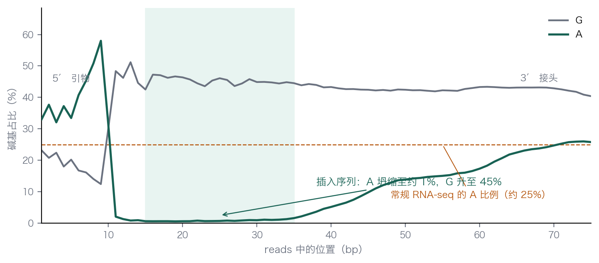{#fig-08-glori-basecomp}

- **第 1–9 位**：A 占 33%–58%，四碱基大致正常——这是逆转录引物序列，体外合成的普通 DNA，**不经过脱氨反应**；
- **第 15–35 位（插入序列）**：A 降到 **0.6%–1.1%**，G 升到 43%–46%——这正是化学转化的直接证据：未修饰的 A 被脱氨成了 I，测序读作 G；残留下来的那一点 A，就是未转化完全的部分加上真正的 m6A；
- **第 41 位之后**：A 比例逐渐回升到 25% 左右——reads 读穿插入序列、进入了 3′ 接头，接头同样是未脱氨的合成序列。

对照组的常识来自第 3 章：普通 RNA-seq 文库中 A 约占 25%–28%，四种碱基大致平稳。两相对照，"A 的坍缩"就是 GLORI 版的转化质控：插入序列中 A 越少，转化越彻底。论文用不经化学处理的 GLORI⁻ 对照文库做了同样的统计，估计未修饰 A 的脱氨效率约 **98%**，并由此给出修饰比例的检出下限——每 100 条覆盖里，约 1–2 条会"假装"携带 m6A。这与 BS-seq 里转化率质控的逻辑完全一致（8.2.6 的噪声地板、8.3.2 的空白对照），只是从 C→T 换成了 A→G。

::: {.callout-note .book-core title="核心知识｜两端序列会“骗人”"}

reads 的两端是引物与接头——它们是体外合成的普通核酸，不参与化学转化，碱基组成正常；中段的插入序列才携带转化信号。把"每碱基序列含量"图上的正常两端误读为"转化失败"，或者反过来忽略两端、直接对整条 read 统计碱基组成，都会得到错误的转化率估计。第 3 章学的"先认清 reads 里每一段是什么"，在这里直接决定了质控结论。

:::

### 从 reads 到位点修饰比例：流程与输出 {#sec-08-05-pipeline}

GLORI-tools（官方 Python3 流程，GitHub 上开源）把 8.5.1 的中间步骤串成一条链：接头与质量修剪 → **STAR** 比对到参考基因组（剪接感知，需 ≥2.7.5c 版本；这里测的是 mRNA，跨越外显子边界的 reads 必须通过剪接感知比对来处理，与第 5 章相同）→ 按坐标排序与去重 → 对每个 A 位点统计 reads 中的 A 与 G → 一系列过滤与检验。其中两道过滤值得单独理解：

- **覆盖深度过滤**：修饰比例是 A/(A+G) 的比值，覆盖太低的位点比值方差极大；
- **SNP 位点排除**：基因组上本来就该是 G 的位点（A/G 杂合 SNP 中来自 G 等位基因的 reads）会与"脱氨成 G"产生完全相同的数据形态——单靠一个样本无法区分，必须借助 dbSNP 等已知变异数据库把这类位点剔除（@fig-08-snp-confounding）。这不是 GLORI 特有的麻烦：BS-seq 同样要面对 C/T SNP 与甲基化信号的混淆，思路一致——**用独立来源的变异信息给化学信号划界**。

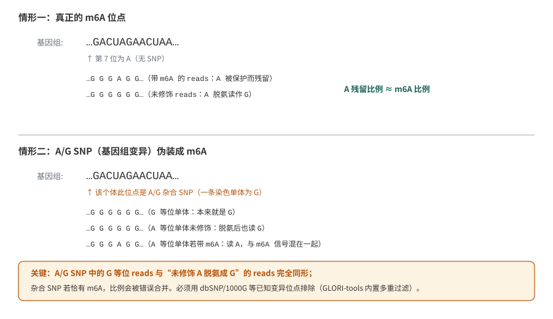{#fig-08-snp-confounding}

流程对每个样本输出一张位点表，即我们拿到的处理表。对我们后续分析最要紧的几列如下（@tbl-08-glori-columns，其余辅助列从略）：

| 列 | 含义 |
| :-- | :-- |
| `Chr` / `Sites` / `Strand` | 位点坐标（hg38）与链 |
| `Gene` | 位点所在基因 |
| `AGcov` | 该位点覆盖 reads 数（A 与 G reads 之和）——相当于"深度" |
| `Acov` | 其中读作 A 的 reads 数 |
| `Ratio` | 修饰比例估计 = `Acov`/`AGcov` |
| `Pvalue` / `P_adjust` | 该位点 Ratio 显著大于转化残留的检验（FDR 校正后） |

: GLORI-tools 位点表中与定量分析直接相关的列 {#tbl-08-glori-columns}

注意 `Ratio` 一列的口径：它是"检出位点表"内部的修饰比例，表里的位点已经通过了一轮质控与检验，并不是全转录本所有 A 位点的随机样本。下一小节的结论也只适用于这一检出位点集合。

### 位点定量与敲低效应：真实数据分析 {#sec-08-05-quantify}

现在把四个样本的处理表读进 R，做本章 RNA 线的核心分析。逐条逻辑都能在 8.3 的 DNA 线找到对应：合并与覆盖过滤对应"从 coverage 到可用位点"，重复相关性对应样本一致性检查，逐位点检验对应 DML 的思想——只是检验的信号从"C 读成 T 的比例"换成了"A 读作 G 的比例"。

```{.r .numberLines data-book-role="code"}
# 读入四个样本的位点表（GEO GSE210563 处理表，tab 分隔）
read_glori <- function(path) {
  d <- read.delim(gzfile(path), sep = "\t")
  d$key <- paste(d$Chr, d$Sites, d$Strand, sep = ":")
  d[, c("key", "Chr", "Sites", "Strand", "Gene", "AGcov", "Acov", "Ratio")]
}
si3.1 <- read_glori("GSM6432607_siMETTL3-1_35bp_m2.totalm6A.FDR.csv.gz")
si3.2 <- read_glori("GSM6432608_siMETTL3-2_35bp_m2.totalm6A.FDR.csv.gz")
nc.1  <- read_glori("GSM6432627_Hela-siNC-1_35bp_m2.totalm6A.FDR.csv.gz")
nc.2  <- read_glori("GSM6432628_Hela-siNC-2_35bp_m2.totalm6A.FDR.csv.gz")

# 按位点合并，要求四个样本覆盖都 >= 10
m <- merge(merge(si3.1, si3.2, by = "key", suffixes = c(".si31", ".si32")),
           merge(nc.1,  nc.2,  by = "key", suffixes = c(".nc1",  ".nc2")),  by = "key")
m <- m[m$AGcov.si31 >= 10 & m$AGcov.si32 >= 10 &
       m$AGcov.nc1  >= 10 & m$AGcov.nc2  >= 10, ]
```

四个样本各自检出 61,872–65,488 个位点，合并后**在四个样本中都有足够覆盖的位点共 34,585 个**，进入后续比较。第一步先看重复：把两个 siNC 重复的 `Ratio` 画散点，算 Pearson 相关（`cor()`）——得到 **r = 0.936**；siMETTL3 组内为 **r = 0.967**（@fig-08-glori-scatter 左）。两个重复在逐位点的修饰比例上高度一致，这张图是后续一切组间比较的前提，作用与第 5 章的样本相关性热图相同。

组间比较用最直接的模型：每个位点把两个条件各自的 A/G 计数汇总成 2×2 列联表，做 Fisher 精确检验，再用 BH 方法做全表多重校正。

```{.r .numberLines data-book-role="code"}
# 组内合并计数：A = sum(Acov)，G = sum(AGcov - Acov)
A_nc <- m$Acov.nc1 + m$Acov.nc2
G_nc <- (m$AGcov.nc1 - m$Acov.nc1) + (m$AGcov.nc2 - m$Acov.nc2)
A_si <- m$Acov.si31 + m$Acov.si32
G_si <- (m$AGcov.si31 - m$Acov.si31) + (m$AGcov.si32 - m$Acov.si32)

pv <- sapply(seq_len(nrow(m)), function(i) {
  fisher.test(matrix(c(A_nc[i], A_si[i], G_nc[i], G_si[i]), nrow = 2))$p.value
})
m$fdr  <- p.adjust(pv, method = "BH")
m$ratio_nc <- A_nc / (A_nc + G_nc)     # 组内合并的修饰比例
m$ratio_si <- A_si / (A_si + G_si)
```

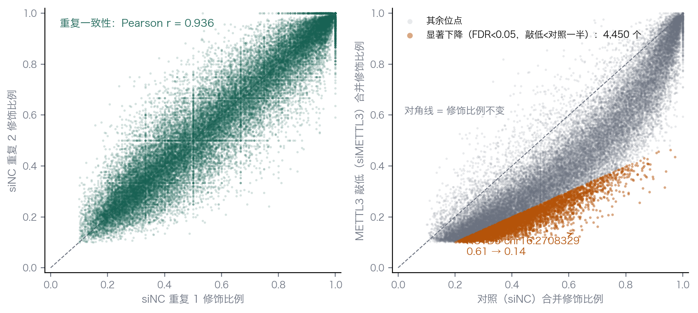{#fig-08-glori-scatter}

结果如下（@fig-08-glori-scatter 右）：

- **4,449 个位点**在敲低后修饰比例显著下降（FDR < 0.05 且降为对照的一半以下），而显著上升的只有 **16 个**——接近检验噪声的背景水平。写入酶被拿掉，修饰几乎只朝一个方向变化，这本身就是"信号真实"的旁证；
- 检出位点的修饰比例中位数从对照的 **0.57** 降到 **0.37**。注意口径：这是"检出位点集合"内部的中位数（表内位点已通过质控，天然偏高）；换算到全转录本所有腺苷，m6A 的平均丰度量级仍是 8.4 说过的 0.2%–0.6%。

看一个具体的位点：**KCTD5 基因 chr16:2,708,329（正链）**。对照两个重复中，139 条与 122 条覆盖里分别有 62.6% 与 59.8% 读作 A；敲低两个重复中，422 条与 390 条覆盖里只剩 14.0% 与 13.1%。合并后修饰比例从 **0.61 降到 0.14**（Fisher 检验 FDR ≈ 5×10⁻⁴⁷）。四个样本中近千条独立 reads 显示修饰比例一致下降，为这个位点的 m6A 依赖 METTL3 提供了支持。

```{.text data-book-role="output"}
gene        位点              nc1    nc2    si31    si32    fdr
KCTD5  chr16:2708329 (+)   0.626  0.598   0.140   0.131   5e-47
MNT    chr17:2386699 (−)   0.591  0.682   0.127   0.119   3e-09
```

::: {.callout-warning .book-warning title="注意｜修饰比例下降不等于表达下降"}

METTL3 敲低后修饰比例下降的位点，其宿主基因的表达未必变化——修饰的有无与 mRNA 的多少是两个层面。把第 5 章的表达差异表与本节的修饰差异表放在同一个基因上对齐（例如按基因取修饰变化最大的位点，再看该基因的 log2FC），才是"修饰变化是否伴随表达后果"的正确问法；即便两者都显著，要建立因果还需要时序或干预实验。8.6 会把这类跨层整合整理成清单。

:::

## IGV 复核、修饰整合与完整交付 {#sec-08-06}

完成 DNA 与 RNA 的分析后，还需要复核结果、整合不同层面的证据，并整理交付材料。

### 用眼睛复核：IGV 里的甲基化数据 {#sec-08-06-igv}

第 4 章学过的 IGV 直接支持甲基化数据。`bismark.cov` 文件从 File → Load 加载（IGV 会把它识别为甲基化轨迹），或者加载 `bedGraph`；基因组坐标要选对参考版本——8.2 的链用 mm10，8.3 的官方表用 mm9，两套坐标不能混看。加载后在感兴趣的区域（例如一个 DMR、一个基因的启动子）逐个检查：

- **两个样本的轨迹叠放对比**：血清样本条形高、2i 样本条形低的区域，正是全基因组去甲基化的局部写照。@fig-08-igv-methylation 用本章数据画了一个真实区域（chr13，mm9）：同一批 CpG 在血清样本中普遍读到 80% 以上，2i 样本大面积塌到 20% 以下，阴影标出的正是 DSS 检出的 DMR；
- **位点层面的比例与覆盖是否合理**：比例 100% 但覆盖只有 2 条 read 的位点，统计上几乎无信息；比例接近但覆盖悬殊的两个位点，置信区间完全不同（8.3.1 的直觉）；
- **抽查"明星位点"**：把统计表格里最显著的几个 DML/DMR 在 IGV 里找到，确认数据形态与结论一致——这是第 7 章"眼见为实"习惯在修饰数据上的延续。

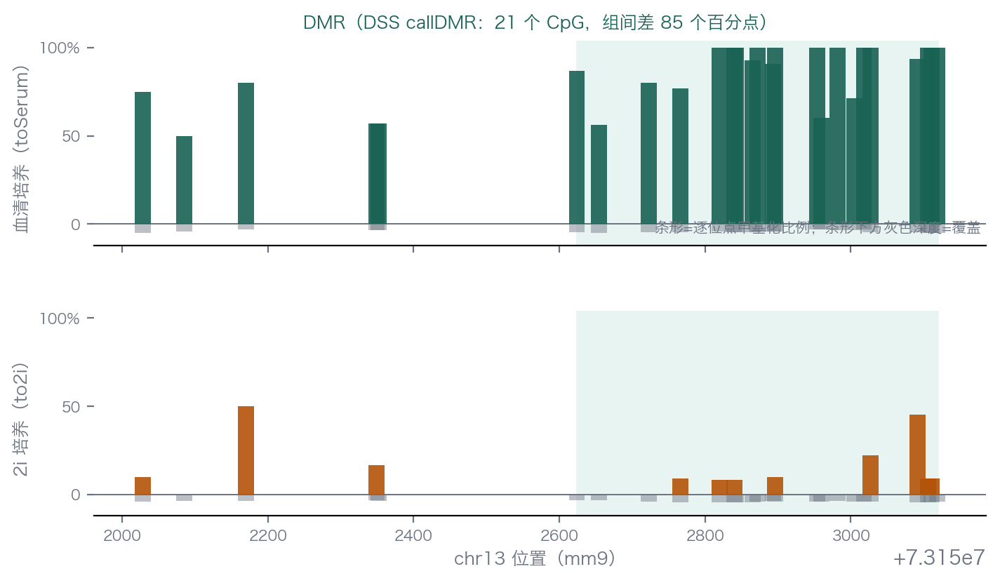{#fig-08-igv-methylation}

如果需要 read 层面的证据（某个位点的 reads 里究竟多少条读 C、多少条读 T），加载 Bismark 的 BAM 并结合 `XM` 标签过滤即可；多数场景下位点级轨迹已经足够，read 级抽查留给最关键的结论。

### 跨层整合：修饰、表达与功能证据 {#sec-08-06-integration}

本章两条线各自都停在"修饰比例变了"。要进一步解释这些变化，需要结合其他层面的数据：

- **RNA 线（m6A）**：把 8.5 的位点表按基因聚合（例如每个基因取修饰变化最大的位点），与第 5 章 METTL3 敲低的差异表达表按基因连接。修饰比例下降的位点其宿主基因表达是否变化、朝哪个方向变化——需要把两张表放在一起比较（8.5.4 的注意框展开操作）。注意连接的口径：修饰是位点级、表达是基因级，聚合方式本身就是一个要报告的分析决定。
- **DNA 线（5mC）**：回到第 6 章的 NRF1 竞争实验——同一批细胞（GSE67867）。本章看到 TKO 细胞 CpG 甲基化掉到约 3%，第 6 章看到 TKO 细胞里 NRF1 多结合了数千个甲基化受限位点。两个观测拼起来："甲基化消失 → 基序可及 → 转录因子结合增加"，跨章的证据链比任何单章都更接近因果。要再往下走一步（结合增加是否改变表达、改变哪些基因的表达），就需要把 DMR、DNase 峰与表达表三方对齐——每增加一层，口径与假名单就多一份，这正是整合分析的价值与风险所在。
- **证据分层**：修饰比例变化（化学计量证据）→ 结合/染色质变化（分子证据）→ 表达与表型变化（功能证据）。三层都齐，"修饰调控了功能"的解释才有相应证据支持；只有第一层时，结论应当停在"存在可检测的修饰变化"。

### 完整交付：把判断过程写成文字 {#sec-08-06-deliverables}

一份完整的碱基不平衡数据分析交付，除了备齐文件，还应把每一层判断**写成别人能复核的文字**。

交付的第一个层面是数据与参考的来历。参考基因组的版本与坐标系统要明确记录，并确认所有文件一致——本章就在同一路数据里同时存在 mm9 处理表与 mm10 比对结果，两套口径并行而不混用，靠的就是显式记录（8.3.2）。文库类型（方向性或非方向性）与相应的比对参数要落在方法里，因为它决定了哪些比对组合被允许。转化率质控必须随结果给出：lambda 外参的转化率，或非 CpG 语境的残余率，或像本章用 TKO 空白对照估出的上界——没有这一项，所有低比例读数都无法解读。位点过滤的标准同样要写进方法：最低覆盖取多少、SNP 排除用了哪个数据库的哪个版本。

第二个层面是过程与结果同交。比对率、去重率和 M-bias 检查不能只留在日志里，要作为结果的一部分随交付给出——它们为判断数据是否可信提供依据。统计口径要写清到可以被复现：检验模型、多重校正方法、差异阈值 δ 的取值与理由。生物学重复的情况要如实说明——本章的 WGBS 每组只有 1 个样本、GLORI 每组 2 个重复，得出的都是演示性结论，正式研究需按设计补足重复；读者需要知道这些限制，才能判断结论的适用范围。结果表本身应包含坐标、覆盖、比例与置信度信息，让他人在不重跑流程的情况下独立复核关键位点。

第三个层面是解读边界。报告要区分"检出的位点集合"与"全基因组口径"的统计差异（8.5.4 的中位数陷阱就是一例）；每个结论要落到基因组位置上说话——启动子、基因体、重复序列的甲基化含义并不相同（8.1.2）；修饰变化与功能结论之间的证据层级更要交代清楚（上一小节的三层证据）。

最后再检查几类在实际项目中常见的错误。最直接的是流程性错误：用 bwa mem 这类普通比对器直接处理 BS-seq，比对率崩塌或甲基化系统性偏移；用 picard 而非 `deduplicate_bismark` 去重，方向性文库的重复判定出错；M-bias 没看就提取，末端失真混进位点比例。更隐蔽的是口径性错误：把 mm9 的表与 mm10 的注释混用，注释悄无声息地全部错位；把 CHH/CHG 的"甲基化率"当生物学信号解读，而它主要是转化率的镜子。最隐蔽的是解释性错误：DMR 只报数量、不报方向与位置分布，回答不了"发生在哪里、意味着什么"；把 5hmC 丰富的样本的 BS-seq 信号直接说成 5mC，混淆了 8.1.3 讲过的修饰家族。

分析自己的项目时，也可以依次检查技术选型、数据处理、统计口径和证据边界：测的是什么，每一步的前提是否满足，比较以什么为单位，最后的结论能支持到什么程度。

[^bird-2002]: Bird A. DNA methylation patterns and epigenetic memory. *Genes Dev*. 2002;16(1):6–21. [原文链接](https://doi.org/10.1101/gad.947102)。
[^lyko-2018]: Lyko F. The DNA methyltransferase family: a versatile toolkit for epigenetic regulation. *Nat Rev Genet*. 2018;19(2):81–92. [原文链接](https://doi.org/10.1038/nrg.2017.80)。
[^tahiliani-2009]: Tahiliani M, et al. Conversion of 5-methylcytosine to 5-hydroxymethylcytosine in mammalian DNA by MLL partner TET1. *Science*. 2009;324(5929):930–935. [原文链接](https://doi.org/10.1126/science.1170116)。
[^ito-2011]: Ito S, et al. Tet proteins can convert 5-methylcytosine to 5-formylcytosine and 5-carboxylcytosine. *Science*. 2011;333(6047):1300–1303. [原文链接](https://doi.org/10.1126/science.1210597)。
[^he-2011-tet]: He YF, et al. Tet-mediated formation of 5-carboxylcytosine and its excision by TDG in mammalian DNA. *Science*. 2011;333(6047):1303–1307. [原文链接](https://doi.org/10.1126/science.1210944)。
[^deaton-bird-2011]: Deaton AM, Bird A. CpG islands and the regulation of transcription. *Genes Dev*. 2011;25(10):1010–1022. [原文链接](https://doi.org/10.1101/gad.2037511)。
[^reik-2007]: Reik W. Stability and flexibility of epigenetic gene regulation in mammalian development. *Nature*. 2007;447(7143):425–432. [原文链接](https://doi.org/10.1038/nature05918)。
[^smith-2012-embryo]: Smith ZD, et al. A unique regulatory phase of DNA methylation in the early mammalian embryo. *Nature*. 2012;484(7394):339–344. [原文链接](https://doi.org/10.1038/nature10960)。
[^seisenberger-2012]: Seisenberger M, et al. The dynamics of genome-wide DNA methylation reprogramming in mouse primordial germ cells. *Mol Cell*. 2012;48(6):849–862. [原文链接](https://doi.org/10.1016/j.molcel.2012.11.001)。
[^church-2014]: Church TR, et al. Prospective evaluation of methylated SEPT9 in plasma for detection of asymptomatic colorectal cancer. *Gut*. 2014;63(2):317–325. [原文链接](https://doi.org/10.1136/gutjnl-2012-304149)。
[^shen-2018]: Shen SY, et al. Sensitive tumour detection and classification using plasma cell-free DNA methylomes. *Nature*. 2018;563(7732):579–583. [原文链接](https://doi.org/10.1038/s41586-018-0703-0)。
[^liu-2020-galleri]: Liu MC, et al. Sensitive and specific multi-cancer detection and localization using methylation signatures in cell-free DNA. *Ann Oncol*. 2020;31(6):745–759. [原文链接](https://doi.org/10.1016/j.annonc.2020.02.011)。
[^frommer-1992]: Frommer M, et al. A genomic sequencing protocol that yields a positive display of 5-methylcytosine residues in individual DNA strands. *Proc Natl Acad Sci USA*. 1992;89(5):1827–1831. [原文链接](https://doi.org/10.1073/pnas.89.5.1827)。
[^meissner-2008]: Meissner A, et al. Genome-scale DNA methylation maps of pluripotent and differentiated cells. *Nature*. 2008;454(7205):766–770. [原文链接](https://doi.org/10.1038/nature07107)。
[^vaisvila-2021]: Vaisvila R, et al. Enzymatic methyl sequencing detects DNA methylation genome-wide at single-base resolution. *Genome Res*. 2021;31(7):1280–1289. [原文链接](https://doi.org/10.1101/gr.266551.120)。
[^booth-2012]: Booth MJ, et al. Quantitative sequencing of 5-methylcytosine and 5-hydroxymethylcytosine at single-base resolution. *Science*. 2012;336(6083):934–937. [原文链接](https://doi.org/10.1126/science.1220671)。
[^yu-2012-tab]: Yu M, et al. Base-resolution analysis of 5-hydroxymethylcytosine in the mammalian genome. *Cell*. 2012;149(6):1368–1380. [原文链接](https://doi.org/10.1016/j.cell.2012.04.027)。
[^roundtree-2017]: Roundtree IA, et al. Dynamic RNA modifications in gene expression regulation. *Cell*. 2017;169(7):1187–1200. [原文链接](https://doi.org/10.1016/j.cell.2017.05.045)。
[^dominissini-2012]: Dominissini D, et al. Topology of the human and mouse m6A RNA methylomes revealed by m6A-seq. *Nature*. 2012;485(7397):201–206. [原文链接](https://doi.org/10.1038/nature11112)。
[^meyer-2012]: Meyer KD, et al. Comprehensive analysis of mRNA methylation reveals enrichment in 3′ UTRs and near stop codons. *Cell*. 2012;149(7):1635–1646. [原文链接](https://doi.org/10.1016/j.cell.2012.05.003)。
[^akichika-2019]: Akichika S, et al. Cap-specific terminal N(6)-methylation of RNA by an RNA polymerase II-associated methyltransferase. *Science*. 2019;363(6423):eaav0080. [原文链接](https://doi.org/10.1126/science.aav0080)。
[^sendinc-2019]: Sendinc E, et al. PCIF1 catalyzes m6Am mRNA methylation to regulate gene expression. *Mol Cell*. 2019;75(3):620–630.e9. [原文链接](https://doi.org/10.1016/j.molcel.2019.05.021)。
[^safra-2017]: Safra M, et al. The m1A landscape in cytosolic and mitochondrial mRNA at base resolution. *Nature*. 2017;551(7679):251–255. [原文链接](https://doi.org/10.1038/nature24456)。
[^grozhik-2019]: Grozhik AV, et al. Antibody cross-reactivity accounts for widespread appearance of m1A in 5′UTRs. *Nat Commun*. 2019;10:5126. [原文链接](https://doi.org/10.1038/s41467-019-13146-w)。
[^squires-2012]: Squires JE, et al. Widespread occurrence of 5-methylcytosine in human coding and non-coding RNA. *Nucleic Acids Res*. 2012;40(11):5023–5033. [原文链接](https://doi.org/10.1093/nar/gks144)。
[^zhang-2021-calibration]: Zhang Z, et al. Systematic calibration of epitranscriptomic maps using a synthetic modification-free RNA library. *Nat Methods*. 2021;18(10):1213–1222. [原文链接](https://doi.org/10.1038/s41592-021-01280-7)。
[^desrosiers-1974]: Desrosiers R, et al. Identification of methylated nucleosides in messenger RNA from Novikoff hepatoma cells. *Proc Natl Acad Sci USA*. 1974;71(10):3971–3975. [原文链接](https://doi.org/10.1073/pnas.71.10.3971)。
[^he-2010-concept]: He C. Grand challenge commentary: RNA epigenetics? *Nat Chem Biol*. 2010;6(12):863–865. [原文链接](https://doi.org/10.1038/nchembio.482)。
[^jia-2011]: Jia G, et al. N6-methyladenosine in nuclear RNA is a major substrate of the obesity-associated FTO. *Nat Chem Biol*. 2011;7(12):885–887. [原文链接](https://doi.org/10.1038/nchembio.687)。
[^grozhik-2017]: Grozhik AV, et al. FTO demethylates m6Am in RNA in an activity-dependent manner. *Nature*. 2017;551(7702):559–562. [原文链接](https://doi.org/10.1038/nature25469)。
[^zaccara-2019]: Zaccara S, et al. Reading, writing and erasing mRNA methylation. *Nat Rev Mol Cell Biol*. 2019;20(10):608–624. [原文链接](https://doi.org/10.1038/s41580-019-0168-5)。
[^linder-2015]: Linder B, et al. Single-nucleotide-resolution mapping of m6A and m6Am throughout the transcriptome. *Nat Methods*. 2015;12(8):767–772. [原文链接](https://doi.org/10.1038/nmeth.3453)。
[^meyer-2019-dart]: Meyer KD. DART-seq: an antibody-free method for global m6A detection. *Nat Methods*. 2019;16(12):1275–1280. [原文链接](https://doi.org/10.1038/s41592-019-0596-9)。
[^zhang-2019-mazf]: Zhang Z, et al. Single-base mapping of m6A by an antibody-independent method. *Sci Adv*. 2019;5(7):eaax0250. [原文链接](https://doi.org/10.1126/sciadv.aax0250)。
[^tang-2023-etam]: Xiao YL, et al. Transcriptome-wide profiling and quantification of N6-methyladenosine by enzyme-assisted adenosine deamination. *Nat Biotechnol*. 2023;41(7):993–1003. [原文链接](https://doi.org/10.1038/s41587-022-01587-6)。
[^liu-2023-glori]: Liu C, et al. Absolute quantification of single-base m6A methylation in the mammalian transcriptome using GLORI. *Nat Biotechnol*. 2023;41(3):355–366. [原文链接](https://doi.org/10.1038/s41587-022-01487-9)。
[^sun-2025-glori2]: Sun H, et al. Mild and ultrafast GLORI enables absolute quantification of m6A methylome from low-input samples. *Nat Methods*. 2025;22(6):1226–1236. [原文链接](https://doi.org/10.1038/s41592-025-02612-x)。
[^domcke-2015]: Domcke S, et al. Competition between DNA methylation and transcription factors determines binding of NRF1. *Nat Methods*. 2015;12(12):1193–1199. [原文链接](https://doi.org/10.1038/nmeth.3642)。
