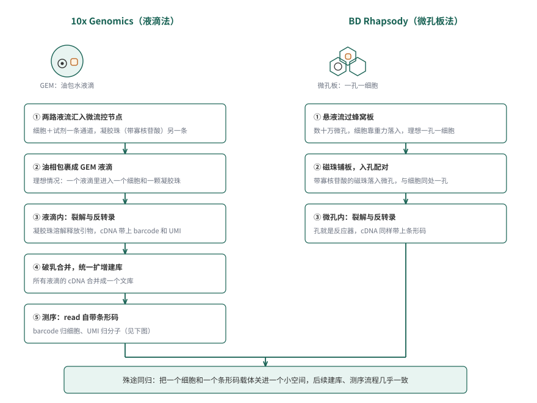
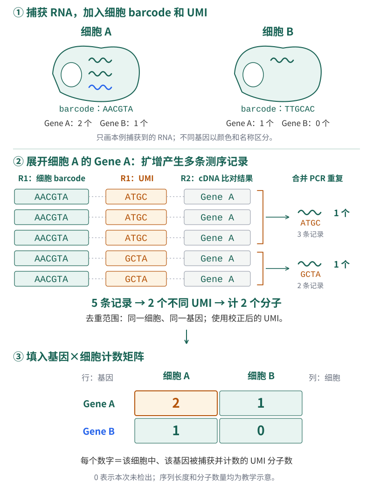
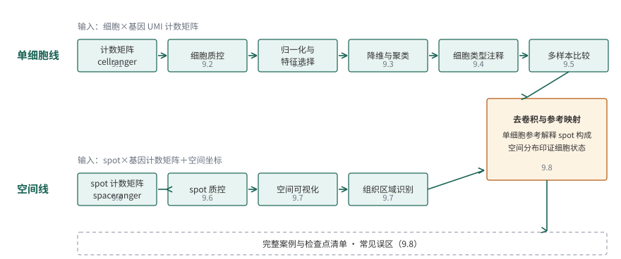
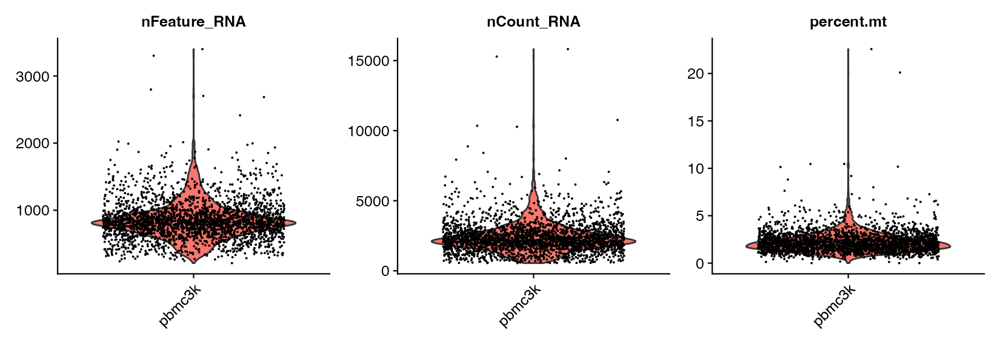
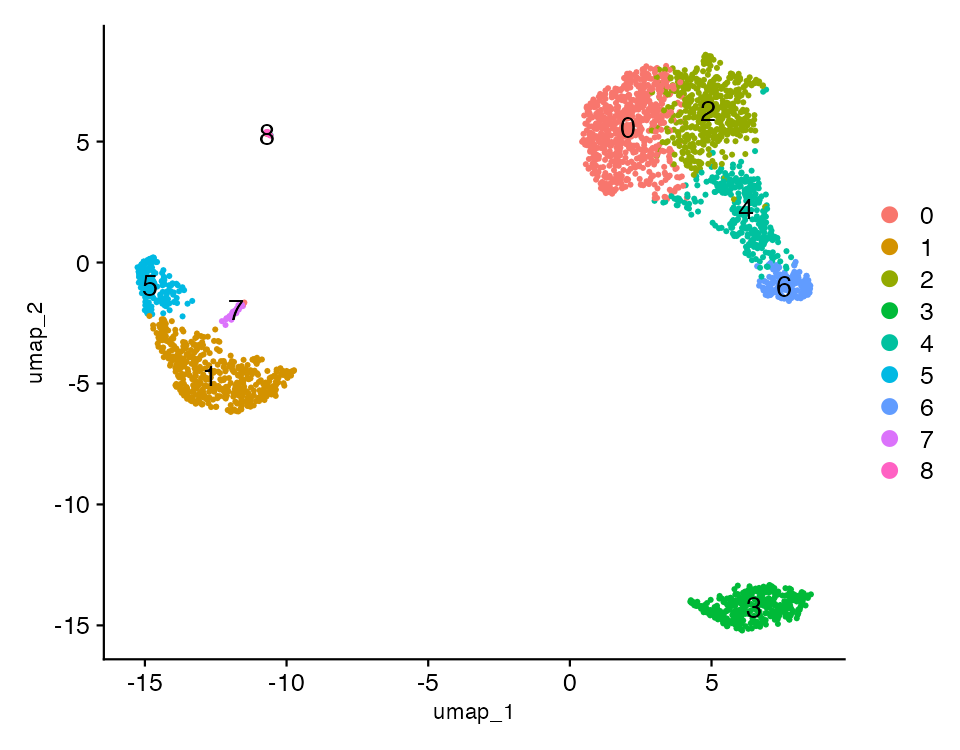
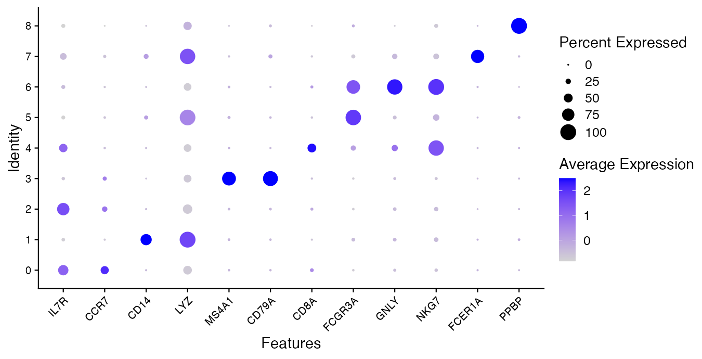
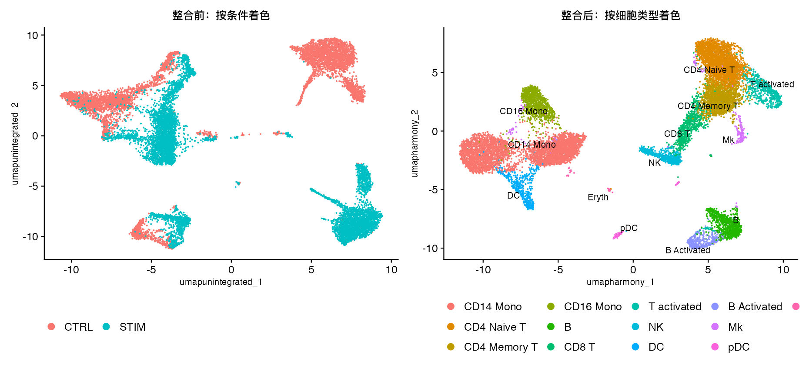
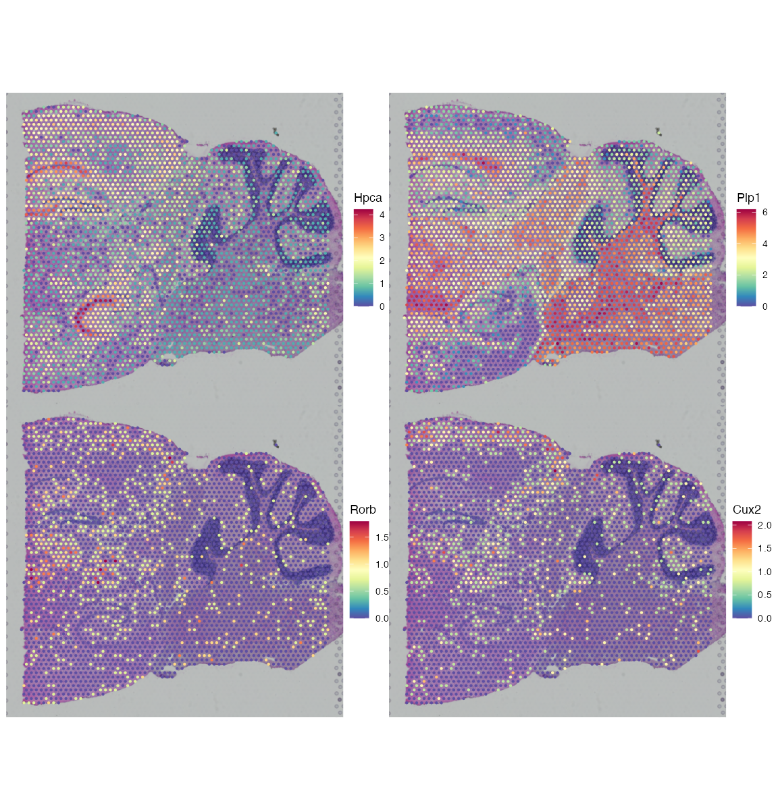

# 单细胞与空间组学 {#sec-ch09}

::: {.hero-book .book-chapter-summary}

## 本章提要 {#chapter-summary-09 .unnumbered}

本章从组织平均信号走向细胞差异与空间位置。单细胞部分依次学习数据结构与质控、归一化和特征选择、降维聚类、细胞类型注释，以及多样本比较；空间部分介绍技术、数据结构与质量控制，随后学习空间表达展示和组织区域的解释。最后讨论单细胞与空间信息如何结合，并整理完整案例和常见误区。第 5 章的表达分析和第 11 章的统计知识可作为参考，分析中应持续核对样本、细胞和空间位置的对应关系。

:::

## 从组织平均到细胞差异与空间位置：研究问题与数据结构 {#sec-09-01}

### 为什么需要单细胞与空间分辨 {#src-0050-RNA-seq-56}

前面各章的转录组测序，研究对象都是多个细胞混合在一起的 RNA：针对某一组织、器官甚至整个生物体（例如小型昆虫）建库测序，测到的基因表达是**所有细胞的平均值**。平均值会掩盖细胞组成的差异：想象两份样本，基因 A 的平均表达完全相同，一份来自"少数细胞高表达 A"，另一份来自"所有细胞中等表达 A"——bulk 数据无法区分这两种完全不同的生物学状态。而单细胞测序把每一个细胞单独捕获测序，能看到样本里**有哪些细胞、各自在表达什么**；这对发育（不同分化阶段的细胞共存）、肿瘤异质性（敏感株与耐药株混合）、微小组织（细胞数本来就少）等研究十分关键。

单细胞解决"有哪些细胞、各自做什么"，却丢掉了"它们在哪里"：解离组织制备单细胞悬液时，细胞原有的空间位置信息就丢失了。空间转录组则保留位置：它在获取基因表达的同时记录每条信号来自组织的哪个坐标。两种分辨率回答不同问题，是**互补关系**而不是谁取代谁——本章最后一节会再回到这一点。

### 领域的发展与汤富酬实验室的贡献 {#topic-09-history}

单细胞转录组测序的开创性工作出现在 2009 年：汤富酬作为第一作者，与剑桥大学 Gurdon 研究所的团队合作，对一个小鼠卵裂球完成了全转录组测序，证明单个细胞的 mRNA 测序在技术上可行[^ch09-tang-2009]。这项工作也奠定了他此后回国在北京大学建立单细胞组学研究方向的基础。

在方法层面，这个领域经历了三个阶段。**早期（2009–2014）是低通量时代**：用显微操作或流式分选挑出单个细胞，一次实验通常只处理几个到几十个细胞，但已经足以回答"早期胚胎发育中每个卵裂球是否已经不同"这类问题。**2013–2015 年方法爆发**：Smart-seq2 把板式（96/384 孔板）单细胞测序的灵敏度和通量显著提升，一次可处理数百个细胞、测到转录本全长[^ch09-smartseq2]；inDrop 与 Drop-seq 两项技术同年把"油包水液滴"引入单细胞捕获，让通量跃升到每次数千至上万个细胞[^ch09-indrop]。**2016 年之后进入商业化与普及期**：10x Genomics 把液滴法做成了标准化仪器和试剂盒（下节），单细胞测序从"手艺活"变成了常规服务，也让万级细胞规模的实验进入普通实验室。

汤富酬实验室（北京大学生物动态光学成像中心/生物医学前沿创新中心，BIOPIC）在单细胞多组学方向做出了系统性贡献：他们将测量范围从转录组扩展到同一细胞的基因组、DNA 甲基化和染色质状态。scTrio-seq 在同一个细胞里同时检测基因组拷贝数、DNA 甲基化和转录组，并用它揭示了肝细胞癌肿瘤细胞在三个层次上的异质性[^ch09-sctrio]；single-cell COOL-seq 则在同一细胞中分析染色质状态、DNA 甲基化与拷贝数，刻画了小鼠早期胚胎的表观重编程动态[^ch09-coolseq]。这些工作与国内多个团队一起，让中国在单细胞多组学方向长期处于国际第一梯队。

方法的发展也影响实验设计：低通量时代只能做"少数细胞的深描"，如今常规平台一次捕获数千至上万个细胞，可以支持"数百到数千个细胞为一类的系统性普查"。读到实验方案时，先看它使用的平台和通量，再判断它支持什么强度的结论。

### 商业化成熟后的主流平台：10x Genomics 与 BD Rhapsody {#topic-09-platforms}

方法商业化成熟后，目前国内使用最广泛的单细胞平台是 **10x Genomics**（Chromium 系列）和 **BD Rhapsody**，分别源自 Drop-seq 代表的液滴法路线[^rna-ref-10]与 CytoSeq 代表的微孔板法路线[^rna-ref-11]。两者最大的差别在于**微反应载体**：一个用油包水液滴，一个用固态微孔板。

10x Chromium 芯片上的细胞捕获在液相中完成：

1. 细胞悬液与反应试剂走一条微流控通道，大量连着后续反应所需寡核苷酸（含细胞 barcode 和 UMI）的凝胶珠走另一条通道；
2. 两股液流在微流控节点与油相相遇，被油包裹成一个个"油包水"微液滴，称为 **GEM**（Gel bead in emulsion）——理想情况下每个液滴里进入一个细胞和一颗凝胶珠；
3. 凝胶珠在液滴内溶解，释放寡核苷酸；细胞裂解释放 mRNA，带 barcode 的 oligo-dT 引物捕获 mRNA 并在液滴内完成反转录；
4. 破乳后把所有液滴里的 cDNA 合并，统一扩增、建库；
5. 测序时每条 read 自带"来自哪个细胞（barcode）＋哪个分子（UMI）"的信息，据此生成计数矩阵[^rna-ref-12]。

BD Rhapsody 采用蜂窝板（微孔板）完成单细胞分离和捕获：

1. 单细胞悬液流过含有数十万个微孔的蜂窝板，细胞靠重力落入微孔，理想情况下一孔一细胞；
2. 带寡核苷酸的磁珠铺到板上，落入微孔与细胞配对；
3. 在微孔内完成细胞裂解、反转录、扩增。

两种方法的共同点是：都是"把一个细胞和一个条形码载体关进一个小空间"，后续建库和测序流程几乎一致。通量上两家处于同一量级：10x 标准试剂盒每个通道的目标回收量约为 500–10,000 个细胞（更高通量的试剂盒可达数万），BD Rhapsody 单筒典型捕获约一万个细胞。值得注意的是，**捕获的细胞越多，一个反应空间里挤进两个细胞的概率也越高**——这就是后面要处理的双细胞问题，10x 官方与原始文献的数据都显示双细胞率大约随回收细胞数线性上升（约每回收 1,000 个细胞增加 1%）[^rna-ref-12]。

{#fig-06-rna-seq-002}

::: {.callout-note .book-core title="核心知识｜barcode 归细胞，UMI 归分子"}

单细胞测序的每条 read 上有两段关键条形码：**细胞 barcode** 标记这条 read 来自哪个细胞（更准确地说，来自哪颗凝胶珠/磁珠），**UMI**（unique molecular identifier，分子唯一标识符）标记它来自哪个原始 mRNA 分子。同一条 mRNA 经 PCR 扩增出多条 read，会带着同一个 UMI——计数时每个 UMI 只算一次，这样 PCR 重复不会虚增表达量。这是单细胞计数与第 5 章 bulk 计数的一个本质差别：bulk 里我们数的是"比对到基因上的 read 数"，单细胞里数的是"带不同 UMI 的分子数"。

:::

### barcode、UMI 与细胞×基因计数矩阵 {#topic-09-barcode-umi}

把上一步的测序结果整理一下，就得到本章分析的全部输入：一个**细胞×基因计数矩阵**。矩阵里每个数字的含义是——某个 barcode 对应的细胞里，某个基因被捕获并计数到多少个 UMI。barcode 的长度只有十几个碱基（不同化学版本的长度不同，例如 10x 早期版本为 14 bp barcode＋10 bp UMI，都从大约 75 万种设计中分配），碱基数虽少，足够给每个反应载体一个独立身份[^rna-ref-12]。

10x 平台把从 FASTQ 到这个矩阵的中间步骤交给了官方软件 **Cell Ranger**：它把 read 比对到参考基因组（内部调用 STAR）、校正测序错误造成的 barcode/UMI 偏差、按 UMI 去重、把分子归属到基因，最后输出标准的三件套文件——`matrix.mtx`（稀疏矩阵）、`barcodes.tsv`（每行一个细胞 barcode）、`features.tsv`（每行一个基因）。这个三件套是 Seurat、Scanpy 等几乎所有下游分析工具的通用输入。

从数据结构看，单细胞矩阵和第 5 章的基因×样本计数矩阵形状相同、语义不同：一列不再是"一个样本的文库"，而是"一个细胞"；矩阵极度稀疏（单个细胞只测得到一两千个基因非零），而且每个细胞的总计数（相当于"文库大小"）差异很大——这两点是后面归一化和质控设计的出发点。

{#fig-09-bc-umi}

@fig-09-bc-umi 把这套对应关系画在一起：三条 read 带着同一个细胞 barcode，其中前两条的 UMI 相同——它们是同一个 mRNA 分子经 PCR 扩增出来的重复，按 UMI 去重后只计 1 个分子；第三条 UMI 不同，是另一个分子。计数矩阵里那一列的每个数字，就是这样一条条数出来的"分子数"。

### 单细胞多组学全景与本章边界 {#topic-09-multimics}

单细胞分辨并不局限于转录组。同一个细胞还可以同时测**基因组**（拷贝数变异、突变）、**DNA 甲基化**（汤富酬团队的 scTrio-seq 即属此类）、**染色质开放性**（scATAC-seq）或**细胞表面蛋白**（CITE-seq 类抗体偶联技术）；把转录组与表观组配对的商品化平台（如 10x Multiome）也已普及。这些多组学技术在原理上仍是"给单细胞加条形码"的思路，但数据处理各有专门方法。

本书作为入门教材，本章只深入**单细胞转录组**这一条主线：它最常用、方法最成熟，也是理解其他单细胞组学的入口。scATAC-seq 等多组学的分析思路，推荐在掌握本章之后阅读进阶资料——本书作者之一刘雨婷整理的单细胞多组学分析教程系统地覆盖了 Seurat 预处理到 ArchR 分析 scATAC 的完整流程，可作为继续学习的路线图[^ch09-liuyuting]。

### 本章示例数据与分析路线 {#topic-09-data-route}

本章主线示例采用 10x 官方发布的 **pbmc3k** 数据集：一份人外周血单个核细胞（PBMC）的 Cell Ranger 输出矩阵，2,700 个细胞、32,738 个基因，体积只有几 MB，适合作为第一个跑通全流程的数据。学到多样本比较时（9.5 节），换用 Kang 等人发表的干扰素刺激实验数据 ifnb：IFN-β 刺激组与未刺激对照组的 PBMC[^ch09-kang-ifnb]。空间部分（9.6–9.7 节）用 10x 官方的 Visium 小鼠脑矢状切面数据。

{#fig-06-rna-seq-009}

如 @fig-06-rna-seq-009 所示，单细胞线从计数矩阵出发，依次经过质控、归一化与特征选择、降维聚类、注释、多样本比较；空间线平行展开，最后两线在去卷积与参考映射处汇合。图中每一步都附了一个"检查"——那是判断这一步做得对不对的可观察依据，9.8 节的检查点清单就是从这些检查汇总的。下面先分析单细胞数据。

## 单细胞数据的质控：细胞、基因、双细胞与背景信号 {#sec-09-02}

### 从比对到矩阵：Cell Ranger 输出与 Seurat 对象 {#topic-09-cellranger-seurat}

Cell Ranger 的运行本身不复杂（`cellranger count` 一条命令，输入 FASTQ 与参考基因组，输出上节的三件套），但它需要参考基因组和较大的内存，通常由测序公司或服务器完成。教学上我们从它的输出矩阵开始——这也符合多数实际工作的入口：拿到数据时，FASTQ 已经变成了 `filtered_feature_bc_matrix` 目录。

在 R 里读入三件套并建立 Seurat 对象：

```{.r data-book-role="code"}
library(Seurat)

counts <- Read10X(data.dir = "filtered_gene_bc_matrices/hg19")
pbmc <- CreateSeuratObject(counts = counts, project = "pbmc3k",
                           min.cells = 3, min.features = 200)
```

`Read10X()` 读入稀疏矩阵；`CreateSeuratObject()` 把它包装成 Seurat 对象，同时完成两步轻量过滤：`min.cells = 3` 丢掉在少于 3 个细胞中检出的基因（几乎全是噪声），`min.features = 200` 丢掉检出基因数少于 200 的 barcode（多半是没有捕获到细胞的空液滴）。对 pbmc3k，这一步把基因从 32,738 个压缩到 13,714 个，2,700 个细胞全部保留。

### 细胞水平质控：nFeature、nCount 与线粒体比例 {#topic-09-qc}

在细胞水平判断质量时，常用以下三个指标：

- **`nFeature_RNA`**：每个细胞检出的基因数。过低提示细胞破损或空液滴；过高是双细胞的嫌疑（一个 barcode 对应了两个细胞，基因种类自然翻倍）。
- **`nCount_RNA`**：每个细胞的 UMI 总数（测序深度）。它和 `nFeature_RNA` 正相关，异常高的同样指向双细胞。
- **`percent.mt`**：来自线粒体基因的 read 百分比。细胞凋亡时线粒体 mRNA 相对富集，比例过高通常意味着破损或垂死的细胞。

三个指标都可以从对象中直接计算和可视化：

```{.r data-book-role="code"}
pbmc[["percent.mt"]] <- PercentageFeatureSet(pbmc, pattern = "^MT-")

VlnPlot(pbmc, features = c("nFeature_RNA", "nCount_RNA", "percent.mt"), ncol = 3)
FeatureScatter(pbmc, feature1 = "nCount_RNA", feature2 = "nFeature_RNA")
```

{#fig-09-qc-violin}

@fig-09-qc-violin 是本章数据实跑的结果：`nFeature_RNA` 中位数 816（范围 212–3,400），`percent.mt` 中位数约 2%，但右侧拖着一条到 22.6% 的尾巴——这条尾巴就是要过滤的对象。按经典教学阈值过滤：

```{.r data-book-role="code"}
pbmc <- subset(pbmc, subset = nFeature_RNA > 200 & nFeature_RNA < 2500 &
                              percent.mt < 5)
```

2,700 个细胞保留了 2,638 个。

::: {.callout-warning .book-warning title="注意｜质控阈值因组织而异，不能照抄"}

"200–2,500 个基因、线粒体 <5%"只是这份 PBMC 数据的示例，不是通用标准。不同组织的合理范围差别很大：代谢旺盛的组织（心肌、脑）线粒体比例天然偏高；肿瘤样本常有侵袭性破碎细胞，上限要放宽；体外培养的细胞系则分布非常均一。正确做法是先看自己数据的分布（小提琴图），把阈值定在分布的"自然断点"上，并在论文里报告阈值和理由。拿到别人的分析代码时，也要先问一句：这套阈值适用于我的组织吗？

:::

### 双细胞：来源、比例与检测 {#topic-09-doublets}

双细胞（doublet）指两个细胞被包进了同一个反应空间，最终共享一个 barcode，在矩阵里表现为一个"表达量约两倍、基因种类异常多、同时表达两套细胞类型 marker"的假细胞。上一节已经提到，双细胞率大约随上样量线性上升：回收 1,000 个细胞时约 1%，回收 9,000 个时已接近 9%[^rna-ref-12]。通量越高，双细胞越不可忽视。

双细胞有两类检测思路。其一是**人工排查**：看 `nFeature_RNA`/`nCount_RNA` 分布的高端尾巴，看是否出现"又像 T 细胞又像 B 细胞"这类不该共存的 marker 组合。其二是**专门工具**：Scrublet 与 DoubletFinder 的核心想法一致——随机把已测细胞两两模拟成"人工双细胞"，看真实细胞里谁的邻居大多落在人工双细胞上，这些细胞就有双细胞的嫌疑[^ch09-scrublet][^ch09-doubletfinder]。教学数据量小、上样低，本章流程省略这一步；正式项目里应在聚类前或聚类后跑一次双细胞检测，并把比例记录在报告里。

### 背景 RNA 与基因过滤 {#topic-09-ambient}

即使液滴里没有细胞，也不是空的：组织解离时细胞破损释放的游离 RNA 会弥散在悬液里，被任何液滴随机捕获，称为**环境 RNA**（ambient RNA）或"汤"（soup）。它的后果是每个细胞都被低水平地"涂"上一层全样本常见的 RNA（常见于线粒体基因、核糖体蛋白基因、解离敏感的转录本），让不同的细胞看起来比实际更相似，甚至让 T 细胞"检出"少量单核细胞基因。

专门的校正工具如 SoupX 和 CellBender 会估计"汤"的构成再从矩阵里扣除[^ch09-soupx][^ch09-cellbender]。本章教学流程不做背景扣除，但你要知道这个现象存在：看到每个细胞都低表达某几个基因时，先怀疑背景 RNA，而不是急着解释为生物学意义。

基因水平的过滤（`min.cells`）在建立对象时已经完成。后续重点检查细胞水平的质量。

## 归一化、特征选择、降维与聚类 {#sec-09-03}

### 单细胞归一化：文库大小与测序深度 {#topic-09-normalization}

单细胞矩阵的每个细胞就是一个"文库"，而每个细胞的测序深度（UMI 总数）可能差好几倍——这份 PBMC 数据里 `nCount_RNA` 从 546 到 15,818 不等。直接比较原始计数，测得深的细胞什么基因都"高"。第 11 章讲过归一化的共同逻辑（CPM、size factor，见 [第 11 章](11-statistics-and-learning.md#sec-11-05)），单细胞最常用的 **logNormalize** 是其中最简单的一种：把每个细胞的计数除以该细胞总数、乘以 10,000，再取对数——$\log(x_i / n \times 10^4 + 1)$。乘 10,000 让数值落在便于查看的量级，`+1` 避免零取对数。

SCTransform 是更现代的替代：它把基因的表达量对测序深度做正则化负二项回归，残差作为归一化值，能更充分地处理测序深度的影响，尤其适合深度差异大的数据[^ch09-sctransform]。对入门数据，两者的聚类结果差别不大；本章主线用 logNormalize，也可以将相应步骤换成 SCTransform。

```{.r data-book-role="code"}
pbmc <- NormalizeData(pbmc, normalization.method = "LogNormalize", scale.factor = 1e4)
```

### 高变基因：特征选择 {#topic-09-hvg}

归一化后，矩阵仍有约 1.4 万个基因。其中大多数基因在细胞间几乎不变（管家基因），它们携带的"细胞间差异"信息很少，只会给下游计算添噪声。因此下一步是挑出**高变基因**（highly variable genes，HVG）：在细胞间离散度显著高于随机期望的基因。

```{.r data-book-role="code"}
pbmc <- FindVariableFeatures(pbmc, selection.method = "vst", nfeatures = 2000)
head(VariableFeatures(pbmc), 10)
```

```{.text data-book-role="output"}
 [1] "PPBP"  "LYZ"  "S100A9" "IGLL5" "GNLY"  "FTL"  "PF4"  "FTH1" "GNG11" "S100A8"
```

这份 PBMC 数据选出的前几个高变基因——`LYZ`、`S100A8`/`S100A9`（单核细胞）、`GNLY`（NK 细胞）、`PPBP`（血小板）——本身恰好就是血细胞身份相关基因。后续 PCA、聚类都只在这 2,000 个基因张成的空间里进行。

### 线性降维 PCA 与非线性嵌入 UMAP/tSNE {#topic-09-dimred}

下一步 `ScaleData()` 把每个基因标准化成均值 0、方差 1（否则表达量大的基因会在 PCA 中占据主导），然后对高变基因做主成分分析：

```{.r data-book-role="code"}
pbmc <- ScaleData(pbmc, features = VariableFeatures(pbmc))
pbmc <- RunPCA(pbmc, features = VariableFeatures(pbmc))
ElbowPlot(pbmc, ndims = 30)
```

PCA 把 2,000 维压缩成几十个主成分，这些主成分保留了细胞间的主要差异方向（原理见 [第 11 章](11-statistics-and-learning.md#sec-11-07)）。用多少个主成分进入下一步？`ElbowPlot()` 画出的"碎石图"上找拐点——方差解释率由陡变平的位置，本数据在 10 个主成分附近，教学流程取前 10 个。

UMAP 或 t-SNE 再把选定的主成分投影到二维，方便人眼查看（同样见 [第 11 章](11-statistics-and-learning.md#sec-11-07)）。要提醒的是：**UMAP 图上两点的距离不能当作真实的表达距离**，它保留的是局部邻接关系，簇的相对位置和大小只有有限的参考价值。判断"两群细胞是否相近"，应回到高维空间里的定量指标，而不是看二维图上挨不挨着。

### 图构建与聚类：kNN、Louvain/Leiden 与分辨率 {#topic-09-clustering}

聚类在主成分空间（而非二维 UMAP）里进行。Seurat 的做法分两步：先在 PC 空间为每个细胞找最近邻，构建**kNN 图**（细胞为节点、近邻关系为边）；再用图聚类算法（默认 Louvain，可选 Leiden[^ch09-leiden]）把连接紧密的细胞群划分成簇。

```{.r data-book-role="code"}
pbmc <- FindNeighbors(pbmc, dims = 1:10)
pbmc <- FindClusters(pbmc, resolution = 0.5)
```

`resolution`（分辨率）是聚类里最需要理解的参数：它决定算法偏向切出更多小簇还是更少大簇——分辨率调高，簇会分裂变多；调低，簇会合并变少。0.5 是这份 PBMC 数据的经典取值，得到 9 个簇：

```{.text data-book-role="output"}
  0   1   2   3   4   5   6   7   8 
684 481 476 344 291 162 155  32  13 
```

::: {.callout-note .book-core title="核心知识｜聚类给出的是操作定义，不是自然类别"}

"9 个簇"不等于"样本里有 9 种细胞"。簇是算法在指定分辨率下对数据的划分：分辨率从 0.5 提到 1.0，T 细胞可能裂成 naive 与记忆两簇；降到 0.3，单核细胞可能与 NK 合并。所以第 9.4 节的注释环节必须回答"每个簇是什么"，并说明在什么分辨率下成立；报告聚类结果时要同时报告分辨率，读者才能复现。

:::

### 标准流程串联实操 {#topic-09-pipeline-code}

把 9.3 节的全部步骤连起来，就是单细胞分析最常用的一段"标准流程"：

```{.r data-book-role="code"}
pbmc <- NormalizeData(pbmc, normalization.method = "LogNormalize", scale.factor = 1e4)
pbmc <- FindVariableFeatures(pbmc, selection.method = "vst", nfeatures = 2000)
pbmc <- ScaleData(pbmc, features = rownames(pbmc))
pbmc <- RunPCA(pbmc, features = VariableFeatures(pbmc))
pbmc <- RunUMAP(pbmc, dims = 1:10)
pbmc <- FindNeighbors(pbmc, dims = 1:10)
pbmc <- FindClusters(pbmc, resolution = 0.5)
DimPlot(pbmc, reduction = "umap", label = TRUE)
```

每一行做一件事：归一化 → 选高变基因 → 缩放 → PCA → UMAP → kNN 图 → 聚类 → 画图。跑完这段代码，你就得到了 @fig-09-umap-clusters 那样的图——但到这一步为止，图上的每个簇还只是一个编号，下一节将根据 marker 判断它们是什么细胞。

{#fig-09-umap-clusters}

## 细胞类型注释与证据核查 {#sec-09-04}

### 找每个簇的 marker 基因 {#topic-09-markers}

注释的出发点是找**marker 基因**：在某一个簇里高表达、在其他簇里低表达的基因。

```{.r data-book-role="code"}
markers <- FindAllMarkers(pbmc, test.use = "wilcox", only.pos = TRUE,
                          min.pct = 0.25, logfc.threshold = 0.25)
```

`FindAllMarkers()` 默认用 Wilcoxon 秩和检验逐基因比较"每个簇 vs 其余所有细胞"。输出表的每一行是一个基因在一个簇的检验结果，关键列包括 `avg_log2FC`（该簇相对其余细胞的表达倍数变化）、`pct.1`/`pct.2`（该基因在本簇/其余细胞中表达的细胞比例）与 `p_val_adj`。

要留意它和第 5 章 [DESeq2 差异分析](05-rna-seq.md#src-0050-RNA-seq-793)的区别：这里比较的是**同一份样本内部的细胞群**，回答"哪些基因刻画了这个簇"，是描述性的；第 5 章比较的是**实验分组**，回答"处理引起了什么变化"，需要完整的设计公式与生物学重复。两者的输出长得像，语义完全不同。

### 用经典 marker 注释 PBMC {#topic-09-annotate-pbmc}

免疫细胞的经典 marker 积累了几十年流式与单细胞文献的验证，PBMC 各类型都有公认的参考基因。把上一步的结果与这些经典 marker 对照，就能给 9 个簇命名：

| 簇 | 主要 marker（本数据实跑） | 注释 | 细胞数 |
| ---: | --- | --- | ---: |
| 0 | CCR7、LEF1、TCF7 | Naive CD4 T 细胞 | 684 |
| 1 | CD14、S100A8、S100A9 | CD14⁺ 单核细胞 | 481 |
| 2 | AQP3、CD40LG | 记忆 CD4 T 细胞 | 476 |
| 3 | MS4A1、CD79A | B 细胞 | 344 |
| 4 | GZMK、CD8A、CCL5 | CD8 T 细胞 | 291 |
| 5 | MS4A7、HES4 | FCGR3A⁺ 单核细胞 | 162 |
| 6 | GNLY、GZMB、NKG7 | NK 细胞 | 155 |
| 7 | FCER1A、CLEC10A | 树突状细胞 | 32 |
| 8 | PPBP、ITGA2B | 血小板 | 13 |

: pbmc3k 九个簇的经典 marker 注释（结果来自本章实跑） {#tbl-09-cluster-annotation}

点图（DotPlot）把整套 marker 与所有簇的对应关系画在一张图里：点的颜色表示平均表达量，点的大小表示表达的细胞比例：

```{.r data-book-role="code"}
DotPlot(pbmc, features = c("IL7R", "CCR7", "CD14", "LYZ", "MS4A1", "CD79A",
                           "CD8A", "FCGR3A", "GNLY", "NKG7", "FCER1A", "PPBP"))
```

{#fig-09-marker-dot}

读 @fig-09-marker-dot 的方法：看每个 marker 只在哪一列"又大又深"。`MS4A1` 只在 B 细胞簇深、`CD14` 只在单核细胞簇深——这些只在某一列明显表达的基因，是注释该细胞类型的依据；而 `IL7R`、`CCL5` 在 T 细胞的几列都亮，提示它们标记的是 T 细胞这个大类，区分 naive/记忆/CD8 还要靠 CCR7、GZMK 等更细的行。

### 自动注释与参考映射 {#topic-09-auto-annot}

手工对照 marker 可行但费力，于是有了自动注释工具。**SingleR** 用纯化细胞类型的 bulk 转录组参考数据比对打分[^ch09-singler]；**Azimuth** 则把新数据映射到一个大型人工注释的单细胞参考集（如骨髓、PBMC 参考图谱），直接返回每个细胞的注释与置信度[^ch09-azimuth]。这类工具大幅降低了注释门槛，也带来了新的依赖：结果的质量取决于参考集是否包含相应细胞类型，以及它们与待分析细胞有多相似。

### 注释的证据核查 {#topic-09-annot-evidence}

无论手工还是自动，注释都是**证据推断**而不是测量，使用工具后仍需核查以下证据：

- **对分辨率敏感**：换一个 `resolution`，簇的边界就变；注释结论应写成"在分辨率 0.5 下，簇 4 的 marker 谱与 CD8 T 细胞一致"，而不是"这就是 CD8 T 细胞"。
- **marker 不是唯一的**：一个基因可以在多种场景上调——炎症刺激下 `ISG15` 在 T、B、单核里都升高（9.5 节会实际看到），它标记的是"状态"而不是"类型"。类型 marker（如 `MS4A1`）与状态 marker（如干扰素响应基因）要分层使用。
- **证据有强弱**：经典 marker 与多项独立证据一致 ＞ 参考映射 ＞ 单一工具输出 ＞ 仅凭一个基因。自动注释结果与经典 marker 冲突时，回到点图和原始文献，不要默认软件正确。

::: {.callout-tip .book-example title="示例与练习｜给一个未知簇定名"}

假设某个新簇的 marker 前几名是 `MS4A1`、`CD79A`、`TCL1A`，同时该簇有少量细胞弱表达 `CD3D`。它最可能是什么？`CD3D` 弱信号该怎么解释？

**参考解答：**`MS4A1`/`CD79A`/`TCL1A` 是 B 细胞谱系的经典 marker 组合，簇的主体应注释为 B 细胞；少量弱 `CD3D` 更可能是背景 RNA 或双细胞的污染信号（回到 9.2 节的两个现象检查），而不是"新发现的 B/T 双阳性细胞"。区分这几种解释的办法：看这些细胞的 `nFeature_RNA` 是否异常高（双细胞）、看 `CD3D` 的表达比例与强度是否只在背景水平（环境 RNA）。

:::

## 多样本比较：批次、重复与差异分析 {#sec-09-05}

### 批次效应：来源与识别 {#topic-09-batch}

真实项目很少只测一个样本。多个样本一起分析时，首先要分辨差异的来源：**生物学差异**（不同供体、不同处理）与**技术批次**（不同实验日、不同建库批次、不同平台）都会让细胞分开，在 UMAP 图上看起来一样是"两团"。分辨的办法是**按样本、按批次元数据给 UMAP 着色**再检查：如果细胞首先按供体/实验日分开、同类型细胞没有混在一起，批次效应占主导；如果同类型细胞聚集、各样本的细胞在同一簇内都有分布，说明结构由生物学主导。

本节示例换用 ifnb 数据集：IFN-β 刺激（STIM）与未刺激（CTRL）两组 PBMC，共 13,999 个细胞[^ch09-kang-ifnb]。先把两组当作两个数据层各自处理，再看未整合的 UMAP：

```{.r data-book-role="code"}
ifnb[["RNA"]] <- split(ifnb[["RNA"]], f = ifnb$stim)
ifnb <- NormalizeData(ifnb)
ifnb <- FindVariableFeatures(ifnb, nfeatures = 2000)
ifnb <- ScaleData(ifnb)
ifnb <- RunPCA(ifnb)
ifnb <- RunUMAP(ifnb, dims = 1:30, reduction = "pca",
                reduction.name = "umap.unintegrated")
DimPlot(ifnb, reduction = "umap.unintegrated", group.by = "stim")
```

{#fig-09-ifnb-umap}

@fig-09-ifnb-umap 左图显示，未整合时两组细胞大面积分开——这里主导的是**干扰素刺激这个生物学条件**（IFN 响应基因被诱导，刺激组细胞整体"变形"），不是技术批次。这个例子故意选了"条件效应"：它提醒我们，整合算法分不清"批次"和"条件"，它只是把指定的分组拉到一起。哪些差异该保留、哪些该去除，必须由分析者依据实验设计决定。

### 数据整合：anchors 与 Harmony {#topic-09-integration}

确有批次需要去除时，常用两类整合方法。Seurat 的 **anchors**（锚点）策略在不同数据集间寻找相互"配对"的细胞作为锚，据此对齐数据结构[^ch09-stuart]；**Harmony** 在 PCA 空间里迭代地把指定分组的分布拉近，速度快、对大数据友好[^ch09-harmony]。Seurat v5 把两者统一进 `IntegrateLayers()` 接口：

```{.r data-book-role="code"}
ifnb <- IntegrateLayers(ifnb, method = "HarmonyIntegration",
                        orig.reduction = "pca", new.reduction = "harmony")
ifnb <- FindNeighbors(ifnb, reduction = "harmony", dims = 1:30)
ifnb <- FindClusters(ifnb, resolution = 0.6)
ifnb <- RunUMAP(ifnb, reduction = "harmony", dims = 1:30,
                reduction.name = "umap.harmony")
```

整合后（@fig-09-ifnb-umap 右图），两组的同类细胞并到一起，聚类得到的主要是细胞类型结构——按细胞类型着色时，T、B、NK 和单核细胞分别聚集，且每个类型内部两种条件的细胞都存在。

::: {.callout-warning .book-warning title="注意｜整合可能把真实生物学差异也抹掉"}

整合算法的目标是"让指定分组看起来一致"，它并不区分该一致是技术原因还是生物学原因。把刺激组与对照组整合后，IFN 响应的整体差异也被部分压缩——好在各细胞类型内部的响应信号仍然保留（下一节的伪批量分析正是从这里把它检测回来）。使用整合前要问：我去除的是批次还是条件？去除之后，我关心的生物学差异还剩下多少可以检测？最好"整合前后各看一遍"，确认目标信号没有在整合中消失。

:::

### 伪批量差异分析：回到样本层面 {#topic-09-pseudobulk}

"IFN 刺激改变了哪些基因的表达？"这个问题不能直接用 `FindAllMarkers` 回答。逐细胞的检验把每个细胞当独立样本，但同一供体的成千上万个细胞共享供体背景——它们不是独立的，逐细胞 p 值会严重虚高，这就是**伪重复**问题。正确做法是**伪批量**（pseudobulk）：按"样本×细胞类型"把计数加和，合成一个 bulk 级样本，再用第 5 章的 DESeq2/edgeR 检验；比较方法学的研究也确认了伪批量在多数场景下更稳健[^ch09-pseudobulk]。

```{.r data-book-role="code"}
# 按 样本(此处为伪重复)×细胞类型 聚合计数（示意：ifnb 对象未保留供体编号，
# 实际分析应使用真实的供体/样本身份）
counts <- GetAssayData(ifnb, assay = "RNA", layer = "counts")
grp <- paste(rep_id, ifnb$seurat_annotations, sep = "|")  # rep_id 为重复编号
pb_counts <- counts %*% sparse.model.matrix(~ 0 + factor(grp))

# 取 CD14 单核细胞，回到 DESeq2
dds <- DESeqDataSetFromMatrix(countData = pb_counts[, cd14_cols],
                              colData = cd14_meta, design = ~ stim)
dds <- DESeq(dds)
```

对 CD14⁺ 单核细胞做 STIM vs CTRL 检验，实跑结果的前几名：

```{.text data-book-role="output"}
     gene  log2FoldChange  padj
   ISG15          7.19     <2e-16
   RSAD2          7.41     <2e-16
   IL1RN          6.64     <2e-16
    IFI6          4.39     <2e-16
    GBP1          3.33     <2e-16
```

`ISG15`、`RSAD2`、`IFI6`、`GBP1`——这些都是经典的干扰素刺激基因（ISG），方向与 Kang 等人的发表结论一致。padj<0.05 的基因共 2,722 个。

::: {.callout-warning .book-warning title="注意｜教学数据的一个坦白"}

本节实跑使用的 ifnb 教学对象没有保留供体编号，上面代码里的"重复"是我们在每个条件内随机切出的三个伪重复，只用于演示方法。**真实分析必须用真实的生物学重复聚合**——这也提醒我们：拿到数据先检查元数据完整性，缺了样本编号，后面的统计就只剩演示价值。

:::

### 细胞比例变化：组成分析的另一条结论 {#topic-09-composition}

处理改变的不一定是基因表达，还可能是**细胞比例**：刺激后某类细胞从 20% 涨到 40%，这类结论与"某基因上调"同样重要，而且要用不同的方法回答——比例的比较（各类细胞计数表、卡方或比例检验）依赖的是"每样本每类型的细胞数"，同样需要生物学重复。把"表达变了"和"组成变了"分开报告，读者才能知道处理到底作用在哪一层。

## 空间转录组的技术 {#sec-09-06}

### 空间转录组解决什么问题 {#src-0050-RNA-seq-91}

[]{#src-0050-RNA-seq-81}

普通的 RNA 测序——包括单细胞 RNA 测序——都无法提供组织内部不同位置的转录组信息：单细胞在解离时丢掉了位置，bulk 连细胞差异一起平均掉了。空间转录组测序在获取基因表达信息的同时保留空间位置：把冰冻切片贴在带位置条形码的捕获芯片上，透化让每个位置的 RNA 释放并被**该位置特有的 barcode** 捕获，测序后即可还原"哪一段序列来自组织的哪个坐标"。

空间转录组不是单细胞转录组的升级，两者是互补关系：主流空间平台的捕获点（spot）里通常是多个细胞，分辨率低于单细胞，但保留了组织学语境；单细胞分辨率高，但丢了位置。把两类数据放在一起用，正是 9.8 节的主题。这一技术路线的原始文献发表于 2016 年，随后被 10x Genomics 商品化为 Visium 平台[^rna-ref-13]。至于 RNA 建库的链特异性问题（read 来自正链还是负链基因），与空间无关，已在[第 5 章](05-rna-seq.md#topic-05-stranded-lib)讲过，本章不再重复。[]{#src-0050-RNA-seq-95}

### 技术全景：捕获型、原位杂交型与高分辨率平台 {#topic-09-spatial-tech}

空间技术按"表达是怎么定位的"分三大类：

| 技术路线 | 代表平台 | 分辨率 | 检测范围 | 一次实验规模 |
| --- | --- | --- | --- | --- |
| 原位捕获 | 10x Visium | 55 µm spot（约 1–10 个细胞） | 全转录组 | 每张片 4 个区域×约 5,000 spot |
| 原位杂交（靶向） | MERFISH、Xenium | 单分子、亚细胞 | 数百至数千个靶基因 | 大片组织 |
| 高分辨率捕获 | Visium HD | 2 µm 网格（多 bin 合并使用） | 全转录组 | 单张大区域 |

: 三类空间转录组技术的取舍（规格为 2026-10 官方口径） {#tbl-09-spatial-tech}

@tbl-09-spatial-tech 的三行代表三种取舍：**全转录组与分辨率不可兼得**——Visium 测所有基因但每点多细胞；MERFISH/Xenium 定位到单分子却只能测预先选好的几百到几千个基因[^ch09-merfish]；Visium HD 把捕获网格推到 2 µm，又带来数据量与统计单位（bin 怎么合并）的新问题[^ch09-visium-specs]。选型时先回答：关心的是"哪些基因在哪里"（全转录组优先），还是"已知分子定位到亚细胞"（靶向高分辨优先）。

### Visium 数据结构与 Space Ranger 质控 {#topic-09-visium-data}

Visium 的专用分析软件 Space Ranger 输出的矩阵与单细胞矩阵很相似：仍是三件套，只是"细胞"换成了"spot"——一个 spot×基因计数矩阵，加一份空间信息（每个 spot 的行列坐标、与组织 H&E 图像配准的比例因子、组织图像本身）。分析对象因此从"细胞"换成"spot"，Seurat 用 `Load10X_Spatial()` 一步读入。

本章示例是 10x 官方的小鼠脑矢状（后段）数据：3,355 个组织内 spot、32,285 个基因。spot 水平的质控指标与单细胞同构——每个 spot 的 UMI 数与基因数：

```{.text data-book-role="output"}
nCount_Spatial  中位数 15,783（范围 29–79,686）
nFeature_Spatial 中位数 4,772（范围 28–9,476）
```

低计数的 spot 通常落在组织边缘或透化不均的区域；与单细胞不同，空间数据一般**不做细胞（spot）过滤**，因为每个 spot 都是组织图景的一部分，删掉它就留下地图上的空洞。质控结论直接标在组织图上（比如把低计数 spot 染成浅色），用组织学形态来解释。

## 空间表达的可视化与结果解释 {#sec-09-07}

### 在组织切片上画表达：空间 featureplot {#topic-09-spatial-plot}

空间数据最直观的读法，是把基因表达叠回组织形态：

```{.r data-book-role="code"}
brain <- Load10X_Spatial(data.dir = ".",
                         filename = "filtered_feature_bc_matrix.h5")
SpatialPlot(brain, features = c("Hpca", "Plp1", "Rorb", "Cux2"))
```

{#fig-09-visium-regions}

@fig-09-visium-regions 里每个小图都是"基因表达 × 组织位置"的叠加：`Hpca` 富集在海马，`Plp1`（髓鞘蛋白）勾勒白质纤维束，`Rorb` 与 `Cux2` 分别标记皮层深层与浅层——它们的空间分布与相应的神经解剖学结构一致。判读空间图的要点是**把表达模式与可辨认的解剖结构对上**：解释空间图时，需要核对表达分布与组织学结构是否一致，不能只看颜色深浅。

### 空间聚类与组织区域识别 {#topic-09-spatial-clusters}

对 spot 矩阵做与单细胞相同的降维聚类（教学流程用 SCTransform 归一化后走 PCA→kNN→Louvain），得到的是**空间上连续的区域**：小鼠脑数据聚成 15 个簇，皮层分层、海马、丘脑、白质等结构各自成簇。与 9.4 节一样，这些簇仍需注释——而空间数据多了一重证据：注释要与解剖结构互证。"簇 5 是海马"之所以可信，既因为它高表达 `Hpca`，也因为它的空间轮廓正好套在 H&E 图的海马上。表达和解剖位置两方面的证据一致，区域注释才有依据。

### 空间特有分析：高变基因与共定位 {#topic-09-spatial-svg}

空间数据也有自己的"特征选择"：**空间高变基因**——表达量与空间位置显著相关的基因（用 Moran's I 或 markvariogram 等统计量度量），它们是组织结构的主要"绘图基因"。另一类常用分析是**共定位/邻域分析**：两类细胞或两个基因是否在空间上比随机更常相邻。这类分析支撑"细胞 A 与细胞 B 可能在相互作用"这类假设，但本身只证明空间共现——从共现到互作还需要配体–受体等更多证据链。

### 分辨率限制与结论边界 {#topic-09-spatial-limits}

解释 Visium 结果时，时刻记得 @tbl-09-spatial-tech 的第一行：**每个 spot 覆盖约 1–10 个细胞**（不同组织密度下浮动）。因此"某 spot 高表达 T 细胞 marker"并不意味着那里全是 T 细胞——可能是 T 细胞富集，也可能是大量 T 细胞混在别的细胞中间。把 spot 表达还原成细胞类型构成的工作叫**去卷积**，RCTD 与 cell2location 是常用工具：它们用一份单细胞参考数据估计每个 spot 里各类型细胞的占比[^ch09-rctd][^ch09-cell2location]。去卷积输出是模型估计而不是测量，不同参考、不同工具给出的比例可能明显不同——把"估计的构成"写成"实测的构成"，就越过了数据能支持的结论。

::: {.callout-warning .book-warning title="注意｜空间相邻不等于相互作用"}

"两类细胞在空间上挨着"只说明它们共处一个微环境。真正的细胞间通信需要配体–受体证据、扰动实验或更多手段。空间数据擅长**生成**"这里可能存在互作"的假设，验证要靠下游实验。

:::

## 单细胞与空间信息的结合 {#sec-09-08}

### 单细胞参考映射与空间去卷积 {#topic-09-mapping-deconv}

[]{#src-0050-RNA-seq-1182}

9.7 节末尾提到的去卷积，可以把单细胞与空间数据联系起来：用本章前半部分得到的**已注释单细胞数据**作参考，去解释每个空间 spot 的表达构成。两个方向的用法都常见——空间数据缺分辨率，用单细胞参考补"里面有哪些细胞"；单细胞数据缺语境，用空间分布补"这些细胞住在哪、邻居是谁"。互证也发生在注释层面：一个在单细胞里新发现的细胞状态，如果在空间数据里占据合理的解剖位置（比如肿瘤侵袭前沿），其存在就多了一重证据。

### 完整案例回顾：从原始数据到交付 {#topic-09-full-case}

把全章流程按"输入→输出→检查点"串起来：

| 步骤 | 输入 | 输出 | 关键检查点 |
| --- | --- | --- | --- |
| 计数 | FASTQ＋参考基因组（Cell Ranger） | 细胞×基因矩阵 | barcode 数、比对率、每个细胞的 UMI 分布 |
| 质控 | 计数矩阵 | 过滤后对象 | 阈值是否有组织依据；双细胞比例 |
| 归一化与特征选择 | 过滤对象 | 归一化矩阵＋HVG | 高变基因是否含已知身份基因 |
| 降维聚类 | HVG | 簇 | 用几个 PC、分辨率多少；敏感性检验 |
| 注释 | 簇＋marker | 细胞类型标签 | 经典 marker 互证；证据分级 |
| 多样本 | 各样本对象 | 整合对象＋差异结果 | 整合没有抹掉目标信号；伪批量有真重复 |
| 空间（可选） | Space Ranger 输出 | 空间图＋区域 | 注释与解剖互证；spot 分辨率边界 |
| 交付 | 以上全部 | 报告＋可复现代码 | 版本、参数、随机种子、阈值全部记录 |

: 单细胞与空间分析流程的检查点清单 {#tbl-09-checkpoints}

这张表也是使用 AI 辅助时的核对框架：让 AI 生成单细胞分析方案时，逐行检查它对每个检查点的处理——阈值给了理由吗？分辨率报告了吗？伪批量用的是真实重复吗？运行前，需要先确认方案已经说明这些问题。

### 常见误区清单 {#topic-09-pitfalls}

本章反复出现的判断点，集中列在这里：

- **质控阈值照抄**：不同组织的合理阈值不同，先看自己的分布（9.2）。
- **双细胞当新类型**："又像 T 又像 B"的簇先查双细胞与背景 RNA（9.2）。
- **把聚类号当细胞类型**：簇是操作定义，命名要靠 marker 证据（9.3–9.4）。
- **marker 唯一性误解**：一个基因可以同时是类型 marker 和状态响应者（9.4）。
- **逐细胞 p 值**：细胞不是独立样本，比较回到样本层面（9.5）。
- **过度整合**：整合分不清批次与条件，目标信号可能被一起抹掉（9.5）。
- **UMAP 距离当真**：二维图只保留局部邻接，定量结论回到高维空间（9.3）。
- **去卷积当实测**：spot 构成是估计值，受参考与工具影响（9.7）。
- **相邻当互作**：空间共现只支持假设，不支持结论（9.7）。

::: {.callout-note .book-extension title="拓展阅读｜轨迹推断与拟时间" collapse="true"}

聚类把细胞看成互不相关的类群，但发育、分化、刺激响应中的细胞常处于**连续的状态过渡**里。轨迹推断（trajectory inference / pseudotime）把细胞按转录状态的相似性排成一条"拟时间"轴，推断哪些细胞更早、哪些更晚、基因沿轨迹如何开关——Monocle 是这一路线的代表工具[^ch09-monocle]。它适合回答"分化从哪来、到哪去"；常见误用是把拟时间方向当成因果证明（算法并不知道真实的先后），以及给本无连续结构的数据强行排轨。需要时，先看状态是否连续（UMAP 上是否成连续流形），再选择相应的轨迹推断方法。

:::

[^rna-ref-10]: Macosko EZ, et al. Highly parallel genome-wide expression profiling of individual cells using nanoliter droplets (Drop-seq). Cell. 2015;161(5):1202–1214。原稿编号参考列表已佚失，本脚注按正文主张重新考证补全。

[^rna-ref-11]: Fan HC, Fu GK, Fodor SPA. Expression profiling: combinatorial labeling of single cells for gene expression cytometry (CytoSeq). Science. 2015;347(6222):1258367。

[^rna-ref-12]: Zheng GXY, et al. Massively parallel digital transcriptional profiling of single cells. Nat Commun. 2017;8:14049（10x Chromium 系统的验证论文，液滴过程、barcode/UMI 设计与双细胞率数据均出自本文）。

[^rna-ref-13]: Ståhl PL, et al. Visualization and analysis of gene expression in tissue sections by spatial transcriptomics. Science. 2016;353(6294):78–82。

[^ch09-tang-2009]: Tang F, Barbacioru C, Wang Y, et al. mRNA-Seq whole-transcriptome analysis of a single cell. Nat Methods. 2009;6(5):377–382。

[^ch09-smartseq2]: Picelli S, et al. Smart-seq2 for sensitive full-length transcriptome profiling in single cells. Nat Methods. 2013;10(11):1096–1098。

[^ch09-indrop]: Klein AM, et al. Droplet barcoding for single-cell transcriptomics applied to embryonic stem cells (inDrop). Cell. 2015;161(5):1187–1201。

[^ch09-sctrio]: Hou Y, Guo H, Cao C, et al. Single-cell triple omics sequencing reveals genetic, epigenetic, and transcriptomic heterogeneity in hepatocellular carcinomas (scTrio-seq). Cell Research. 2016;26(3):304–319。

[^ch09-coolseq]: Hu Y, et al. Single-cell multi-omics sequencing of mouse early embryos and embryonic stem cells (single-cell COOL-seq). Cell Research. 2017;27:967–988。

[^ch09-liuyuting]: Yuting Liu. Single Cell MultiOmics Data Analysis（bookdown 在线教程，<https://bookdown.org/ytliu13207/SingleCellMultiOmicsDataAnalysis/>；配套脚本与数据见 GitHub 仓库 YutingPKU/SingleCell-Multiomics）。

[^ch09-kang-ifnb]: Kang HM, et al. Multiplexed droplet single-cell RNA-sequencing using natural genetic variation. Nat Biotechnol. 2018;36:89–94（ifnb 数据集出处；SeuratData 包 ifnb 为其整理版）。

[^ch09-scrublet]: Wolock SL, Lopez R, Klein AM. Scrublet: computational identification of cell doublets in single-cell transcriptomic data. Cell Syst. 2019;8(4):281–291。

[^ch09-doubletfinder]: McGinnis CS, Murrow LM, Gartner ZJ. DoubletFinder: doublet detection in single-cell RNA sequencing data using artificial nearest neighbors. Cell Syst. 2019;8(4):329–337。

[^ch09-soupx]: Young MD, Behjati S. SoupX removes ambient RNA contamination from droplet-based single cell RNA sequencing data. Genome Biol. 2019;20(1):251。

[^ch09-cellbender]: Fleming SJ, et al. Unsupervised removal of systematic background noise from droplet-based single-cell experiments using CellBender. Nat Biotechnol. 2023;41:1330–1339。

[^ch09-sctransform]: Hafemeister C, Satija R. Normalization and variance stabilization of single-cell RNA-seq data using regularized negative binomial regression. Genome Biol. 2019;20(1):296。

[^ch09-leiden]: Traag VA, Waltman L, van Eck NJ. From Louvain to Leiden: guaranteeing well-connected communities. Sci Rep. 2019;9:5233。

[^ch09-singler]: Aran D, et al. Reference-based analysis of lung single-cell sequencing reveals a transitional profibrotic macrophage. Nat Immunol. 2019;20(2):163–172（SingleR 方法论文）。

[^ch09-azimuth]: Hao Y, et al. Integrated analysis of multimodal single-cell data. Cell. 2021;184(13):3573–3587（Seurat v4 与 Azimuth 参考映射）。

[^ch09-stuart]: Stuart T, et al. Comprehensive integration of single-cell data. Cell. 2019;177(7):1888–1902（Seurat anchors 整合策略）。

[^ch09-harmony]: Korsunsky I, et al. Fast, sensitive and accurate integration of single-cell data with Harmony. Nat Methods. 2019;16:1289–1296。

[^ch09-pseudobulk]: Murphy AE, Skene NG. A balanced measure shows superior performance of pseudobulk methods in single-cell RNA-sequencing analysis. Nat Commun. 2022;13:7851；单细胞最佳实践综述另见 Luecken MD, Theis FJ. Mol Syst Biol. 2019;15(6):e8746 与 Heumos L, et al. Nat Rev Genet. 2023。

[^ch09-merfish]: Chen KH, Boettiger AN, Moffitt JR, et al. Spatially resolved, highly multiplexed RNA profiling in single cells (MERFISH). Science. 2015;348(6233):aaa6090。

[^ch09-visium-specs]: 规格引自 10x Genomics 官方资料：Visium HD 性能技术说明（CG000686）及 Visium 试剂盒用户指南；2026 年 10 月核对。

[^ch09-rctd]: Cable DM, et al. Robust decomposition of cell type mixtures in spatial transcriptomics data (RCTD). Nat Biotechnol. 2022;40:317–327。

[^ch09-cell2location]: Kleshchevnikov V, et al. Cell2location maps fine-grained cell types in spatial transcriptomics. Nat Biotechnol. 2022;40:661–671。

[^ch09-monocle]: Trapnell C, et al. The dynamics and regulators of cell fate decisions are revealed by pseudotemporal progression of transcriptomes (Monocle). Nat Biotechnol. 2014;32(4):381–386。
