# 统计相关知识学习路线及实践 {#sec-ch11}

::: {.hero-book .book-chapter-summary}

## 本章提要 {#chapter-summary-11 .unnumbered}

前面各章的分析背后是同一批统计与机器学习方法。本章不逐一推导每个公式，而是先给出一条学习路线：建立“问题类型—方法—数学基础”的地图，再沿描述数据、概率分布、假设检验、归一化、线性模型的主线，用 RNA-seq 与 GTEx 真实数据把常用方法的直觉和前提讲清楚；随后简单推导 PCA、t-SNE、UMAP 的核心原理，并在 GTEx 十组织数据上实测不同参数的效果。学习目标是判断力：知道每种方法处理什么数据、依赖什么假设、结果能支持什么结论，以及还需要到哪里继续学。可以在前面实战中遇到问题时回来查阅对应小节。

:::

## 生信分析中的统计与机器学习：问题地图与学习路线 {#sec-11-01}

[]{#statistics}

### 已经遇到过的统计问题 {#src-0080-statistics-1}

如果你按顺序读到了这里，其实已经用过不少统计方法，只是当时我们把重点放在操作上。[第 3 章](03-sequencing-technologies.md#src-0050-RNA-seq-132)的 Phred 质量分数把“碱基判错概率”换算成一个数，这是概率论；[第 5 章](05-rna-seq.md#src-0050-RNA-seq-793)的 DESeq2 结果表里，`log2FoldChange` 是效应量、`padj` 是多重检验校正后的 p 值；差异分析前的 [PCA 图](05-rna-seq.md#topic-05-sample-qc)和样本相关性热图，是本章要讲的降维与相关；[第 9 章](09-single-cell-and-spatial-omics.md#sec-09-03)的单细胞流程里，归一化、高变基因、聚类、UMAP 每一步都对应一种统计方法。

前面分析步骤中的许多选择，都需要统计知识来解释。本章将这些方法联系起来，说明它们各自解决什么问题。

### 概率论、数理统计与机器学习各管什么 {#topic-11-map}

生信里的统计问题可以按“你想回答什么”分成几类，每类都需要相应的数学基础：

- **这批数据长什么样？**——描述统计：均值、方差、分位数、可视化。这是入门必备，也是所有分析的起点。
- **数据是怎么产生的？**——概率论与概率分布：测序读段落到基因上是随机事件，计数因此服从特定分布。分布是“数据的模型”。
- **两组之间有没有差异？**——假设检验与效应量：t 检验、负二项检验、p 值、FDR。这是差异表达分析的核心。
- **多个因素同时影响结果时，怎么分离每个因素的作用？**——线性模型与实验设计：设计公式、回归系数、对照水平。
- **没有分组答案，样本和基因之间是什么关系？**——无监督学习：相关、聚类、降维（PCA、t-SNE、UMAP）。
- **想预测或分类（比如用基因表达预测药物响应）？**——有监督机器学习：分类、回归、交叉验证。本书只定位这类问题的入口，深入要靠专门的学习资源。

@fig-11-learning-map 把这张地图画在了一起。学习路线就是从上往下：先会用描述统计和分布的直觉，再掌握检验与线性模型这条差异分析主线，然后把降维聚类当作探索工具用熟；有监督方法等有了完整项目再学不迟。

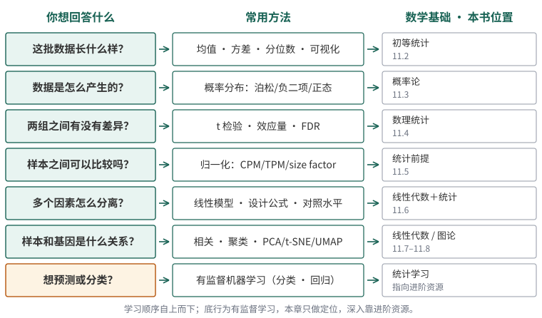{#fig-11-learning-map}

::::: {.callout-note .book-core title="核心知识｜学统计的顺序不是按数学课本的目录"}

数学教材从公理体系讲起，适合系统学习，但和生信分析的用法是两个方向。本书建议的顺序是：**带着数据学**——每个概念都对应一种你已经见过的分析。遇到难以理解的概念时，可以回到数据，先问“这个数是怎么算出来的”。需要系统补课时，参考本章末尾的[进阶资源](#topic-11-resources)。

:::::

### 一条可执行的学习路线 {#topic-11-resources}

对多数同学，我们把深度分三层：

1. **入门够用**（本章 11.2—11.6 + 各实战章）：会解读结果表的每一列，知道方法的前提是什么、结果能支持什么结论。
2. **能做判断**（本章 11.7—11.9 + 反复实践）：能给真实数据选对方法，看出参数和图形背后的问题，识别越界的结论。
3. **按需深入**：做一个具体项目卡住时再深入。例如做差异分析被批次效应困住，就去学线性模型的对比与混合模型；做分类预测，就去学交叉验证与过拟合。

资源上，两本免费在线书值得放在手边：OpenIntro Statistics（[openintro.org/book/os](https://www.openintro.org/book/os/)）覆盖概率论与假设检验的基础；Holmes 与 Huber 的《Modern Statistics for Modern Biology》（[web.stanford.edu/class/bios221/book](https://web.stanford.edu/class/bios221/book/)）全程用 R 和真实生物数据，适合在本书之后继续学习。想系统学机器学习时，再读《An Introduction to Statistical Learning》（原书官网可免费获取）。

## 描述数据与量化不确定性 {#sec-11-02}

### 从一个基因的计数开始 {#topic-11-describe}

描述统计回答的第一个问题是：这批数长什么样？我们用 GTEx 数据库里白蛋白基因 `ALB` 在 10 个肝组织样本中的表达量做例子（数据的来历见 [11.8](#sec-11-08)，这里是同一套数据）。

```{.r .numberLines data-book-role="code"}
# ALB 在 GTEx 10 个肝样本中的 TPM（第 11.8 节同一数据子集）
alb_liver_tpm <- c(43600, 59050, 38210, 24270, 36410,
                   24030, 30130, 19050, 29260, 21590)
mean(alb_liver_tpm)     # 均值：32560
median(alb_liver_tpm)   # 中位数：29695
sd(alb_liver_tpm)       # 标准差：12163
range(alb_liver_tpm)    # 最小值到最大值：19050 到 59050
```

同一个基因、同一种组织，表达量最高和最低的样本相差三倍。**生物学重复之间的这种差异是真实的**：供体的遗传背景、取材位置、文库制备批次都会造成差别。分析前先看这些描述量，就是在问“我手里的变异有多大”——它决定了后面任何比较的难度。

表达量跨样本比较前通常取对数，让分布更接近对称、方差更稳定：

```{.r .numberLines data-book-role="code"}
alb <- log2(alb_liver_tpm + 1)   # 加 1 避免 log2(0)
mean(alb)                        # 14.909
sd(alb)                          # 0.504
quantile(alb)                    # 0%/25%/50%/75%/100% 分位数
# 14.22 14.56 14.86 15.20 15.85
```

取对数之后，10 个样本的 `ALB` 表达集中在 14.2—15.9 之间（即 TPM 在 2 万—6 万之间），中位数和均值接近，分布大致对称。从此我们用 `log2(TPM+1)` 这个量讨论问题。

### 变异与不确定是两回事 {#topic-11-sd-se-ci}

接下来区分两个容易混淆的概念。**标准差（SD）描述样本之间的变异**；**标准误（SE）描述“估计出的均值”这个数本身的不确定性**：

$$
SE = \frac{SD}{\sqrt{n}}
$$ {#eq-se-def}

10 个肝样本 `SD = 0.504`，于是均值的 `SE = 0.504 / √10 ≈ 0.159`。把样本量加到 40，SD 基本不变（组织还是那个组织，变异还是那些来源），SE 却减半（分母是 √40）——**测得更准，不等于样本更整齐**。

```{.r .numberLines data-book-role="code"}
n <- 10
se <- sd(alb) / sqrt(n)
se                                    # 0.159
mean(alb) + c(-1, 1) * qt(0.975, n - 1) * se
# 14.548 15.269   即均值的 95% 置信区间
```

置信区间的读法：如果反复取样并计算区间，约 95% 的区间会盖住真值。它不是“真值有 95% 的概率落在这个区间”——真值是固定数，随机的是区间。样本量越小、变异越大，区间越宽：`ALB` 均值的区间宽约 0.72（log2 尺度），说明用 10 个样本估计“肝中 ALB 的典型表达”已经比较准了。

::::: {.callout-warning .book-warning title="注意｜三个常见混淆"}

- 把 SD 当成“误差”：论文里“mean ± SD”和“mean ± SE”含义完全不同，读图先看图例写的是哪个。
- 用 SE 描述样本变异：SE 会随 n 缩小，拿它展示“数据很集中”是过度美化。
- 把 95% 置信区间读成真值的概率区间（见上文）。

:::::

## 概率分布与计数数据 {#sec-11-03}

### 从二项、泊松到负二项 {#topic-11-count-dist}

描述统计刻画“观察到什么”，概率分布回答“这些数是怎么产生的”。RNA-seq 计数的产生机制可以这样想：测序得到的每个读段落到基因组上哪个基因，是一次随机试验。对一个基因来说，每个读段要么落到该基因上（概率很小，记为 p），要么不落（概率 1−p）——大量读段独立重复，落到该基因的读段数服从**二项分布**。当读段总数巨大而 p 极小时，二项分布近似为**泊松分布**，它的特点是均值等于方差。

问题出在真实数据比这个模型“散”。泊松假设每个样本的期望计数完全一致，但生物学重复之间的文库组成本身在变（上节已经看到三倍的样本差异）。于是计数的方差系统性大于均值，这叫**过度离散**。描述它的模型是**负二项分布**：在泊松的基础上，让期望本身再随机波动一层。

```{.r .numberLines data-book-role="code"}
set.seed(20261011)
pois <- rpois(4000, lambda = 20)            # 泊松：均值 = 方差 = 20
nb   <- rnbinom(4000, mu = 20, size = 8)    # 负二项：均值 20，方差 20 + 20²/8 = 70
c(mean = mean(pois), var = var(pois))       # 20.06  20.20
c(mean = mean(nb),   var = var(nb))         # 20.09  72.49
```

@fig-11-count-dist 展示两组模拟计数：均值相同，负二项明显更散。这正是 [第 5 章](05-rna-seq.md#src-0050-RNA-seq-793) 差异分析不用普通 t 检验、而用 DESeq2/edgeR 这类负二项模型的原因——数据的产生机制决定了模型的选择。

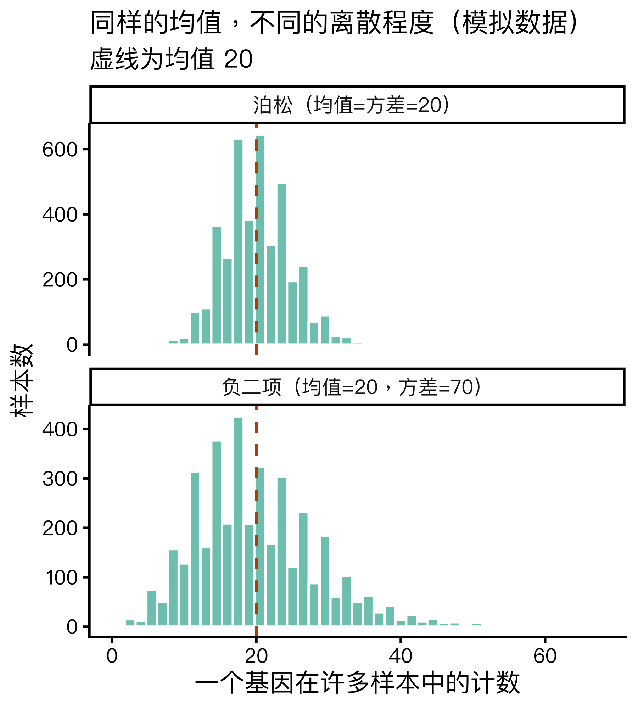{#fig-11-count-dist}

### 正态分布、t 分布与对数变换 {#topic-11-normal-t}

连续型数据常用**正态分布**描述。表达量取对数后近似正态，这是 heatmap、PCA、t 检验能用在表达数据上的前提。**t 分布**和正态几乎一样，只是尾巴更厚——样本量小的时候，估计出的方差本身不可靠，t 分布用厚尾巴补偿这种不确定性。上节置信区间用 `qt(0.975, n-1)` 而不是 1.96，就是这个原因；n 越大，t 分布越接近正态。

选择模型时，先区分数据类型：**计数看泊松/负二项，对数表达量看正态/t；分组比较前先确认自己面对的是哪一种数据**。

## 效应量、假设检验与多重比较 {#sec-11-04}

### t 检验：两组数据的比较 {#src-0080-statistics-3}

t 检验回答的问题是：两组数据的差异，相对于组内波动而言大不大？统计量 t 就是这两者的比：差异越大、组内波动越小、样本越多，t 越大。

继续用 `ALB`：肝 10 个样本、胰腺 10 个样本（同一 GTEx 子集）。直觉上白蛋白由肝细胞分泌，两组应该差很多——下面用检验量化这个差异：

```{.r .numberLines data-book-role="code"}
alb_pancreas <- c(7.819, 9.376, 8.608, 8.223, 8.041,
                  8.751, 8.655, 8.503, 7.373, 8.707)   # log2(TPM+1)
t.test(alb, alb_pancreas)
```

```{.text data-book-role="output"}
	Welch Two Sample t-test

data:  alb and alb_pancreas
t = 27.251, df = 17.79, p-value = 5.873e-16
alternative hypothesis: true difference in means is not equal to 0
95 percent confidence interval:
 6.001272 7.004821
sample estimates:
mean of x mean of y
  14.90865   8.40560
```

结果逐项读：t = 27.25，组间差异远大于组内波动；两组均值差 6.50（log2 尺度，即约 90 倍），95% 置信区间 [6.00, 7.00] 不含 0；p 值 5.9×10⁻¹⁶。@fig-11-alb-ttest 把两组原始点和均值画在一起——检验做的比较，就是图上“组间距离 vs 组内散布”。

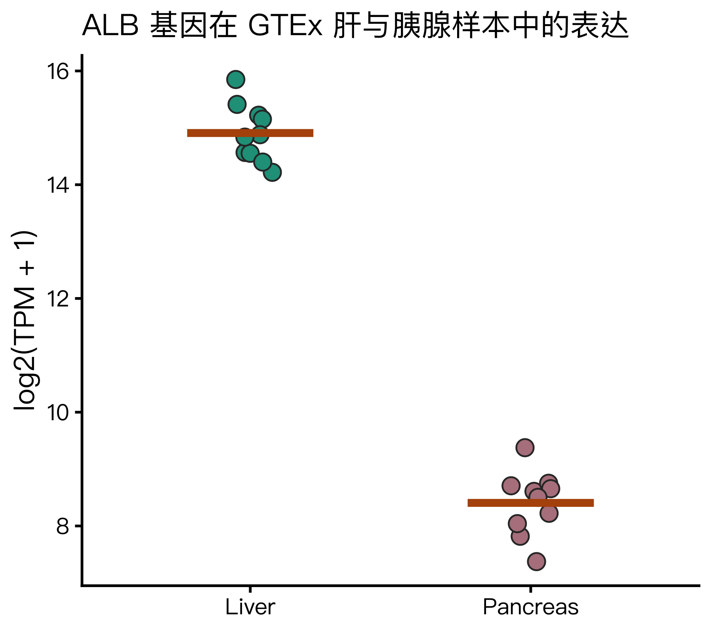{#fig-11-alb-ttest}

t 检验的前提：样本相互独立、数据近似正态（或样本量足够大）、两组方差可比。`t.test()` 默认用 Welch 版本，不要求方差相等——这就是输出里 df = 17.79 而不是 18 的原因。前提明显不满足时（比如严重偏态的计数），换 Wilcoxon 秩和检验或按 [11.3](#sec-11-03) 的思路换模型。

::::: {.callout-tip .book-example title="示例与练习｜2×2 设计为什么弱"}

[第 5 章](05-rna-seq.md#topic-05-sample-design)的 METTL3 数据每组只有 2 个生物学重复：组内 SD 本身估计不稳，t 检验置信区间会非常宽。这就是“每组至少 3 个重复、条件允许更多”的统计理由。想想：n=2 时 `qt(0.975, 1)` 是多少？（答案：12.7——均值要拉出组内 SD 的十几倍才显著。）

:::::

### p 值是什么、不是什么 {#topic-11-pvalue}

p 值的定义：**假如两组真的没有差异（原假设成立），观察到当前这么极端或更极端的差异的概率**。它不是“两组有差异的概率”，也不是“结果正确的概率”。三个高频误读：

- p = 0.06 不等于“没差异”，只说明现有数据不足以排除偶然；效应量和置信区间比 p 值信息量大。
- p 值受样本量影响：差异不变，样本翻倍，p 值可以缩小几个数量级。显著 ≠ 重要。
- 一次检验的 p = 0.03 不等于结论有 97% 的把握重复出来。

### 效应量与 log2FoldChange {#topic-11-effect-size}

效应量回答“差多少”。RNA-seq 用 `log2FoldChange`：上面两组均值差 6.50 就是这个量，换算回去是 2^6.50 ≈ 90 倍。火山图（[第 5 章](05-rna-seq.md#src-0050-RNA-seq-793)）横轴是效应量、纵轴是显著性，正是把两个维度分开看：筛选阈值同时设在这两根轴上（例如 |log2FC| > 1 且 padj < 0.05），是在说“既要差得够多，又要经得起检验”。

### 检验两万次：多重比较与 FDR {#topic-11-fdr}

差异表达是对每个基因各做一次检验，人类基因组一次就是两万次。就算两组完全相同，两万次检验里也会“显著”出几百个 p < 0.05 的基因——这就是多重比较问题。常用的控制目标是**错误发现率（FDR）**：让“显著”列表中错误项的期望比例不超过阈值。Benjamini–Hochberg（BH） procedure 的直觉是把所有 p 值排序后，按名次放大阈值再取最严格的一档：

```{.r .numberLines data-book-role="code"}
p <- c(0.001, 0.008, 0.013, 0.180, 0.350)   # 5 个基因的原始 p 值
p.adjust(p, method = "BH")
```

```{.text data-book-role="output"}
[1] 0.005 0.020 0.022 0.225 0.350
```

DESeq2 结果表的 `padj` 列就是这么来的（对通过均值过滤的基因做 BH 校正）。读差异结果时永远看 `padj` 而不是原始 p 值——这是 [第 5 章](05-rna-seq.md#src-0050-RNA-seq-793) 结果表解读的统计背景。

## 归一化及其隐含假设 {#sec-11-05}

### 为什么原始计数不可比 {#topic-11-why-normalize}

[第 5 章](05-rna-seq.md#src-0050-RNA-seq-304)提过归一化的操作，这里补上“为什么”。两个样本测到的原始计数受三件事影响：基因的真实表达、**测序深度**（文库大小）和**基因长度**。后两者与生物学无关，却在原始计数里占了很大分量——样本 2 测了双倍的读段，所有基因的计数都近似翻倍，看似“全部上调”。

### CPM、TPM 与 size factor {#topic-11-normalization-methods}

常用归一化量各自处理了不同的因素。用一张 3 基因 × 2 样本的小计数表算一遍：

```{.r .numberLines data-book-role="code"}
counts <- matrix(c(2200,  800, 150,     # 样本 1：基因 A/B/C
                   9800, 4200, 300),    # 样本 2
                 nrow = 3, byrow = FALSE,
                 dimnames = list(c("geneA", "geneB", "geneC"),
                                 c("sample1", "sample2")))
kb <- c(1.2, 15.8, 3.4)                       # 三个基因的长度（kb）

# CPM：只除以文库大小，消除测序深度差异
cpm <- sweep(counts, 2, colSums(counts), "/") * 1e6
round(cpm)
#        sample1 sample2
# geneA   335878   73394
# geneB    22901  899083
# geneC   641221   27523

# TPM：先按基因长度折算（RPK），再在每个样本内归一到百万
rpk <- counts / kb
tpm <- sweep(rpk, 2, colSums(rpk), "/") * 1e6
round(tpm)
#        sample1 sample2
# geneA   595601  484794
# geneB     3084  451042
# geneC   401314   64164
```

对比 `geneC` 的两行：CPM 里它在样本 1 高、样本 2 低；TPM 里结论相反——因为长基因 `geneB` 在样本 2 占用了较多测序读段，把它折算掉之后其余基因的相对比例全变了。**每种归一化都在改变“比较的尺度”**：

- **CPM**：只管测序深度，用于计数型分析（如 5.4 节的计数矩阵）。
- **TPM**：同时管深度与基因长度，样本内总和恒为一百万，适合“一个基因在组织间谁高谁低”的展示与排序。
- **DESeq2 size factor**：基于“大多数基因不差异”的假设，用中位数比值估计每个样本的缩放系数，**保留计数的整数性质**，供负二项模型直接使用——这是差异检验用原始计数矩阵加 size factor、而不用 TPM 的原因。
- 单细胞场景的 logNormalize/SCTransform 在 [第 9 章](09-single-cell-and-spatial-omics.md#sec-09-03)按其数据特点另有展开。

::::: {.callout-warning .book-warning title="注意｜归一化不创造可比性"}

归一化只能消除技术因素，不能修复设计问题。样本制备批次和处理分组混在一起时（批次即分组），任何归一化都无法把两者分开——这要靠实验设计和 [11.6](#sec-11-06) 的设计公式。另外，“大多数基因不差异”是 size factor 和许多方法的前提；全局 shift（如整体转录量变化）会让这类假设失真。

:::::

## 回归、设计公式与比较方向 {#sec-11-06}

### 线性回归：把比较写成模型 {#src-0080-statistics-5}

t 检验一次只能比较两组，而真实实验常有多个因素。**线性模型**把“哪些因素影响表达”写成一条公式，一次估计所有因素的作用。先看最简单的情形——它和 t 检验是同一件事：

```{.r .numberLines data-book-role="code"}
d2 <- data.frame(
  tissue = factor(rep(c("Liver", "Pancreas"), each = 10)),
  alb    = c(alb, alb_pancreas))
fit <- lm(alb ~ tissue, data = d2)
round(coef(fit), 3)
#    (Intercept) tissuePancreas
#         14.909         -6.503
```

`alb ~ tissue` 读作“alb 由 tissue 解释”。`lm()` 把分类型变量变成 0/1 哑变量（@fig-11-design-matrix）：截距 14.909 是第一个水平 Liver 的均值；`tissuePancreas` 的系数 −6.503 是“从 Liver 换到 Pancreas，表达变化多少”——正是 t 检验里的均值差。`confint(fit)` 给出每个系数的 95% 置信区间（[−7.00, −6.00]），与 t 检验输出一致。

### 设计公式与比较方向 {#topic-11-design}

设计公式可以加入多个因素。`~ batch + condition` 表示“先扣掉批次的影响，再估计处理效应”——DESeq2 的 `design = ~condition`（[第 5 章](05-rna-seq.md#src-0050-RNA-seq-793)）正是这里最简的情形；若当时还有批次注释，就该写成 `~ batch + condition`。两个实用要点：

- **对照水平决定符号**。R 按因子水平的字母序选第一个水平当截距：Liver 在前，所以系数是“胰腺减肝”。要反过来，用 `factor(tissue, levels = c(“Pancreas”, “Liver”))` 或 `relevel()`。[第 5 章](05-rna-seq.md#topic-05-sample-design)特意提醒“注意分组方向”，因为 log2FC 的正负号完全由它决定——表格里上调下调写反，多半是这一步错了。
- **比较方向与检验方向**。contrast 是“谁减谁”的问题，不是“谁比谁高”的问题：写清楚方向，讨论“上调/下调”时才能正确对应比较的两组。

{#fig-11-design-matrix}

### 从线性模型到 DESeq2 的真实模型 {#topic-11-glm}

普通线性模型假设方差恒定、响应连续，不符合计数的特性（[11.3](#sec-11-03)）。**广义线性模型（GLM）**调整了响应分布与均值的表达方式：响应服从负二项分布（刻画过度离散），均值的对数是各因素的线性组合（log 链接，保证预测值为正）。于是 [第 5 章](05-rna-seq.md#src-0050-RNA-seq-793) 的 DESeq2 流程可以完整地翻译成统计语言：

- `estimateSizeFactors()` → [11.5](#sec-11-05) 的 size factor 归一化；
- `~ condition` 设计 → 本节的设计公式；
- 负二项 GLM 拟合 → [11.3](#sec-11-03) 的计数分布；
- Wald 检验 → [11.4](#sec-11-04) 的假设检验；
- `padj` → BH 校正。

这样，第 5 章的各个操作就与相应的统计方法对应起来了。**归一化、模型拟合、检验和校正彼此相连**，需要结合起来理解。

## 探索数据结构：相关、聚类与降维 {#sec-11-07}

差异分析是“带着假设验证”，很多时候还需要“不带假设地看数据”：样本之间谁和谁像？有没有离群样本？分组标签是否真的反映表达结构？这类问题交给相关、聚类和降维。

### 相关与距离 {#topic-11-correlation}

**Pearson 相关系数**度量两个变量的线性关系，取值 −1 到 1；**Spearman 相关**先取秩再算，对量纲和偏态稳健。在样本×样本相关热图（[第 5 章](05-rna-seq.md#topic-05-sample-qc)）里，每个格子是两个样本在几千个基因上的相关——“组内相关高于组间”就是这么读出来的。

降维与聚类不直接用相关，而用**距离**：两样本在所有基因上的差别的汇总，最常见是欧氏距离。相关高、距离不一定近（整体差一个常数时相关为 1 但距离不小），所以**先想清楚“相似”怎么定义，再选方法**——这是探索分析的第一个决定。log 变换在这里也发挥作用：高表达基因的绝对差异会支配距离，取对数后各基因的贡献更均衡。

### 聚类：把相似的放在一起 {#src-0080-statistics-11}

**层次聚类**从“每个样本自成一簇”开始，反复合并最相似的簇，得到一棵树；**k-means** 把样本分进 k 个簇、迭代更新簇中心。两者都依赖距离的选择。两个使用要点：类别数（树的切割高度、k 的大小）是人为设定，不同选择给不同结果；聚类对离群点敏感。**聚类是操作定义，不是自然类别**——[第 9 章](09-single-cell-and-spatial-omics.md#sec-09-03)单细胞分析里“细胞类型”要先靠聚类发现、再用标记基因确认，用的正是这条谨慎原则。

### 主成分分析：线性降维 {#src-0080-statistics-7}

几千个基因维度里看不出样本结构，PCA 把数据投影到几个“最能保留差异”的方向上。其核心原理是：**在样本 × 基因矩阵上找一组互相垂直的新坐标轴（主成分），第一轴让投影后的方差最大，第二轴在与第一轴垂直的方向上继续取方差最大**。数学上这是对中心化数据的协方差矩阵做特征分解，主成分方向是特征向量、方差解释比例是特征值占比——这里先介绍分析所需的原理，熟悉矩阵运算的同学可以在[进阶资源](#topic-11-resources)里找到完整版。

@fig-11-pca-principle 用两个基因的简化情形展示“投影”在做什么。真实分析里：输入是行=样本、列=基因（通常已 log 变换、常取高变基因）的矩阵，输出是每个样本的前几个主成分得分。**载荷（loading）**告诉你每个主成分由哪些基因构成，是 PCA 可解释性的来源；**碎石图**（各主成分的方差解释比例）告诉你前几个成分保留了多少信息——前几名加起来不高，说明数据结构复杂，二维图只是其中一个切面。第 5 章的 `plotPCA()` 和 11.8 节的 GTEx 实战都是这套流程。

[]{#src-0080-statistics-9}

**主坐标分析（PCoA）**是 PCA 的推广：不要求原始坐标，只要有样本间的距离矩阵就能做（PCA 只用欧氏距离）。扩增子分析常用 Bray–Curtis 距离加 PCoA，单细胞用其他距离的场合同理——先定义距离，再找最能代表距离结构的低维坐标。

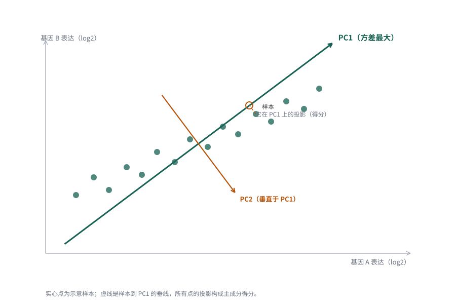{#fig-11-pca-principle}

### 非线性降维：t-SNE 与 UMAP {#src-0080-statistics-13}

[]{#src-0080-statistics-73}

PCA 只能表达线性结构。当数据的真实结构“弯”在高维空间里——单细胞分化过程中的连续状态就是典型——线性投影会把不相近的细胞压到一起。这类数据需要**流形学习**：数据的高维分布近似躺在一个低维“流形”上，经典比喻是“瑞士卷”（@fig-11-swiss-roll）：三维的点其实排在一张二维曲面上，卷曲让欧氏距离失真（两黑点在纸面上的距离是红线，直线穿过去的欧氏距离却短得多）。t-SNE 和 UMAP 都试图把这张曲面“摊开”到二维。

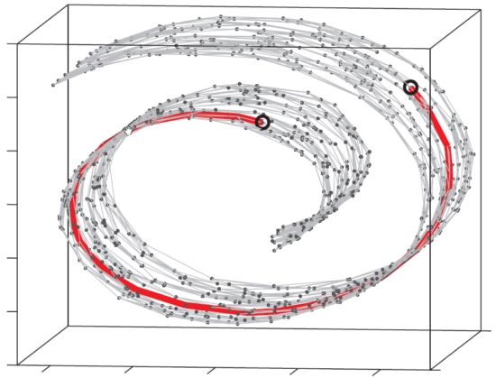{#fig-11-swiss-roll}

[]{#src-0080-statistics-19}

#### 信息熵与 KL 散度：t-SNE 的两块基石 {#topic-11-entropy-kl}

[]{#src-0080-statistics-21}

t-SNE 的优化目标要用两个信息论概念。**信息熵**度量一个分布的不确定性。以天气为例：90% 下雨时，结果几乎确定，熵低；50/50 时最难判断，熵最高。晴雨两种天气的熵计算：

$$
H(X) = -\sum_{i=1}^{r} p(a_i) \log_2 p(a_i)
$$ {#eq-entropy}

[]{#src-0080-statistics-40}

代入三个预报（90/10、50/50、10/90）：熵分别是 0.469、1.0、0.469 比特。“旗鼓相当最难猜”就是熵最大的情形。

**KL 散度（相对熵）**度量两个分布的差别：$D_{KL}(P\|Q)$ 表示“用 Q 去近似真实分布 P”时平均多付出的信息量：

$$
D_{KL}(P \| Q) = \sum_{i=1}^{n} p(x_i) \log \frac{p(x_i)}{q(x_i)}
$$ {#eq-kl}

注意 $D_{KL}(P\|Q) \neq D_{KL}(Q\|P)$——KL 散度不对称，所以它不是距离。t-SNE 把“高维结构在低维图里保真吗”写成一个 KL 散度：最小化它，就是让低维图尽可能复现高维的邻近关系。

#### 从 SNE 到 t-SNE {#src-0080-statistics-71}

[]{#src-0080-statistics-90}

SNE（t-SNE 的前身）分为三步。第一步，把高维距离变成概率：样本 $j$ 离 $i$ 越近，条件概率 $p_{j|i}$ 越大，

$$
p_{j|i} = \frac{\exp\left(-\|x_i - x_j\|^2 / 2\sigma_i^2\right)}{\sum_{k \neq i} \exp\left(-\|x_i - x_k\|^2 / 2\sigma_i^2\right)}
$$ {#eq-conditional-p}

其中 $\sigma_i$ 控制以 $i$ 为中心的高斯核宽度——密集区的样本用小 $\sigma$、稀疏区用大 $\sigma$，由**困惑度（perplexity）**统一确定。困惑度定义为 $2^{H(P_i)}$，即条件分布的熵换算成的“有效邻居数”：困惑度 30 大致意味着每个点按 30 个近邻来定标。这是 t-SNE 最重要的参数，原论文建议在小数据集上取 5—50 之间的几个值都看看；数据越大可用的值越大（scikit-learn 文档的建议是随样本量增加而加大）。

第二步，在低维（二维）上同样定义概率 $q_{ij}$。第三步，用梯度下降迭代调整低维坐标，最小化 $\sum_i D_{KL}(P_i \| Q_i)$。

[]{#src-0080-statistics-177}

t-SNE 相对 SNE 的两处关键改进：一是把条件概率对称化为联合概率 $p_{ij} = (p_{j|i} + p_{i|j}) / (2n)$，让“i 视 j 为近邻”与“j 视 i 为近邻”权重一致；二是低维分布改用自由度为 1 的 t 分布（重尾巴），

$$
q_{ij} = \frac{\left(1 + \|y_i - y_j\|^2\right)^{-1}}{\sum_{k \neq l} \left(1 + \|y_k - y_l\|^2\right)^{-1}}
$$ {#eq-lowdim-q}

t 分布的重尾巴解决了**拥挤问题**：高维里挤在一起的近邻，在低维里仍可以摊开；高维里中等的距离在低维里被推得更远（@fig-11-t-vs-normal）。代价是 t-SNE 图上**簇间距离和簇大小基本不可解读**——它保留的是局部邻接，不是全局几何（这也是单细胞领域后来更多用 UMAP 的原因之一）。[11.8](#sec-11-08) 会用真实数据展示困惑度和随机种子的影响。

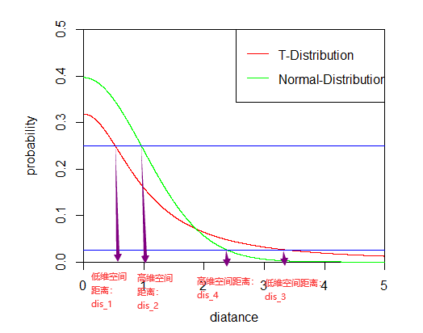{#fig-11-t-vs-normal}

::::: {.callout-note .book-extension title="拓展阅读｜SNE 的逐步推导（4×4 表达矩阵示例）" collapse="true"}

以 4 个细胞、每个细胞 4 个基因表达值的 $4\times 4$ 矩阵为例，可以完整走一遍 SNE：(1) 计算两两欧氏距离 $dis(cell_i, cell_j)$；(2) 按式 @eq-conditional-p 把距离转成条件概率 $p_{j|i}$；(3) 对每个细胞解方程 $2^{H(P_i)} = \text{perplexity}$（$H$ 为式 @eq-entropy 的熵），得到各自的 $\sigma_i$；(4) 随机初始化低维坐标，同样计算 $q_{j|i}$；(5) 以 $C = \sum_i \sum_j p_{j|i} \log(p_{j|i}/q_{j|i})$ 为目标做梯度下降（默认约 1000 步）。原论文与推导细节见 van der Maaten 与 Hinton 2008 年的 JMLR 文章^[van der Maaten, L. & Hinton, G. (2008). Visualizing Data using t-SNE. *Journal of Machine Learning Research*, 9, 2579–2605. [jmlr.org/papers/v9/vandermaaten08a.html](https://www.jmlr.org/papers/v9/vandermaaten08a.html)。]。

:::::

#### UMAP：另一种摊开流形的方式 {#topic-11-umap}

[]{#src-0080-statistics-210}

**UMAP**（Uniform Manifold Approximation and Projection）思路不同：先用 **kNN 图**把每个点连向最近的 k 个邻居（这个 k 就是参数 `n_neighbors`），把边转成模糊的“连接强度”，再在低维上直接优化这张图的布局。与 t-SNE 相比，UMAP 通常更快、对全局结构保留更好（簇间相对位置多少有些参考价值），已成为单细胞分析的默认可视化；但它同样**不保证低维距离可当真实距离用**，同样对参数和随机性敏感。

两个关键参数（[官方文档](https://umap-learn.readthedocs.io/en/latest/parameters.html)）：`n_neighbors`（默认 15）控制“看多远”——小值只顾紧邻的局部结构，大值纳入更多全局信息；`min_dist`（默认 0.1）控制低维图上点能挤到多近——小值成团紧密，大值摊得松散。[11.8](#sec-11-08) 会实测两者的影响。

**t-SNE 与 UMAP 的共同警告**（也是读图时的注意事项）：图上两簇的距离、簇的大小、甚至簇的个数都可能随参数和种子改变^[Wattenberg, M., Viégas, F. & Johnson, I. (2016). How to Use t-SNE Effectively. *Distill*. [distill.pub/2016/misread-tsne](https://distill.pub/2016/misread-tsne/)。]。它们是**探索与展示**工具：用来发现结构、生成假设，再把结论交回差异分析或聚类去检验。

## GTEx 实战：用多组织真实数据比较降维方法 {#sec-11-08}

### GTEx：公共的人体组织表达库 {#src-0080-statistics-225}

下面下载真实数据，观察这些方法的实际表现。**GTEx**（Genotype-Tissue Expression）项目收集了数百名捐赠者全身数十种组织的 RNA-seq 数据，是“组织特异性表达”最重要的公共资源之一；v8 版本覆盖 838 名捐赠者、17,382 个样本^[GTEx Consortium (2020). The GTEx Consortium atlas of genetic regulatory effects across human tissues. *Science*, 369(6509), 1318–1330.。]。组织之间的表达差异远大于个体差异，正是演示降维的理想数据：如果方法可靠，样本应当按组织而不是按捐赠者聚在一起。

基因 TPM 矩阵（约 1.6 GB）和样本注释表是开放数据，可直接下载（2026 年 10 月核实的官方直链）：

```{.bash .numberLines data-book-role="code"}
# 全样本基因 TPM 矩阵：56,200 基因 × 17,382 样本（约 1.6 GB）
curl -O https://storage.googleapis.com/adult-gtex/bulk-gex/v8/rna-seq/GTEx_Analysis_2017-06-05_v8_RNASeQCv1.1.9_gene_tpm.gct.gz
# 样本属性注释表：样本 ID → 组织类型（SMTS）等（约 11 MB）
curl -O https://storage.googleapis.com/adult-gtex/annotations/v8/metadata-files/GTEx_Analysis_v8_Annotations_SampleAttributesDS.txt
```

```{.r .numberLines data-book-role="code"}
# install.packages(c("data.table", "R.utils", "ggplot2", "Rtsne", "uwot", "showtext"))
library(data.table)
tpm   <- fread("GTEx_Analysis_2017-06-05_v8_RNASeQCv1.1.9_gene_tpm.gct.gz",
               skip = 2, header = TRUE)          # 跳过 gct 前两行版本说明
annot <- fread("GTEx_Analysis_v8_Annotations_SampleAttributesDS.txt",
               select = c("SAMPID", "SMTS"))     # 只读需要的两列
dim(tpm)          # 56200 17384（基因 × [Name+Description+样本]）
```

### 预处理：log 变换与高变基因 {#topic-11-gtex-prep}

全矩阵太大，教学上取 10 个组织、每个组织 10 个样本（共 100 个样本，来自 38 名捐赠者）。随后两步预处理与 [第 9 章](09-single-cell-and-spatial-omics.md#sec-09-03)的思路一致：**log2(TPM+1)** 稳定方差，**只保留变异最大的 3000 个高变基因**——组织间的差异信号集中在这些基因里，低变基因只添噪声和计算量。

```{.r .numberLines data-book-role="code" data-focus-lines="4,7"}
tissues10 <- c("Brain", "Heart", "Lung", "Liver", "Pancreas",
               "Stomach", "Colon", "Blood", "Muscle", "Kidney")
rna     <- annot[SAMPID %in% names(tpm)]        # 注释表里只保留 RNA-seq 样本
setorder(rna, SAMPID)                           # 固定取样顺序，保证可复现
samples <- rna[SMTS %in% tissues10, head(.SD, 10), by = SMTS]
cols    <- samples$SAMPID
mat     <- as.matrix(tpm[, ..cols]); rownames(mat) <- tpm$Name

log_tpm  <- log2(mat + 1)                       # 样本 × 基因 的对数表达
gene_var <- apply(log_tpm, 1, var)
x <- t(log_tpm[names(sort(gene_var, decreasing = TRUE))[1:3000], ])
dim(x)          # 100 3000（样本 × 高变基因）
```

本章所有图由随书脚本 `scripts/figures/ch11/gtex_dimred.R` 在这套输入上生成，随机种子固定并在脚本内验证可复现（t-SNE 同种子两次运行结果完全一致；UMAP 需单线程加种子）。

### PCA：组织按什么分开 {#topic-11-gtex-pca}

```{.r .numberLines data-book-role="code"}
pca <- prcomp(x, center = TRUE, scale. = FALSE)
pve <- pca$sdev^2 / sum(pca$sdev^2)     # 各主成分方差解释比例
plot(pca$x[, 1], pca$x[, 2], col = factor(samples$SMTS))  # 简图；书用 ggplot2 着色
```

@fig-11-gtex-pca 是结果：PC1 解释 19.9%、PC2 解释 17.5%，十个组织几乎完全按组织分开——脑、肌肉、心、肝各自成簇，位置与生理功能对应（高代谢的器官在 PC1 一侧、免疫相关的全血在另一侧）。@fig-11-gtex-scree 的碎石图显示前五个主成分合计约 72%，二维图虽然只切了一个截面，主结构已经清楚。这与 [第 5 章](05-rna-seq.md#topic-05-sample-qc) 差异分析前的 PCA 检查是同一个方法、同一个读法：**样本该聚的聚了，才轮得到下游分析；若有样本落错了簇，先查标签和批次，再谈结论**。

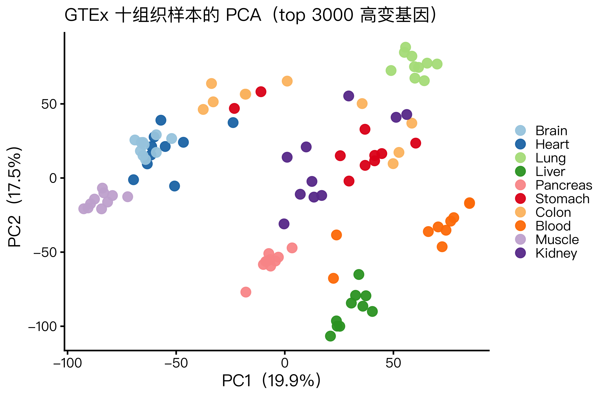{#fig-11-gtex-pca}

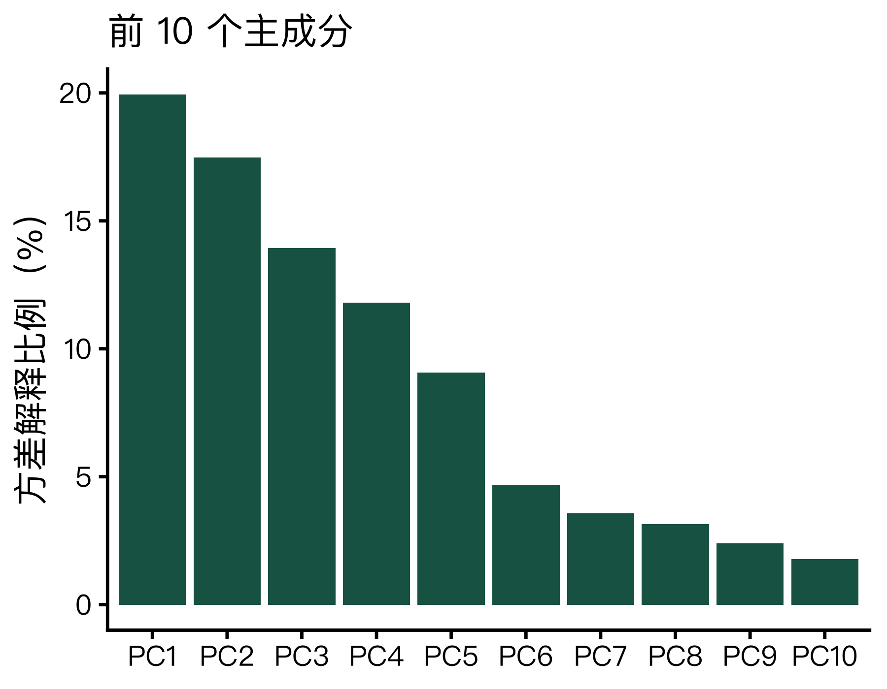{#fig-11-gtex-scree}

### t-SNE：perplexity 与随机种子 {#topic-11-gtex-tsne}

```{.r .numberLines data-book-role="code"}
library(Rtsne)
set.seed(20261011)
tsne <- Rtsne(x, dims = 2, perplexity = 30,
              pca = TRUE, check_duplicates = FALSE)
plot(tsne$Y, col = factor(samples$SMTS))
```

@fig-11-gtex-tsne-perp 把困惑度设为 5、15、30 各跑一遍：5 时图碎成小团（每个点只认 5 个邻居，局部噪声被放大），30 时组织块更连贯。注意 Rtsne 要求困惑度小于 (n−1)/3——100 个样本的演示里 30 已接近上限，这也是“困惑度上限随样本量增长”的直观体现。@fig-11-gtex-tsne-seed 则固定困惑度换两个随机种子：组织成员基本稳定，但簇的形状和相对位置明显变化——**t-SNE 图的簇间距离与簇大小不能解读**。

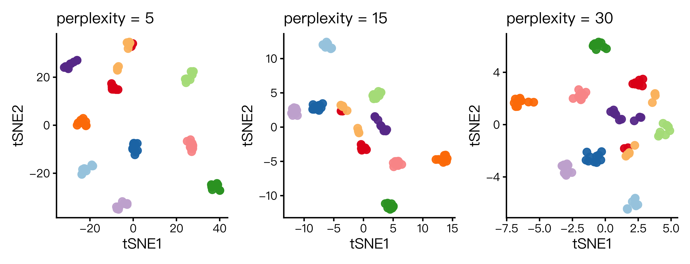{#fig-11-gtex-tsne-perp}

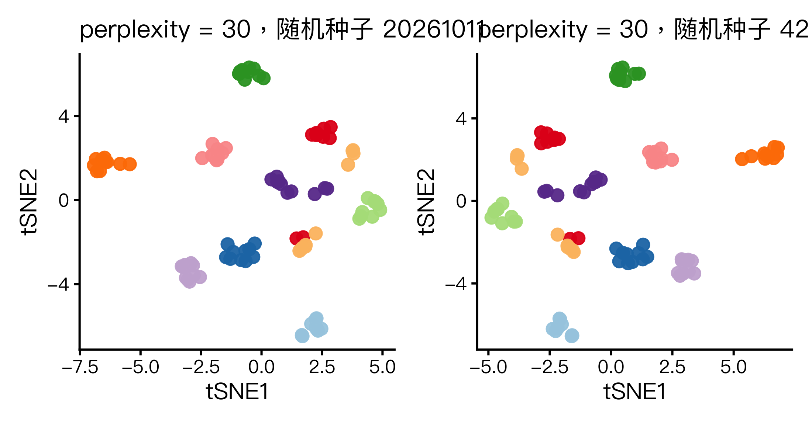{#fig-11-gtex-tsne-seed}

### UMAP：n_neighbors 与 min_dist {#topic-11-gtex-umap}

```{.r .numberLines data-book-role="code"}
library(uwot)
set.seed(20261011)
emb <- umap(x, n_neighbors = 15, min_dist = 0.1,
            metric = "euclidean", seed = 20261011, n_threads = 1)
plot(emb, col = factor(samples$SMTS))
```

@fig-11-gtex-umap-nn 展示 `n_neighbors` = 5 / 15 / 50：小值突出局部小团、图更零碎；50 时（100 个样本的一半）整图被“拉通”，局部细节换成了全局布局。@fig-11-gtex-umap-md 展示 `min_dist` = 0.0 / 0.1 / 1.0：0.0 时点挤成密块，1.0 时整体摊开、簇内结构变模糊。与 t-SNE 相比，UMAP 跑得快、多数情况下簇间相对位置更稳定，但同样要固定种子、同样不能拿图上距离当真实距离。

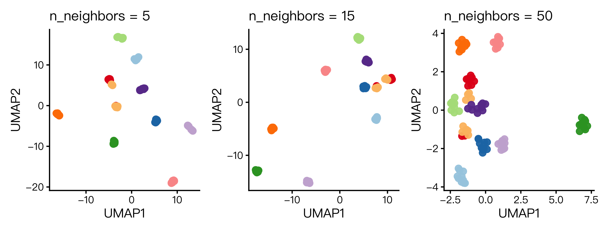{#fig-11-gtex-umap-nn}

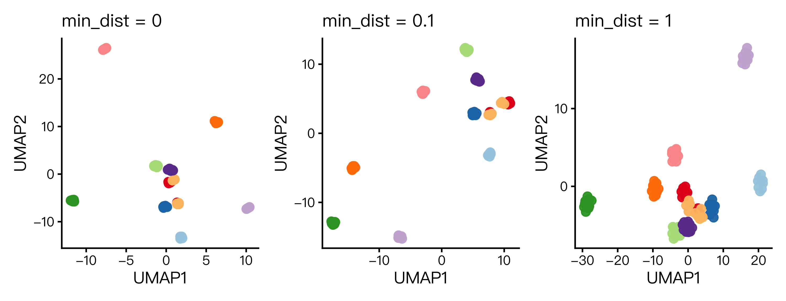{#fig-11-gtex-umap-md}

### 三种方法怎么选 {#topic-11-dimred-choice}

| 方法 | 保留什么 | 适合 | 注意 |
| --- | --- | --- | --- |
| PCA | 线性结构、全局方差 | 第一步检查、定量下游（如取前若干主成分） | 非线性结构会压扁；载荷可解释 |
| t-SNE | 局部邻接 | 可视化、发现簇 | 簇间距离/簇大小不可解读；对困惑度和种子敏感；慢 |
| UMAP | 局部为主、兼顾一定全局 | 可视化、大数据集 | 距离仍不可当真值；对 n_neighbors、min_dist、种子敏感 |

: 三种降维方法的选择要点 {#tbl-11-dimred-compare}

实践上的默认次序：**先 PCA 看主结构与离群样本，需要展示局部结构再用 t-SNE 或 UMAP**；无论用哪个，报告参数与种子（[第 10 章](10-snakemake-and-reproducibility.md#sec-ch10)的可复现原则在这里同样适用），重要的结论不建立在任何一张降维图上。

## 稳健解释、可视化与常见统计误区 {#sec-11-09}

### 常见统计误区清单 {#topic-11-pitfalls}

读论文或检查自己的结果时，可以对照以下常见问题：

- **p 值误读**：把 p 当差异概率、把 0.06 当“无差异”、忽视样本量对 p 的影响（[11.4](#sec-11-04)）。
- **忘记多重检验**：两万次检验挑最小的 p 值报告，不经 BH 校正（[11.4](#topic-11-fdr)）。
- **效应量与显著性不分**：padj 极小但 log2FC 不到 0.1 的“差异基因”，生物学意义要另说（[11.4](#topic-11-effect-size)）。
- **归一化当万能**：批次与分组混在一起时，任何归一化都无法区分两者的影响（[11.5](#sec-11-05)）。
- **比较方向不明**：对照水平没写清，上调下调全反（[11.6](#topic-11-design)）。
- **降维图当证据**：把 t-SNE/UMAP 上的距离、簇大小、簇个数当结论用（[11.7](#topic-11-umap)、[11.8](#sec-11-08)）。
- **相关当因果**：两个基因表达高度相关，可能只是共同响应于第三个因素；[第 9 章](09-single-cell-and-spatial-omics.md#sec-09-04)的“细胞类型要先聚类后用标记基因确认”是同样的谨慎。
- **可视化误导**：截断的 y 轴放大差异、无点的柱状图藏分布、热图色标范围随意拉伸——读图先看坐标与色标。

### 让结论站得住：报告与核查 {#topic-11-reporting}

为了让他人复核结果，报告中需要说明以下信息：数据来源与版本（如 GTEx v8 及下载日期）、预处理与参数（高变基因数、困惑度、n_neighbors）、随机种子、软件与包版本（本章数值来自 R 4.4.1，Rtsne 0.17、uwot 0.2.4）。参数选择可能改变结果，读者需要知道具体设置，才能判断结论是否稳健。

让 AI 参与分析时同样如此。AI 给出的统计方案要按本章的问题清单核对：数据是什么类型、用什么分布建模、怎么归一化、比较方向是什么、多重检验校正了吗、参数和种子记下来了吗。这些检查也是 [第 12 章](12-ai-learning-and-practice.md#sec-12-02)“向 AI 描述任务并核查信息”一节将继续讨论的内容。
