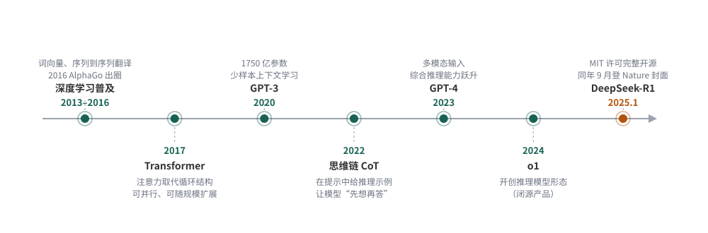
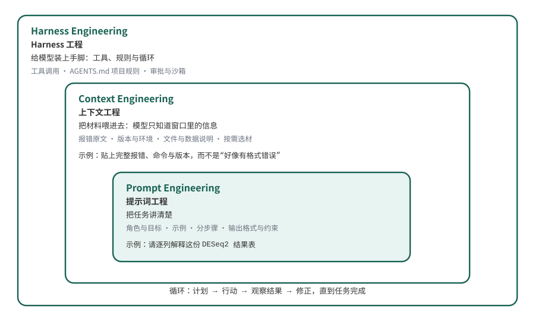

# 拥抱大语言模型 {#sec-ch12}

::: {.hero-book .book-chapter-summary}

## 本章提要 {#chapter-summary-12 .unnumbered}

本章不再展开新的分析技术，而是把全书一直在使用的工具——大语言模型——放到舞台中央。我们先回顾自然语言处理走过的路，看大语言模型如何在深度学习、超大规模预训练与思维链的接力中出现"智能涌现"，又为什么说它虽然不是人类的智能、却已经能够真正参与工作；随后借软件工程的经典文章《没有银弹》讨论 AI 的能力边界：技术上的难可以被大模型快速消除，本质上的难仍然要靠人来判断。在此基础上，我们学习用好大语言模型的三个阶段——提示词工程、上下文工程与 Harness 工程，认识把流程固化为可复用能力的 skill，理解为什么在 AI 时代必须用 Git 为每一轮改动留下案底。最后以 ZCode 为例，从拷问需求、建立项目记忆，到逐轮实现、测试与复盘，完整走一遍智能体项目实战。读完本章，你应该能放心地把重复劳动交给 agent，同时清楚哪些判断必须由自己负责。

:::

## 从自然语言处理到大语言模型的智能涌现 {#sec-12-01}

看清大语言模型从哪里来，理解它"会做事"的能力来源。

### 从专用小模型到通用大模型 {#topic-12-nlp-to-llm}

在大语言模型（Large Language Model，LLM）出现之前，让计算机处理自然语言是一件"一个任务一套办法"的事。自然语言处理（Natural Language Processing，NLP）的经典任务包括中文分词、词性标注、命名实体识别、机器翻译、情感分析和文本分类。生物信息学也用这些技术做文献挖掘，例如从 PubMed 的海量论文里抽取"某个基因与某种疾病相关"的线索。每个任务都要标注专门的数据、设计专门的特征、训练专门的模型；换一个任务，这些工作基本重来。

2016 年是一个转折点。这一年 3 月，AlphaGo 以 4:1 战胜李世石，深度学习从学术圈走向公众视野。在自然语言处理领域，深度学习其实早已铺开——词向量、序列到序列翻译、注意力机制相继出现——但"一个任务一套模型"的格局没有变。真正的转折发生在 2017 年：Google 的团队提出 Transformer 架构，用注意力机制完全取代了循环结构[^ch12-transformer]。这个架构有两个后来被证明很关键的特性：**可以并行计算**，因此能够用海量文本训练；**可以随规模扩展**，模型越大、效果越好。

沿着"预训练＋规模化"的路线，参数量从亿级一路涨到千亿级。2020 年，OpenAI 发布拥有 1750 亿参数的 GPT-3[^ch12-gpt3]，它展示了一种前所未有的能力：**少样本学习**（few-shot learning）——不再需要为每个任务微调模型，只要在提示（prompt）里给几个例子，它就能照着做新任务。"一个任务一套模型"的时代就此让位给"一个通用大模型做所有任务"的时代。

### 思维链与推理模型 {#topic-12-cot-reasoning}

GPT-3 虽然什么任务都能"照猫画虎"，但做数学题、多步推理时仍然频繁出错。2022 年初，Google 的研究者发表了思维链（Chain-of-Thought，CoT）提示方法：在提示里给出带中间推理步骤的示例，模型就会跟着"想一步再答"，在数学、常识和符号推理任务上的表现大幅提升[^ch12-cot]。这说明，模型的表现除了取决于参数，也取决于**你怎样让它工作**。12.3 节将介绍使用方式的三个阶段。

2023 年 3 月，GPT-4 发布，能够同时接受图像和文本输入，综合推理能力再次跃升[^ch12-gpt4]。很多人从这一刻开始真正把大模型当作工作工具，而不只用于聊天。2024 年，OpenAI 发布 o1，开创了"推理模型"这一形态——模型在给出答案前先进行长链条的内部思考。但 o1 是闭源产品。

2025 年 1 月，DeepSeek 发布 R1，并采用 MIT 许可完整开源[^ch12-r1]。R1 是第一个把当时最先进的推理能力连同训练方法一起开源的模型：论文显示，模型的推理能力可以通过纯强化学习激发出来，甚至不需要人工标注的思维链数据去微调；这项工作后来登上 Nature 封面。它的意义不只是"多了一个免费模型"：全世界的团队都能在 R1 的基础上研究、改进和部署，开源模型的门槛从"能用"一步跨到"最强梯队"，成本也随之一路下降。今天你在本地或免费服务里用的模型，很可能已经超过两年前的付费旗舰。

@fig-12-llm-timeline 把这段历程排成一条时间线。值得注意的规律是：**每一次跃迁都建立在此前的积累上**——没有深度学习的普及就没有 Transformer 的快速采纳，没有超大规模预训练就没有少样本学习，没有思维链的发现就谈不上推理模型的训练目标。

{#fig-12-llm-timeline}

图注：图中按时间排列 2025 年前的关键事件，并标注各阶段能力的主要来源。

### 涌现的"智能"与它的边界 {#topic-12-emergence}

随着规模跨过某个阈值，大模型出现了小模型完全不具备的能力——不训练就能按示例做新任务、跟随指令、多步推理。研究者把这种现象称为"智能涌现"（emergent abilities）。这里需要区分：**涌现出来的不是人类的智能**。机制上，大模型做的仍然是"预测下一个词"；它没有体验、没有目的，也不知道自己什么时候在编造。"涌现是否只是度量方式的假象"在学界仍有讨论，但工程界不太纠结这个争论，因为另一个事实更直接。

::: {.callout-note .book-core title="核心知识｜大模型的能与不能"}

大语言模型通过超大规模预训练获得了通用语言与知识处理能力，配合思维链等使用方式可以完成大量过去需要专门系统的任务；但它仍然是基于概率的下一个词预测，会产生"一本正经的胡说"（幻觉），也不会因为规模变大而自动获得目的、体验或对真伪的自我觉察。

**工程结论：把它当作能力极强但需要检查的协作者，而不是无所不知的权威。**
:::

我自己经历过一个直观的对比。GPT-3 刚发布时，我让它推荐几篇某个方向的文献，返回的标题、作者、期刊看起来像模像样，逐条去查，几乎一篇都不存在——那一代模型离"能干活"很远。今天，我正在用大模型驱动的智能体（agent）编写和维护包含构建、校验、自动部署在内的完整软件项目；你在 12.4 节会看到，agent 现场写出一个可运行、带测试的质控工具。

所以我的态度是：**拥抱它**。以大语言模型为代表的 AI 技术，是这个时代给每一个人的礼物，也是机遇。生物信息学日常需要处理大量文档、代码和数据格式，善用这类工具，可以减轻许多重复劳动。拥抱不等于迷信，下一节会具体讨论它能做什么，以及哪些判断仍需自己负责。

## AI的能力边界 {#sec-12-02}

判断一个任务的瓶颈在哪，就能预期 AI 能帮到哪一步。

### 《没有银弹》的两种复杂度 {#topic-12-silver-bullet}

1987 年，《人月神话》的作者布鲁克斯（Fred Brooks）发表了一篇软件工程的经典文章：《没有银弹——软件工程中的本质与偶然》（No Silver Bullet — Essence and Accident in Software Engineering）[^ch12-silver-bullet]。银弹（silver bullet）是欧洲传说中杀死狼人的唯一武器，引申为"一招解决所有问题的万能解"。布鲁克斯的著名论断是：

> 未来十年内，没有任何单一的技术进展或管理方法，能够仅凭自身让软件的生产力、可靠性和简洁性获得一个数量级（十倍）的提升。

他为什么作出这个判断？他的论证借用了亚里士多德的一对古老概念，把软件的困难分成两类：

- **本质的困难（essence）**：软件固有、无法绕开的困难——问题本身的复杂度、与真实世界的一致性、需求的无休止变化、以及不可见的抽象结构。
- **偶然的困难（accident）**：制作软件过程中碰到的、但并非固有的困难——工具难用、语言低效、流程繁琐。

布鲁克斯观察到：软件工程此前几十年的生产力提升，几乎全部来自消除偶然的困难（高级语言、集成环境、图形界面），这部分的红利快被吃完了；而本质的困难没有银弹，"造软件永远会是难的"。

这篇文章是 1987 年写的，但它讨论的问题今天读来毫不陌生。把"软件"换成"科学研究"、"生信分析"，框架照样成立。而大模型的出现让这个问题有了新的紧迫感：**它是人们找了四十年的那颗银弹吗？**

### 技术上的难：大模型能快速消除 {#topic-12-accidental}

借用布鲁克斯的分类，我们可以把工作中的困难分为两类。

**第一种是技术上的难**：事情本身有明确做法，障碍只是信息与操作——文档繁琐、不会语法、环境配置、样板代码、正则表达式、格式转换。这类困难对应布鲁克斯说的"偶然的困难"。

大语言模型适合协助处理这类困难，因为它在人类语料的海量"做法"上训练过，而且结果**可验证**。生物信息学的日常几乎被这类任务填满：

- 读不懂某个工具的文档，让模型逐段解释；
- 不会写一行流的 bash 命令，描述需求让模型生成；
- 把一段 R 代码翻译成 Python，或反过来；
- 配置 conda 环境、解决依赖冲突；
- 为 Snakemake 工作流写样板规则；
- 解释一段看不懂的报错。

这些任务的共同特征：任务本身可以说清楚，判断对错的标准明确，出了错容易发现。**大模型已经把这类任务的时间成本压缩了一个数量级**——这恰恰是布鲁克斯认为银弹才能做到的事，只不过只在"偶然"这一半成立。

### 本质上的难：大模型帮不了的部分 {#topic-12-essential}

**第二种是本质上的难**：问题的答案不在任何语料里——设计一款抗癌药、提出一个新的生物学假说、判断某个差异表达结果反映的是生物学还是批次效应、决定一个结论的边界画在哪里。这类困难对应"本质的困难"：它们需要提出问题、设计实验、权衡证据，而这些正是布鲁克斯说的无法用工具批量消除的部分。

大模型对这类问题不是没有用，但用途限于**加速其中的信息环节**：帮你检索和整理已知文献、列出候选假说、列明不同选择的利弊。注意，它给出的每一个"答案"都可能是自信的错——因为答案本来就不在语料里，模型只能把最像答案的东西生成出来。最终判断仍需要你来作。

@tbl-12-two-difficulties 列出了这两类困难的区别。

| 维度 | 技术上的难 | 本质上的难 |
| :--- | :--- | :--- |
| 典型任务 | 配环境、写正则、翻译代码、读文档 | 设计药物、提假说、判断批次效应、定结论边界 |
| 答案在哪 | 在人类积累的语料中 | 不在任何语料中 |
| 大模型角色 | 直接完成，快速消除 | 只加速信息环节，不能替代判断 |
| 出错方式 | 少数情况幻觉，易验证 | 一本正经地编，验证代价高 |
| 你要做的 | 验证输出可用 | 守住判断权，把模型当顾问 |

: 技术性困难与本质性困难的区别 {#tbl-12-two-difficulties}

表注：对应布鲁克斯对“偶然复杂度”与“本质复杂度”的区分。

遇到一个任务，先问一句：**这个任务的瓶颈是信息与操作，还是知识与判断？** 前者可以交给模型处理，后者仍需要你主导判断。这里仍需注意："能运行"从来不等于"能得出正确的结论"，工具跑通了，结论的边界仍然要由理解数据的人来划定。第 11 章结尾留下的那道题——"AI 给出的统计方案如何核查"——答案就在这张表里：把它的方案拆开，逐项问哪些只是技术上的顺手，哪些悄悄替你做了本质的判断。

## 如何用好大语言模型 {#sec-12-03}

把大模型从"聊天对象"变成"可靠协作者"。

### 用法演进的三个阶段 {#topic-12-three-stages}

大语言模型出现以来的使用方式，大致经历了三个阶段：**提示词工程、上下文工程、Harness 工程**。它们不是互相取代，而是不断叠加——每个新阶段都把前一个阶段包进来，见 @fig-12-three-stages。

{#fig-12-three-stages}

图注：外层阶段包含内层阶段；各层标注使用者提供什么、模型获得什么。

**提示词工程**（prompt engineering）流行于 2022 年前后：把任务说明写得清楚——给角色、给例子、分步骤、定输出格式。它解决的问题是"任务没说清"。

**上下文工程**（context engineering）在 2025 年由 Karpathy 的一篇帖子推广开来，他把它定义为"为下一步在上下文窗口里放进恰好正确的信息的精密艺术与科学"[^ch12-context]。它解决的问题是"材料没给全"：模型只知道你提供给它的上下文，报错要贴原文、版本要交代、文件要给到，同时窗口有限，塞什么、不塞什么本身就是设计。

**Harness 工程**（harness engineering，harness 原意是"挽具"，这里指模型的运行环境）在 2025 年底到 2026 年初进入主流[^ch12-harness]。它解决的问题是"模型不能动手"：给模型装上工具——读写文件、执行命令、检索网络——再配上规则与循环，让它自己完成多步骤任务。

::: {.callout-note .book-core title="核心知识｜Agent = 模型 + Harness"}

智能体（agent）＝大模型＋挽具（harness）。模型负责理解和生成；harness 是模型之外的一切——能调用哪些工具、遵循哪些规则（AGENTS.md）、按什么循环工作（计划→行动→观察→修正）、在什么边界内被授权（审批与沙箱）。

同一个模型配不同的 harness，表现出的"能干程度"可能有很大差别；优化 harness 往往比换更大的模型更划算。
:::

三个阶段在分工上的对照见 @tbl-12-three-stages 。

| 阶段 | 你提供什么 | 典型动作 | 对应失败模式 |
| :--- | :--- | :--- | :--- |
| 提示词工程 | 清晰的任务说明 | 给角色、示例、分步、格式 | 指令含糊，答非所问 |
| 上下文工程 | 恰好的材料 | 贴报错原文、版本、文件、数据说明 | 关键信息缺失，模型只能猜 |
| Harness 工程 | 工具、规则与循环 | AGENTS.md 项目记忆、skill、审批控制 | 无约束地乱改，错误层层累积 |

: 提示词工程、上下文工程与 Harness 工程的比较 {#tbl-12-three-stages}

表注：三个阶段相互叠加，后一阶段包含前一阶段。

### 提示词工程：把任务讲清楚 {#topic-12-prompt}

写提示词时，可以按这个标准检查：**把任务讲到一个人不用追问就能接手的程度**。具体要素：交代角色与目标、提供输入材料、给出示例、复杂任务拆步骤、规定输出格式与约束。

::: {.callout-tip .book-example title="示例与练习｜同需求的两种提问"}

需求：看不懂一段 DESeq2 差异分析的结果表。

- 差的提问："帮我看看这个表。"——模型不知道表在哪、列是什么、你想知道什么。
- 好的提问："这是一份 DESeq2 的 `results()` 输出，列有 baseMean、log2FoldChange、lfcSE、stat、pvalue、padj。请逐列解释含义和单位，说明 padj 是怎么从 pvalue 校正来的，并指出按 `padj < 0.05` 且 `|log2FoldChange| > 1` 筛选时的注意事项。下面是前 3 行数据：（略）"

**练习：** 把第二个提问里的要素（角色／材料／问题／输出要求）逐项标出来，再用同样的结构为"解释一段报错信息"写一个提问。
:::

提示词能解决的只是"说清楚"。如果问题出在材料没给全，仅调整提问方式并不能补齐信息，下一节讨论怎样提供上下文。

### 上下文工程：把材料喂进去 {#topic-12-context}

模型只有上下文窗口里的信息。提供上下文时，可以遵循以下三条原则：

1. **给原文，不给转述。** 排错时贴完整报错（而不是"好像有个格式错误"）、贴你执行的确切命令、贴期望结果与实际结果的对照。第 2 章排错一节讲的"问对问题带三样东西"，在这里原样适用。
2. **交代版本与环境。** 同一个函数在不同版本里参数默认值可能不同；`sessionInfo()`、`pip list` 的输出、参考基因组版本，都能帮助模型了解实际环境。
3. **按需选材，而不是全部塞入。** 窗口有限，无关材料会稀释关键信息。给一个 200 行文件里相关的 20 行，通常比整份文件加一句"自己找"更好；当然，如果工具能让模型自己读文件（12.4 节的 agent 就可以），就把选材权交给它。

### Harness 工程：给模型装上手脚 {#topic-12-harness}

当模型能读写文件、执行命令，使用方式就完全变了：你不再把材料复制进对话，而是让它**到项目里自己拿**；它不再只给建议，而是直接改代码、跑测试、看输出、再修正。让这套循环可靠运转的配置工作，就是 Harness 工程。对初学者来说，最重要的三件事：

**AGENTS.md 项目记忆。** 在项目仓库根目录放一个 `AGENTS.md`，写清楚项目目的、常用命令、目录结构、代码约定和注意事项。主流工具（ZCode、Claude Code、Codex、Cursor 等）都会在每次会话自动读取它——2025 年它已经成为事实标准，数以万计的项目在用[^ch12-agents-md]。把这些信息写下来，后续对话就不必反复交代项目背景。

**Skill（技能）。** 把重复的工作流程固化成一份可调用的"说明书"，起个名字，用的时候一句话调用。它是什么、长什么样、怎么装，下一小节专门讲。

**审批与沙箱。** 默认模式下，agent 读写文件、执行命令前要经过你批准；熟练之后可以放宽，但权限越自动，事后的验证越要认真。设置权限时，要明确哪些操作可以自动执行、哪些需要自己把关。

### Skill 的概念、格式与安装 {#topic-12-skills}

前面提到的 skill，可以进一步展开来看。**Skill（技能）就是把一套流程或一项专长写成 agent 能读的说明书**：告诉它在什么情况下、按什么步骤、遵守什么约束去做一件事。写好之后放在约定位置，agent 平时"记得有这个能力"，你一句话就能调用，比如 12.4 节开场的 `/grill-me`。

skill 采用了一种称为**渐进披露**（progressive disclosure）的设计：平时只有每个 skill 的名字和一句描述进入模型的上下文，正文只在被调用时才完整加载[^ch12-skills-spec]。因此，装几十个 skill 也不会把全部正文同时放进上下文。两类文件可以分工：AGENTS.md 是每次会话都在场的"项目宪法"，skill 是按需取用的"专项手册"，两者配合正好。

**标准格式。** 一个 skill 就是一个文件夹，核心是一份 `SKILL.md`：文件开头是 YAML frontmatter，声明 `name` 和 `description`；其后是 Markdown 正文，写给模型看的工作指令，可以再附脚本、模板等资源文件。开放规范（agentskills.io）要求 `name` 不超过 64 字符、只用小写字母数字和连字符；`description` 则是一段话，说清"什么时候用、用来做什么"。

```{.text data-book-role="data" data-code-title="SKILL.md 骨架"}
---
name: my-qc-review
description: 在生信分析产出结果后使用。按固定清单核查统计口径、
  样本对应关系与图表一致性，列出发现的问题。
---

# 质控审查

收到"审查结果"的请求后，按以下步骤执行：
1. 核对输出文件的行列数与样本表是否一一对应；
2. 复算一项关键统计量并与报告数值对照；
3. 逐图检查图题与正文描述是否一致；
4. 输出问题清单，按严重程度排序，不擅自修改文件。
```

**如何安装。** 把 skill 文件夹放进技能目录即可：个人全局放在本机目录（如 `~/.agents/skills/`，Claude Code 使用 `~/.claude/skills/`），团队共享则放进项目仓库内的技能目录，克隆即得；具体路径以所用客户端的文档为准。社区还提供了 `skills.sh` 这样的安装器，一条命令从 GitHub 安装别人写好的 skill。

**哪里找。** 三个来源：Anthropic 官方维护的技能仓库（github.com/anthropics/skills）；任何平台都可采用的开放规范与示例（agentskills.io）；以及社区整理的各类合集。2025 年底规范开放后，skill 正在成为跨客户端通用的能力格式[^ch12-skills]。

最后看一个真实的 skill——**grill-me**。它的 `SKILL.md` 描述只有一句：

> A relentless interview to sharpen a plan or design.
> （一场毫不留情的追问，用来打磨你的计划或设计。）

正文则规定了一套"拷问协议"：把方案拆成决策树，每轮把当前能问的问题一次问完，每个问题附推荐答案，等回答后再推进下一轮，直到没有悬而未决的假设。注意那句 description 的价值：模型读到"relentless interview to sharpen a plan"，就知道该在什么时候触发、按什么姿态执行——**一段好描述，就能大幅对齐 LLM 对需求的理解**，这正是写 skill 时最值得花心思的地方。本章的两次修订（图 12.2 双语化、Git 与 skill 这两节的扩写）动手之前，作者都先用 grill-me 把方案拷问了一轮，一轮问答就锁定了全部取舍，之后的执行没有再返工。

### 使用 Git 进行版本管理 {#topic-12-git-version-control}

我的看法是：**很多时候，生物信息学分析并不需要 Git。** 一个脚本配一份数据，跑完出图交差；版本管理靠文件名后缀——`result_v2.xlsx`、`result_final_final.xlsx`——这种做法不够规范，却已在许多轻量分析中使用多年。如果你的分析是"一次跑完不再回头"的类型，这套土办法勉强够用。

AI 时代的前提变了。agent 一个下午可能替你做几十轮修改：改代码、改配置、改参数，每一轮都又快又多。你无法逐行盯住每一次改动，也无法确定这一轮 AI 是否准确完成了任务、有没有把昨天还能跑通的文件悄悄改坏。看一个示意场景：周一你让 agent 给质控脚本加一个指标，它"顺手"把配置文件里的样本路径换成了自己的测试路径；周三你重新运行全部样本，报错一片，而你已经想不起周一之前配置文件长什么样——没有版本记录，"回退到上一个能跑的版本"这句话就无法落实。

::: {.callout-warning .book-warning title="注意｜agent 改代码的破坏半径"}

LLM 需要大量的调试和控制，不能完全交给它。模型会幻觉、会忘记几轮之前的要求、会在你不知道的地方"顺手"改掉一行关键代码，而它的解释仍可能很肯定。agent 的每一次改动都落在你的项目里——放权越多，检查越不能少。
:::

因此，我的建议是：**完成一个项目的时候，尤其是利用 AI 帮助你完成项目的时候，一定要使用 Git。**

**Git 是什么。** Git 是一个免费开源的**分布式版本管理系统**：它把项目的每一次存档（提交）连同完整历史保存在本地，任何时候都能查看、比较、回退到任意版本。它诞生于一场危机——2005 年 4 月，Linux 内核社区与所用商业工具 BitKeeper 的合作破裂，免费授权被收回，Linus Torvalds 于是决定自己写一个替代品：最初约一千行 C 代码，十来天就跑了起来，当月就用 Git 管理起了 Git 自己的源码；2005 年 6 月发布的 Linux 2.6.12，成为第一个由 Git 管理的内核版本[^ch12-git-history]。

"分布式"是 Git 与前辈（CVS、SVN 等集中式系统）的根本区别：集中式系统离开中央服务器什么都做不了，而 Git 把完整历史复制到每个开发者手里，提交、建分支、回退全是本地操作，联网只是同步的附带动作。为全球上千人并行开发内核而生，需要掌握的概念不少——工作区、暂存区、提交、分支、合并——学习曲线确实陡峭；掌握之后，就能追踪改动，并按需要查看或恢复历史版本。

**GitHub 是什么。** GitHub 与 Git 是两回事：Git 是装在你电脑里的工具，GitHub 则是 2008 年上线的代码托管与协作平台——把 Git 仓库搬到云端，再加上社交化的 fork、pull request 和 issue 协作层。2018 年微软以 75 亿美元收购 GitHub 时，它已有 2800 万开发者、8500 万个仓库；如今仓库数超过 1.5 亿，是开源世界默认的门牌[^ch12-github-facts]。本书的源码就托管在 GitHub（menghaowei/bioinfo_book），你正在读的网页由它自动构建发布。

**怎样查看一个项目的历史。** 对 AI 协作来说，Git 最有价值的不是"保存"，而是**查看**——每一轮改动都有记录，随时可以检查。三条命令覆盖日常所需，下面全部用本书自己的公开仓库作真实示范。

`git log --oneline` 把全部提交压成一行一条的时间线，最新的在最上面：

```{.text data-book-role="output" data-code-title="本书仓库的 git log --oneline（节选）"}
6b6b0a7 第十二章图12.2反馈：三阶段名称改为英文在上中文在下
180d8ab Rebuild book HTML [skip ci]
858520b 第十二章整章创作《拥抱大语言模型》：智能涌现、能力边界、三阶段用法与ZCode智能体实战
397d92d 第六章图6.3反馈：ATAC原理图换用Buenrostro2013原文图
48c0d26 第六章反馈轮：框型调整与三图替换
```

`git show <提交号>` 展开某一次提交：谁在什么时候、动了哪些文件、各有多少增删行：

```{.text data-book-role="output" data-code-title="git show --stat 858520b（节选）"}
858520b 第十二章整章创作《拥抱大语言模型》：智能涌现、能力边界、三阶段用法与ZCode智能体实战
 .../001-llm-timeline.svg                           |  55 +++
 .../003-three-stages.svg                            |  19 ++
 index.qmd                                           |   2 +-
 manuscript/12-ai-learning-and-practice.md           | 376 +++++++++++++++++++--
 scripts/figures/ch12/generate_all.py                | 147 ++++++++
 scripts/legacy-redirects.json                       |  12 +-
 scripts/validation-manifest.json                    |   15 +-
 7 files changed, 578 insertions(+), 48 deletions(-)
```

`git diff <版本一> <版本二>` 逐行比较两个版本，`-` 开头是被删的行，`+` 开头是新增的行。比如比较本章初版与图 12.2 修订版（只看相关文件）：

```{.text data-book-role="output" data-code-title="git diff --stat（限定本章绘图文件，节选）"}
 .../003-three-stages.svg             | 33 ++++++++++++----------
 scripts/figures/ch12/generate_all.py | 21 +++++++-------
 2 files changed, 29 insertions(+), 25 deletions(-)
```

不看命令，用 GitHub 网页也能完成同样的检阅：打开仓库首页，点 "Commits" 就是那条时间线，点开任意一条提交，增删行用红绿高亮直接展示。可以打开本书仓库，选一条提交试着查看。

再看上面那段 `git log`，它同时是一份**提交信息的示范**：每条一行，说清"改了哪一章、做了什么"（`Rebuild book HTML [skip ci]` 是机器人自动构建的提交）；这也是 12.4 节实录里四条提交信息的写法。反例是 `update`、`fix`、`改了一些`——三周后连你自己都不知道改了什么。

**与 agent 协作的三条纪律。** 建仓库和提交的基本操作（`git init`、`git add`、`git commit`），第 2 章 2.6 节已经带你做过，这里不重复教程，只强调跟 agent 配合时的用法：**一轮一提交**——每轮对话结束、验证通过就提交一次，每次提交对应一轮改动，出现问题时便于退回上一版；**提交前审查 diff**——`git diff` 逐行看 agent 改了什么，读不懂的当场问；**提交前运行验证**——"代码看起来对"不算数，跑一遍、看输出、对口径，这也是全书反复练的：能运行不等于能得出正确结论。

**怎样让 LLM 真正执行这套纪律。** 光靠自己每次口头叮嘱，早晚会漏；要把规矩写进 agent 读得到的地方。第一个位置是 AGENTS.md——记录规则，供后续每轮读取：

```{.text data-book-role="data" data-code-title="写进 AGENTS.md 的版本管理纪律（模板）"}
## 版本管理纪律
- 每完成一轮可验证的修改（一个功能、一次修复、一批图），立即提交；一轮一个提交，不要攒。
- 提交前先运行测试或在示例数据上执行一遍，失败不提交。
- 提交信息用中文，一行说清"做了什么"，必要时补一句"为什么"。
- data/、results/ 和任何密钥不入库（.gitignore 已排除）。
- 禁止 git push --force，禁止改写已有提交历史。
```

第二个位置是每轮对话的收尾指令，当场把关：

```{.text data-book-role="data" data-code-title="Prompt｜每轮收尾"}
本轮修改完成后：先运行测试；然后把 git diff 完整展示给我，逐段说明
改了什么、为什么这样改；我确认之后再提交，提交信息按"做了什么＋为什么"写。
```

两个模板里最关键的一句是"**我确认之后再提交**"——它把提交的按钮留在你手里，便于逐轮审查版本变化。12.4 节实录里那条"第2轮修复：质量字符合法上限应为Q41(Illumina 1.8+)，首跑报错后修正"，就是这套流程的产物：报错、修复、验证、提交，每一步都有记录。

## 智能体项目实战 {#sec-12-04}

把前三节的认识变成一次完整的动手经验。

这一节我们用 ZCode 真实做一个与本书内容相关的项目：一个 **FASTQ 质检小工具**。它读取 FASTQ 文件，统计 reads 数量、长度分布、GC 含量、Q20/Q30 比例和平均质量，输出一份 Markdown 报告——正是第 3 章 FASTQ 格式与第 5 章质控思想的浓缩。项目小而完整：有数据生成、有核心代码、有测试、有版本历史，纯 Python 标准库实现，你在自己的电脑上可以完整复现。本节所有指令、代码、输出和提交记录都来自一次真实会话的实录，仅在篇幅上做了节选。

### 准备：项目、环境与版本控制 {#topic-12-prepare}

工具准备在第 2 章 2.5 节已经完成：安装 ZCode（[zcode.z.ai](https://zcode.z.ai/) 下载客户端），用 GLM Coding Plan 或 API key 登录。这里只回顾关键动作：在 ZCode 中新建一个空白文件夹 `fastq-qc` 并打开，这个文件夹就是 agent 的工作目录。

按第 2 章的项目目录约定建好骨架，并初始化 Git 仓库：

```{.bash data-book-role="code"}
mkdir -p fastq-qc/{data,reports,tests}
cd fastq-qc
git init
```

教学数据不下载真实测序文件，而是用一段 40 行的 Python 脚本生成模拟 FASTQ：固定随机种子 42，生成 300 条 reads，长度在 80–120 bp 之间波动，质量值从 5' 端到 3' 端逐渐衰减，GC 含量约 45%——模拟了真实数据的主要特征。**注意这是模拟数据，仅用于教学**；生成脚本 `make_mock_fastq.py` 与数据一起保存在项目里，任何人运行同一脚本都能得到逐字节相同的数据（这就是第 10 章讲的可复现性思想，用固定种子实现）。生成后我们独立校验过格式：1200 行恰好 300 条记录、序列与质量等长、质量字符都在合法范围内，统计值为 GC 45.14%、Q20 99.63%、Q30 64.48%——这组数字后面用来核对工具输出。

### 第 0 轮：用 grill-me 把需求问清楚 {#topic-12-round0}

动手前，先确认自己是否已经想清楚需求。grill-me 是一个把"拷问式访谈"固化下来的技能：它会像一位较真的合作者，就你的计划一轮一轮提问，每题附上它的推荐答案，直到把每个含糊之处都问明白。在 ZCode 里输入：

```{.text data-book-role="data" data-code-title="Prompt｜第 0 轮"}
/grill-me 我想给 FASTQ 文件做一个质控小工具，帮我梳理需求。
```

它第一轮抛出的问题（节选）与我们的决定：

```{.text data-book-role="data" data-code-title="grill-me 第一轮问题（节选，➡️ 为其推荐答案）"}
❓ Q1 - 输入数据：用真实测序数据还是教学数据？
   ➡️ 教学数据：脚本生成模拟 FASTQ，固定种子可复现。
❓ Q2 - 输出形式：报告给谁看，什么格式？
   ➡️ 给自己快速判断数据质量；Markdown 报告，不依赖浏览器。
❓ Q3 - 统计指标：算哪些，为什么是这些？
   ➡️ Reads 数、长度分布、GC、Q20/Q30、平均质量——与主流质控口径一致。
❓ Q4 - 依赖边界：允许引入哪些第三方库？
   ➡️ 只用 Python 标准库，兼容 3.8+，任何机器 python3 直接能跑。
❓ Q5 - 完成标准：怎么判断这个工具"做好了"？
   ➡️ 模拟数据端到端跑通；单元测试覆盖正常与异常输入；报告数值与独立校验一致。
```

五问下来，"做个质控工具"这句模糊的话变成了五条可执行的规格。这一轮的本质是**把提示词工程做在动手之前**——12.2 节说 AI 擅长消除技术上的难，但前提是你能把它说清；尚未说清的部分，需要在实现前继续讨论。

### 第 1 轮：建立 AGENTS.md 项目记忆 {#topic-12-round1}

需求明确后，先写项目的“说明书”，再进入代码实现。把第 0 轮的结论交给 agent：

```{.text data-book-role="data" data-code-title="Prompt｜第 1 轮"}
按上面确认的需求，为这个项目创建 AGENTS.md，写清楚：项目目标、
常用命令（生成数据、运行质检、跑测试）、目录结构、代码约定
（只用标准库、兼容 Python 3.8+、报错带行号）、注意事项
（发现 bug 先写复现测试再修复）。再建 .gitignore 把 data/、
reports/ 和 __pycache__/ 排除出仓库。完成后做首次提交。
```

agent 生成的 `AGENTS.md` 核心部分如下（完整文件见项目仓库）：

```{.text data-book-role="data" data-code-title="AGENTS.md（节选）"}
# AGENTS.md — fastq-qc 项目说明

## 常用命令
python3 make_mock_fastq.py            # 生成模拟数据（种子 42）
python3 fastq_qc.py data/sample.fastq -o reports/qc_report.md
python3 -m unittest discover -s tests -v

## 代码约定
- 只用 Python 标准库，兼容 Python 3.8+；不引入第三方依赖。
- 质量值按 Phred+33 解码；FASTQ 记录为标准 4 行结构。
- 函数必须有 docstring；报错信息带行号，方便定位格式问题。

## 注意事项
- 发现程序 bug：先写一个能复现问题的测试，再修复，最后提交。
- 不要改动 data/ 下的任何文件；需要新数据时改生成脚本。
```

注意两个设计：`data/` 与 `reports/` 不入库——数据可以由固定种子的脚本再生，生成的报告也可以由程序再生，仓库里只放"不能再生"的东西；AGENTS.md 里写下了"发现 bug 先写复现测试"的工作规则——下一轮它真的用上了。首次提交：

```{.text data-book-role="output"}
17d56c3 第1轮：建立项目说明与数据生成脚本，完成首次提交
```

（你复现时提交号会不同，这不影响；看的是提交信息的写法——一行说清做了什么。）

### 第 2 轮：让 agent 实现核心功能 {#topic-12-round2}

```{.text data-book-role="data" data-code-title="Prompt｜第 2 轮"}
按 AGENTS.md 实现 fastq_qc.py：解析 FASTQ（4 行一条记录，Phred+33），
校验格式（行数、头行、序列与质量等长、质量字符范围），统计 reads 数、
长度分布（含字符直方图）、GC 含量、Q20/Q30 比例、平均质量，
生成 Markdown 报告。完成后在 data/sample.fastq 上运行并保存报告。
```

agent 写出了约 150 行的 `fastq_qc.py`，其中格式校验一段是审查重点：

```{.python .numberLines data-book-role="code"}
for pos, ch in enumerate(qual):
    q = ord(ch) - 33
    if q < 0 or q > 41:  # Illumina 1.8+ 的 Phred+33 合法范围为 Q0–Q41
        raise ValueError(
            "第 %d 条记录第 %d 个质量字符 %r 超出 Phred+33 范围"
            % (i // 4 + 1, pos + 1, ch))
```

第一次运行，报错了：

```{.text data-book-role="output"}
错误：第 1 条记录第 10 个质量字符 'J' 超出 Phred+33 范围
```

这是一个真实的失误：agent 初版把质量上限写成了 Q40，而生成脚本会产出 Q41（字符 `J`）。把报错原样贴回去，agent 查明 Illumina 1.8+ 的 Phred+33 合法范围是 Q0–Q41，把上限修正为 41（上面的代码是修正后的版本），重新运行：

```{.text data-book-role="output"}
Reads: 300  长度 80-120 bp  GC 45.14%  Q30 64.48%
报告已写入 reports/qc_report.md
```

GC 45.14%、Q30 64.48%，与准备阶段的独立校验完全一致——两组数字对上，这次运行才算通过。这一轮的审查要点有两个：一是读统计口径，GC 的分母是全部碱基而不是 reads 数，Q20/Q30 按碱基计——统计口径错误会使报告结果失真；二是看它修复 bug 的方式，改的是校验上限这个"病因"，而不是把生成脚本的质量压到 40 以下来"掩盖症状"。两次提交：

```{.text data-book-role="output"}
345d458 第2轮：实现FASTQ解析、统计与Markdown报告生成
569ad09 第2轮修复：质量字符合法上限应为Q41(Illumina 1.8+)，首跑报错后修正
```

### 第 3 轮：测试、边界与复盘 {#topic-12-round3}

```{.text data-book-role="data" data-code-title="Prompt｜第 3 轮"}
为 fastq_qc.py 补充 unittest 单元测试，至少覆盖：正常输入的统计
正确性（用小的手工数据核对 GC、Q20/Q30、平均质量）、空文件、
总行数不是 4 的倍数、序列与质量长度不一致、非法质量字符，
以及 Q41（'J'）合法的回归测试。运行全部测试并提交。
```

```{.text data-book-role="output"}
test_empty_file (test_fastq_qc.TestComputeStats) ... ok
test_stats_values (test_fastq_qc.TestComputeStats) ... ok
test_good_input (test_fastq_qc.TestParseFastq) ... ok
test_illegal_quality_char (test_fastq_qc.TestParseFastq) ... ok
test_length_mismatch (test_fastq_qc.TestParseFastq) ... ok
test_q41_j_is_legal (test_fastq_qc.TestParseFastq) ... ok
test_truncated_file (test_fastq_qc.TestParseFastq) ... ok

----------------------------------------------------------------------
Ran 7 tests in 0.003s

OK
```

七项测试全部通过，其中 `test_q41_j_is_legal` 就是把第 2 轮的 bug 固化成回归测试——以后任何人改动这段代码，错误都会被测试当场拦下。项目到此收尾，最终四条提交记录：

```{.text data-book-role="output"}
61098a3 第3轮：补充单元测试，覆盖正常输入、格式错误与Q41边界
569ad09 第2轮修复：质量字符合法上限应为Q41(Illumina 1.8+)，首跑报错后修正
345d458 第2轮：实现FASTQ解析、统计与Markdown报告生成
17d56c3 第1轮：建立项目说明与数据生成脚本，完成首次提交
```

复盘整个项目，每一轮都有一个"必须由人把关"的环节：第 0 轮是**需求与完成标准**（agent 只能给推荐答案，取舍是你的）；第 1 轮是**项目规则**（什么入库、bug 怎么处理，这些约定决定了后续所有轮次的行为）；第 2 轮是**统计口径与修复方式**（改病因还是掩症状）；第 3 轮是**测试是否覆盖关键问题**（有没有把真实出过错的地方变成回归测试）。这正是 12.2 节边界的具体化——写代码、配格式是技术上的难，agent 几乎包办；需求、口径、结论的质量，从头到尾是你的责任。

::: {.callout-tip .book-example title="示例与练习｜在真实数据上延续这个项目"}

1. 把工具跑到一份真实（小的）FASTQ 上，先检查它的报错信息能否帮你定位格式问题。
2. 给报告增加"每个位置的平均质量"指标，画出 5'→3' 衰减曲线的数据；观察它与模拟数据的差异。
3. 思考题：如果要把这个工具接入第 10 章的 Snakemake 工作流，哪些设计要改？（提示：命令行参数、输入输出约定与退出码。）
:::

完成这个项目后，除了得到质控工具，还可以将下面的协作方式用于其他项目：**grill-me 定需求 → AGENTS.md 立规矩 → 逐轮下指令、审 diff → 测试与独立校验收尾**。把它用在你自己的数据上——从下一份要处理的 FASTQ、下一个要写的小脚本开始。本书到这里结束，后续的学习可以从这些具体任务继续。

[^ch12-transformer]: Vaswani A, et al. Attention Is All You Need. NeurIPS 2017。 [arXiv:1706.03762](https://arxiv.org/abs/1706.03762)。

[^ch12-gpt3]: Brown T B, et al. Language Models are Few-Shot Learners. NeurIPS 2020。 [arXiv:2005.14165](https://arxiv.org/abs/2005.14165)。

[^ch12-cot]: Wei J, et al. Chain-of-Thought Prompting Elicits Reasoning in Large Language Models. NeurIPS 2022。 [arXiv:2201.11903](https://arxiv.org/abs/2201.11903)。

[^ch12-gpt4]: OpenAI. GPT-4 Technical Report. 2023。 [arXiv:2303.08774](https://arxiv.org/abs/2303.08774)。

[^ch12-r1]: Guo D, et al. DeepSeek-R1 incentivizes reasoning in LLMs through reinforcement learning. Nature 645, 633–638 (2025-09-18 封面文章)。

[^ch12-silver-bullet]: Brooks F P. No Silver Bullet — Essence and Accident in Software Engineering. IEEE Computer, 1987 年 4 月。

[^ch12-context]: Karpathy A. 关于 context engineering 的帖子，2025-06-25。

[^ch12-harness]: 参见 Martin Fowler 的 Harness engineering for coding agent users 一文及相关工程博客（2025–2026）。

[^ch12-agents-md]: AGENTS.md 约定见 [agents.md](https://agents.md/)；InfoQ 2025 年 8 月报道已有超过两万个项目采用。

[^ch12-git-history]: Git 起源与时间线见 Pro Git 官方书的 [A Short History of Git](https://git-scm.com/book/en/v2/Getting-Started-A-Short-History-of-Git) 一节。

[^ch12-github-facts]: GitHub 创立与规模见维基百科 GitHub 条目；收购信息见[微软 2018 年 6 月公告](https://news.microsoft.com/2018/06/04/microsoft-to-acquire-github-for-7-5-billion-in-microsoft-stock/)。

[^ch12-skills-spec]: Agent Skills 开放规范：[agentskills.io](https://agentskills.io/)（SKILL.md 的 frontmatter 要求与渐进披露机制）。

[^ch12-skills]: Anthropic 官方技能仓库：[github.com/anthropics/skills](https://github.com/anthropics/skills)；安装器 skills.sh 见其说明。
